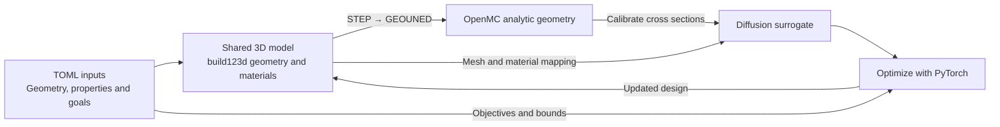
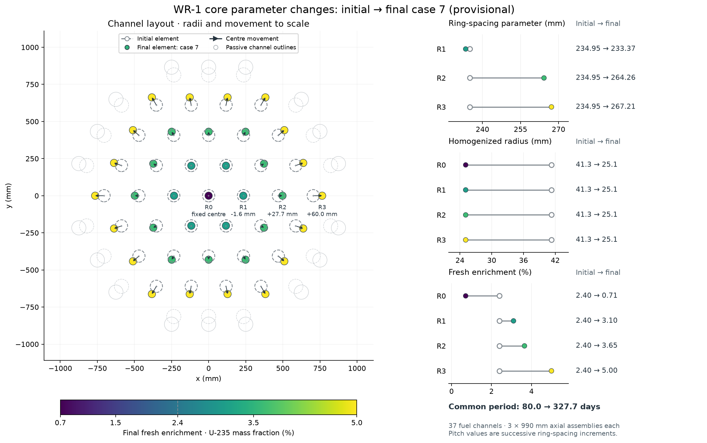
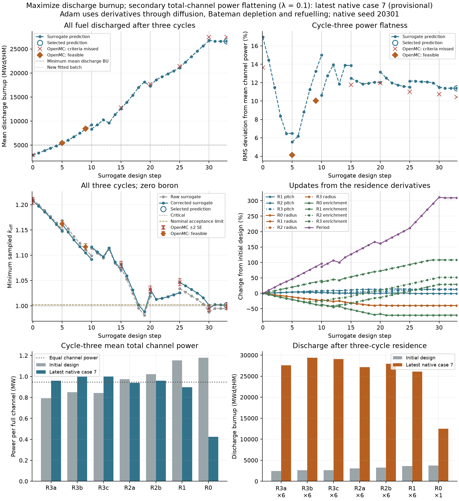

# Core Optimization

**Reactor design with a fully differentiable diffusion surrogate, calibrated against OpenMC.**

Core Optimization connects geometry, neutron diffusion, isotope depletion and fuel
movement in one PyTorch model. Use it to improve fuel utilization, shape power
distributions and explore reactivity tradeoffs by changing geometry, fuel composition
and cycle duration together.

The central idea is to **reuse one calibrated surrogate for several optimization
steps**, then evaluate the proposed design with OpenMC and refresh the fit. Gradients
connect the objective to all selected design parameters, at a single state or
through an entire fuel history.

Start with a small lattice, scale to **490 independent enrichment variables**,
then apply the same approach to **WR-1 fuel utilization over three depletion cycles**.

[Small lattice](#small-lattice-a-complete-workflow) ·
[490-variable enrichment study](#enrichment-shaping-490-design-variables) ·
[WR-1 results](#wr-1-results) ·
[Install](#install) · [Create your own design](#create-your-own-design)

## From transport calculations to design gradients



TOML supplies the dimensions, material properties, operating conditions and
optimization goals. One shared **3D build123d geometry** assigns a material to each
volume. GEOUNED converts its STEP solids into OpenMC's analytic surfaces and cells;
diffusion adapters derive meshes and material fractions from the same geometry
definition; Gmsh handles meshing of CAD solids and sector faces. FreeCAD runs
inside the converter; there is no separate FreeCAD model to maintain.

**One scalar objective. One backward pass. Derivatives for every selected design
parameter.** PyTorch's [reverse-mode automatic differentiation](https://docs.pytorch.org/docs/2.7/notes/autograd.html)
computes these derivatives together, without a separate perturbed transport run for
each parameter. The examples below use this approach for one radius, 490 enrichment
variables, and coupled WR-1 geometry, composition and fuel-cycle decisions.

- **Keep transport in the loop.** Fit material cross-section and diffusion corrections
  to OpenMC reference states; evaluate selected candidates with OpenMC before acceptance.
- **Optimize across the fuel history.** Differentiate through diffusion, depletion,
  residence time and fuel movement to improve an end-of-residence objective.
- **Reuse the engine for another case.** Supply geometry, materials, operating conditions
  and goals. Calibration, gradients, fuel-history execution and optimization live in
  the shared library.

## Small lattice: a complete workflow

The first example makes the entire process visible in a **3 × 3 pin lattice**.
Build the geometry once, run OpenMC, calibrate diffusion, optimize the common fuel
radius, and verify the updated design with a new OpenMC history. The objective
is **k-effective = 1 at the end of ten days**.

| Quantity | Initial lattice | Selected lattice |
| --- | ---: | ---: |
| Common fuel radius (cm) | 0.4500 | **0.4861** |
| End-of-history OpenMC k-effective | 0.92708 ± 0.00106 | **1.00006 ± 0.00103** |

The complete local workflow took **85 seconds with two OpenMC threads**. It uses
manufactured one-group cross sections and a four-isotope depletion chain, so it
runs without downloading nuclear data.


*One geometry definition supplies both solvers. Changing the radius changes
material fractions, fuel inventory and the depletion history; OpenMC checks the
resulting end-of-history target.*

[Run the small lattice](designs/small_lattice/README.md) after following the
[installation instructions](#install).

## Enrichment shaping: 490 design variables

Next, keep the geometry fixed and optimize the fuel composition in a **7 × 7
lattice with ten axial segments per pin**. Each of the **490 segments has its own
enrichment variable**, starting at 4 wt% U-235 with 2–5 wt% bounds. The objective
is to flatten the three-dimensional power distribution while preserving both
the original U-235 inventory and reference k-effective. Evaluated nuclear data
support fresh-fuel transport calculations, without depletion.

**The selected design reduces peak/average fuel power density by 19.0%.**

| OpenMC result | Initial lattice | Selected design |
| --- | ---: | ---: |
| Peak / average fuel power density | 1.992 | **1.614** |
| k-effective ± 1 standard error | 0.99008 ± 0.00081 | **0.98987 ± 0.00090** |
| Enrichment range (wt% U-235 within uranium) | 4.00 everywhere | **2.75–5.00** |
| Total U-235 inventory (kg) | 9.598277 | **9.598277** |

The preserved reference is slightly subcritical, **k = 0.99008**. Each diffusion
search enforces that k and the original inventory as equalities. OpenMC acceptance
allows an absolute k difference of 0.005, including two combined standard errors.

This is where obtaining all parameter derivatives together becomes especially
useful. At the uniform reference, a diffusion evaluation took **1.84 seconds**,
followed by **0.061 seconds for all 490 objective sensitivities in one backward
pass**, measured locally with four CPU threads. The k and inventory constraints
each use a separate backward pass through the same forward solution.

Each calibration supports up to **80 diffusion optimizer iterations** before
another OpenMC evaluation. The best feasible improvement is proposed; only a
design that improves native power and passes the constraints becomes the next
starting point. Ten verification rounds produced four accepted updates.


*The accepted power peak decreases while rejected trials remain visible. Stars
mark the feasible diffusion iterates selected for OpenMC verification.*


*Each square is an independent enrichment variable. The optimizer redistributes
fuel composition radially and axially while retaining the same fissile inventory.*

[Power profiles, complete results and reproduction commands](designs/enrichment_shaping/README.md)
include all native evaluations. The selected design is round 5; five subsequent
smaller-step trials did not improve its native power peak, reaching the configured
local stopping limit.

## WR-1 results

The final example applies the method to a reactor-scale fuel-utilization problem:
**a 35 MW core with 37 fuel channels**, three axial assemblies per channel and a
three-cycle fuel residence. Optimize geometry, enrichment and cycle duration
together to increase discharge burnup and improve channel-power distributions.

Here, each design change propagates through **neutron diffusion, isotope depletion
and fuel movement across all three cycles**. Gradients connect the discharge
objective to the decisions that shaped the entire fuel history. Subsequent OpenMC
histories check the proposed designs, including their changing k-effective and power.

### Optimization 1: more burnup, more uniform channel power

**The final evaluated design, OpenMC case 7, reached 27,458 MWd/tHM: 9.26× the initial
discharge burnup, with 23% lower channel-power RMS deviation.** The optimizer varied
12 parameters together: three ring pitches, four fuel radii, four enrichments and
the common cycle duration.

| OpenMC result | Initial design | Final evaluated design (case 7) |
| --- | ---: | ---: |
| Mean discharge burnup (MWd/tHM) | 2,965 | **27,458** |
| Channel-power RMS deviation from the mean | 13.62% | **10.43%** |
| Cycle duration (days) | 80.0 | 327.7 |
| Minimum sampled k-effective | 1.20787 | 0.99915 |

Case 7's minimum k-effective was 0.99915 against the study target of 1.002.
Its power-tally statistical errors also exceeded the chosen precision limits.
Case 2 met those criteria and reached 8,416 MWd/tHM.


*Initial geometry and channel power (left), case 2 (center), and the
final evaluated design in the table, case 7 (right).*

The full search made **33 gradient-based updates between eight OpenMC reference
histories**. The parameter plot shows how the optimizer redistributed enrichment,
changed fuel radii and ring spacing, and extended the cycle duration as the search progressed.



*Initial design to case 7, showing the parameter changes behind the burnup increase.
All 12 objective derivatives come from the same backward pass.*

The OpenMC histories show the initial and final designs over all three cycles.
Their burnup panels track **peak assembly burnup**; the table above reports
**mean discharge burnup**.


*Initial design: 80 days per cycle and 3,768 MWd/tHM peak assembly burnup.*


*Case 7: 327.7 days per cycle and 29,391 MWd/tHM peak assembly burnup, with
27,458 MWd/tHM mean discharge burnup.*

<details>
<summary>See the full optimization trajectory and OpenMC checks</summary>



Diamonds mark OpenMC evaluations that met the study's criteria.
The lower panels show case 7.

</details>

### Optimization 5: extend the geometry to 33 design variables

Adding graphite sleeves introduced **21 independent thicknesses**, distributed
across seven radial groups and three axial levels. Those thicknesses joined the
original 12 variables in the same differentiable workflow. The goals combined
discharge burnup, beginning-of-cycle excess reactivity and the largest channel-power
swing during the final cycle.


*Each sleeve thickness receives its own derivative, together with the other design
parameters, in one objective backward pass. The figure shows OpenMC case 1.*

| OpenMC result | Initial graphite design | Case 1 |
| --- | ---: | ---: |
| Mean discharge burnup (MWd/tHM) | 25,571 | 25,129 |
| Largest channel-power swing over cycle 3 (MW) | 0.150 | 0.134 |
| Cycle-3 beginning-of-cycle reactivity (pcm) | 17,875 | 18,100 |
| Cycle-3 end-of-cycle k-effective | 0.99316 | 1.00649 |

Case 1 reduced power swing by about **11%** relative to the initial graphite
design, with slightly lower burnup and higher initial reactivity. Its power-tally
statistical errors exceeded the chosen precision limits. This study shows how
additional geometry variables use the same model and backward pass.

<details>
<summary>See the graphite optimization trajectory</summary>


Gray markers and bars are the earlier step-3 design without graphite; the table
above compares against the initial graphite design. Red crosses mark missed native
checks. The final plotted proposal has no completed OpenMC evaluation.

</details>

These are retained computational studies. “Accepted” means the study's recorded
numerical criteria passed. The figures demonstrate the method; they do not establish
experimental validation or a global optimum. [Reproduction notes](designs/wr_1/README.md#reproducibility)
describe the historical runs and current replay limitations.

### Recorded performance

For WR-1 step 1, a coupled surrogate history averaged **4.1 minutes**, and the backward
pass for all 12 design derivatives averaged **5.0 minutes**. One OpenMC reference
history took approximately **one hour**. Reusing a fit lets the optimizer take
several design steps between those transport histories.

| Work performed | Recorded wall time |
| --- | ---: |
| OpenMC transport and extraction for a 33-state history | 58.5–63.3 min |
| Native depletion for that history | 3.6–4.0 min |
| One coupled surrogate forward history | **4.1 min** average |
| One objective backward pass, all 12 parameters | **5.0 min** average |
| One optimizer update: two forwards and one backward | 13.2 min average |
| Calibration and replay per reference history | 16.3–28.0 min |

These CPU timings use two OpenMC threads, 1,000 particles per batch, and 80 inactive
plus 80 active batches. The recorded campaign subtotal was **18.9 hours** for eight
reference histories and 33 updates, excluding untimed setup and interruptions.
These are historical case timings, not a measured end-to-end speedup. Separate
constraint gradients can require additional backward passes.

## Built upon

| Tool | What it provides |
| --- | --- |
| [OpenMC](https://docs.openmc.org/en/stable/) | Monte Carlo reference transport, fluxes, reaction rates and candidate evaluation |
| [PyTorch](https://docs.pytorch.org/docs/2.7/index.html) | Automatic differentiation and gradient-based optimization |
| [build123d](https://build123d.readthedocs.io/) | Parametric CAD solids and named material volumes shared by both solvers |
| [GEOUNED](https://geouned-org.github.io/GEOUNED/dev/) and [FreeCAD](https://www.freecad.org/) | STEP-to-CSG conversion for OpenMC, preserving supported analytic surfaces |
| [Gmsh](https://gmsh.info/) | Conformal tetrahedral meshes of 3D CAD solids and triangular meshes for the WR-1 sector |
| [NJOY2016](https://github.com/njoy/NJOY2016) | Evaluated nuclear-data processing at the requested temperatures |
| [NumPy](https://numpy.org/), [SciPy](https://scipy.org/) and [h5py](https://www.h5py.org/) | Arrays, sparse numerical methods and HDF5 data |
| [Matplotlib](https://matplotlib.org/) | Geometry, power-history and optimization plots |

## Install

With Git and [micromamba installed](https://mamba.readthedocs.io/en/latest/installation/micromamba-installation.html),
first clone the repository and enter its directory:

```sh
git clone https://github.com/nikolaskallieros/core-optimization.git
cd core-optimization
```

Run the installation and verification commands below from this repository root
(`core-optimization/`). Both environments will be created inside that directory:

```sh
micromamba --no-rc create -y -p "$PWD/.venv" -f environment.yml
micromamba run -p "$PWD/.venv" python -m pip install -e '.[test]'
micromamba --no-rc create -y -p "$PWD/.geouned" -f environment-geouned.yml
micromamba run -p "$PWD/.venv" python tests/check_installation.py
```

The environment includes Python 3.12, OpenMC 0.16.0, PyTorch 2.7 and NJOY with their
native libraries. The package installation adds build123d 0.11 and Gmsh 4.15.
The separate `.geouned` environment contains GEOUNED 1.6.2 and FreeCAD 1.0.0;
the adapter invokes it automatically. This isolates FreeCAD's native libraries
from the solver environment. Set `GEOUNED_PYTHON` to the converter's Python path
when running outside the checkout or using another environment location.
GEOUNED is pinned because its maintainers identify incorrect conversions in
[versions 1.6.3 and 1.6.4](https://github.com/GEOUNED-org/GEOUNED#geouned).
Installation has been checked on Apple Silicon macOS; Linux
installation has not yet been verified.

**Run the small-lattice workflow without downloading nuclear data:**

```sh
.venv/bin/python -m designs.small_lattice.scripts.run_optimization
```

For the 490-variable study, follow the [enrichment-shaping instructions](designs/enrichment_shaping/README.md).
Its data-preparation command downloads about 21 MB of selected evaluated isotope
and water thermal-scattering tables.

Full WR-1 runs require evaluated nuclear data and at least 10 GiB of free space
for preparation. Follow the [WR-1 running instructions](designs/wr_1/README.md#nuclear-data-and-running-a-scenario).
Only figures are versioned under design result folders; new runs regenerate
numerical records locally and preserve the retained figures.

<details>
<summary>Verification, current scope and licensing</summary>

Installation checks cover analytical diffusion, first derivatives, depletion,
case interfaces and a small native OpenMC calculation. They verify the current
software; the retained WR-1 campaigns predate the refactoring. Strict replay of
the historical step-one trace inventories remains unresolved on the tested macOS
environment, as described in the [reproducibility notes](designs/wr_1/README.md#reproducibility).

Within an optimization batch, fitted correction coefficients and reference spectral
shapes remain fixed. Changing the surrogate representation requires a new fit.
The implicit eigensolve supports first derivatives. The coupled study runner
currently supports synchronized axial loading from fresh fuel, fixed boron and a
final-cycle objective; other schedules can use the shared `CycleRunner` interface.

See [third-party notices](THIRD_PARTY_NOTICES.md) for attribution. A project-wide
license has not yet been selected.

</details>

## Create your own design

Use the [small lattice](designs/small_lattice/README.md) as a complete workflow
template, following the same directory roles as WR-1.

```sh
cp -R designs/small_lattice designs/my_case
.venv/bin/python -m designs.my_case.scripts.run_optimization
```

1. **Describe the case.** Record the agreed objective in `goals.md`. Put dimensions,
   material data, parameter bounds and executable settings in `inputs/model.toml`,
   the single source of truth for the design's configuration.
2. **Define the geometry once.** Build solids with build123d in a small
   `build_geometry.py` script. Bind region names, materials and boundary faces with
   `CadGeometry.from_solids(...)`. Shared adapters generate OpenMC cells and a
   diffusion mesh from those actual solids.
3. **Choose a scalar objective.** Use solver responses such as k-effective or power
   to define the goal; the shared optimizer handles differentiation and updates.
4. **Add OpenMC and a fuel history when needed.** The
   [`CaseModel` and `CycleCase` interfaces](src/coupling/cases.py) connect your
   case to shared preparation, calibration and optimization. The
   [WR-1 adapter](designs/wr_1/model/case.py) demonstrates the complete integration.

Keep case bindings in `model/`, thin run scripts in `scripts/`, and design-specific
plotting in `scripts/plotting/`. Retain figures under `results/`; new raw calculations
and numerical records go under `runs/<design>/` at the repository root.

Native and surrogate models **share the physical geometry by default**. A simpler
surrogate layout is an explicit choice through `surrogate_mesh`, with material
identities and volumes checked. Calibration remains at the material-coefficient level.

For example, the geometry interfaces accept a curved solid directly:

```python
import build123d as bd
from geometry import CadGeometry
from geometry.diffusion import discretize
from geometry.openmc import from_cad
from diffusion_surrogate import FiniteElementDiffusion

solid = bd.Solid.make_sphere(40)  # build123d dimensions are in mm
cad = CadGeometry.from_solids({"fuel": solid})  # unselected exterior: vacuum
mesh = discretize(cad, max_size_cm=0.75)
solver = FiniteElementDiffusion(mesh.grid)
native = from_cad(cad, {"fuel": openmc_material})
# solver.solve(mesh.fractions(), regional_macroscopic_data)
```

TOML is the editable source. The generated `geometry.step` stores the actual
solids, material identities and boundary selections. Both adapters can read it
for a fixed design; it does not store an autograd graph.

**Geometry and derivatives are separate interfaces.** Direct solids use a
tetrahedral finite-element diffusion solver, with differentiable material
coefficients. For a coupled case, declare the allowed material-volume error with
`volume_rtol` in the mesh inputs and refine until preparation passes; physical CAD
volumes and densities are retained. Shape derivatives require an explicit Torch map of mesh-node
coordinates, keeping the nodes on the updated CAD geometry; remeshing itself is
not differentiable. WR-1 and the slab tutorial retain their shared analytical
parameterizations for exact moving-interface or dimension derivatives. They
build actual CAD for OpenMC from the same parameters.

<details>
<summary>How WR-1 assigns material properties to the diffusion mesh</summary>

**WR-1 first builds a background mesh, then assigns properties to its cells:**

1. Mesh the outer CAD sector with Gmsh and extend its triangles axially into prism cells.
2. Calculate how much of each material lies inside each cell using analytical
   intersections of the shared parametric geometry. For example, a cell crossing
   a fuel–coolant interface could contain 30% fuel and 70% coolant by volume.
3. Combine the material cross sections using those volume fractions to calculate
   each cell's effective cross sections and diffusion coefficients, then solve diffusion.

During optimization, changes to internal dimensions or material composition update
the fractions and coefficients while the background mesh stays fixed. These updates
remain differentiable in PyTorch. Changing the outer domain requires a new mesh.

The direct 3D CAD adapter uses tetrahedral elements whose faces follow material
interfaces to the mesh's geometric accuracy, with one material region per element.

</details>

The OpenMC adapter accepts analytic planes, cylinders, cones, spheres and
axis-aligned tori, including supported Boolean/nonconvex solids. It rejects
splines, tilted tori and uncertain GEOUNED decompositions instead of approximating
them. Boundary conditions must cover an entire native surface; a surface shared
by exterior and internal patches is rejected. Direct tetrahedral diffusion
currently supports vacuum and reflective boundaries; WR-1's sector adapter also
supports its periodic planes.

For a minimal introduction to the solver, the [slab tutorial](designs/slab/README.md)
uses one input file and one short script:

```sh
.venv/bin/python -m designs.slab.run
```

It adjusts the slab width from **20.000 cm to about 8.631 cm** to reach
**k-effective = 1.000000** with manufactured one-group cross sections, demonstrating
inputs → CAD → diffusion → gradients → optimization. The final CAD is written to
`runs/slab/geometry.step`.

Your case belongs in `designs/`. Shared packages live directly under `src/`;
adding a new design does not require copying their numerical engines.

| Package | Responsibility |
| --- | --- |
| [`geometry`](src/geometry/) | Parametric CAD, material volumes, meshing and OpenMC/diffusion adapters |
| [`diffusion_surrogate`](src/diffusion_surrogate/) | Diffusion solvers and cross-section calibration |
| [`optimization`](src/optimization/) | Fitting, design updates, objectives and constraints |
| [`depletion`](src/depletion/) | Isotope-depletion integrators, chains and CRAM kernels |
| [`fuel_cycle`](src/fuel_cycle/) | Refuelling schedules and fuel-residence calculations |
| [`materials`](src/materials/) | Isotopic recipes, cross-section conversions and inventories |
| [`coupling`](src/coupling/) | Case interfaces and OpenMC/calibration/optimization execution |
| [`get_nuclear_data`](src/get_nuclear_data/) | Nuclear-data acquisition and processing |
| [`plotting`](src/plotting/) | Shared geometry, history and optimization figures |
| [`runtime`](src/runtime/) | File storage, paths, processes and autograd memory support |
