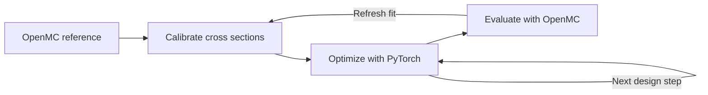
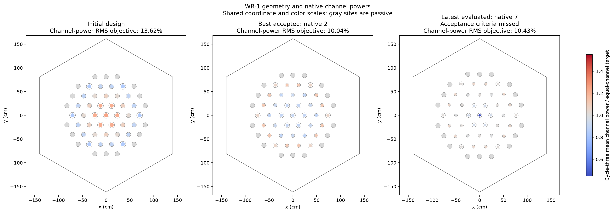
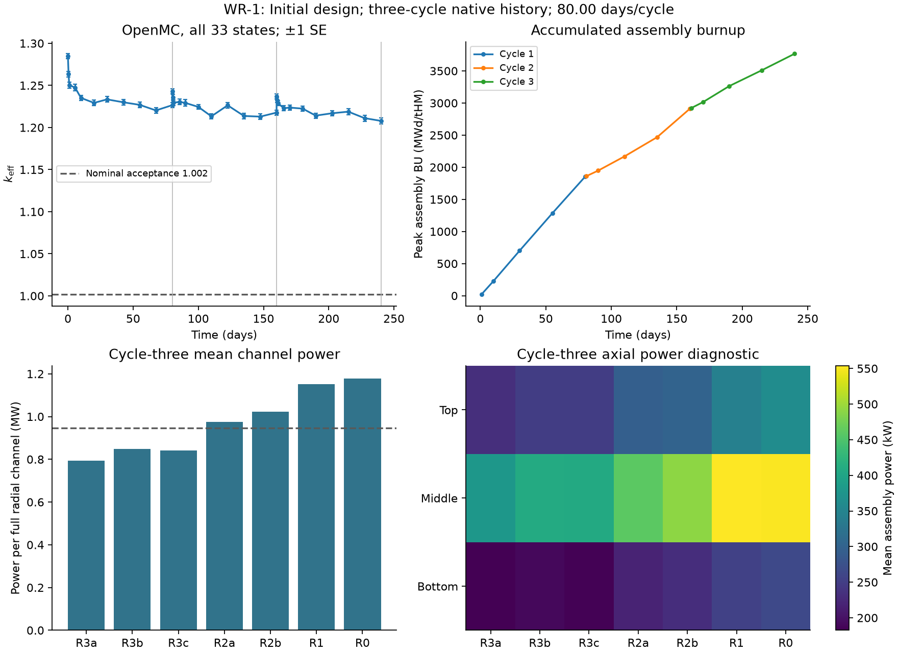
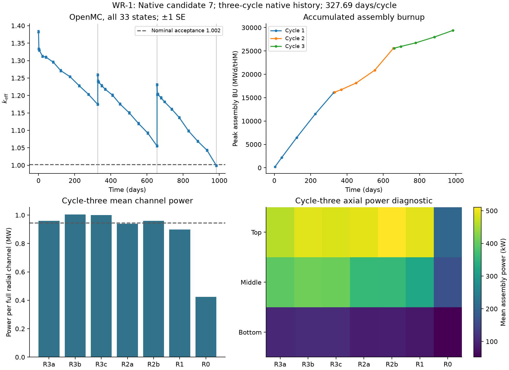
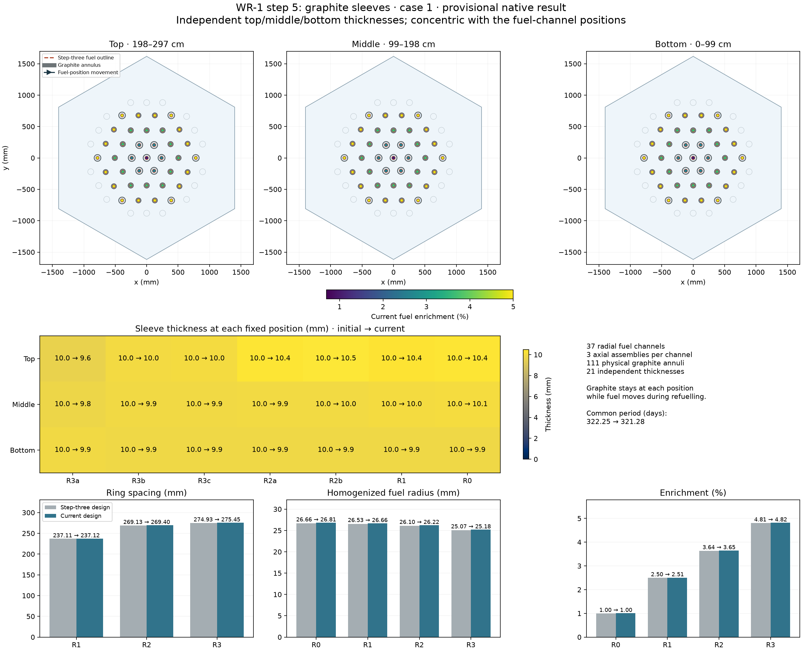
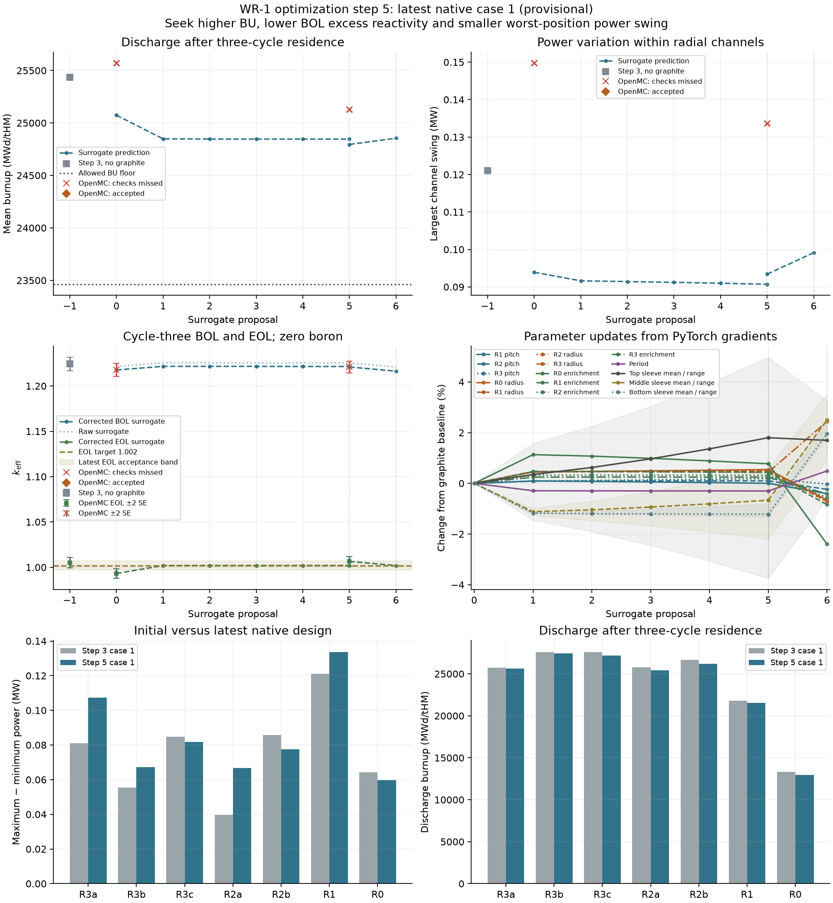

# Core Optimization

**Reactor design with a fully differentiable diffusion surrogate, calibrated against OpenMC.**

Core Optimization connects geometry, neutron diffusion, isotope depletion and fuel
movement in one PyTorch model. Use it to improve fuel utilization, shape power
distributions and explore reactivity tradeoffs by changing geometry, fuel composition
and cycle duration together.

The central idea is to **reuse one calibrated surrogate for several optimization
steps**, then evaluate the proposed design with OpenMC and refresh the fit. Gradients
connect a goal at discharge to the design decisions that shaped the entire fuel history.

[WR-1 results](#wr-1-results) · [Performance](#recorded-performance) ·
[Install](#install) · [Create your own example](#create-your-own-example)

## From transport calculations to design gradients



**One scalar objective. One backward pass. Derivatives for every selected design
parameter.** PyTorch's [reverse-mode automatic differentiation](https://docs.pytorch.org/docs/2.7/notes/autograd.html)
computes these derivatives together, without a separate perturbed transport run for
each parameter. The WR-1 examples use this same approach for both 12-variable and
33-variable designs.

- **Optimize across the fuel history.** Differentiate through diffusion, depletion,
  residence time and fuel movement to improve an end-of-residence objective.
- **Keep transport in the loop.** Fit material cross-section and diffusion corrections
  to OpenMC reference states; evaluate selected candidates with OpenMC before acceptance.
- **Reuse the engine for another case.** Supply geometry, materials, operating conditions
  and goals. Calibration, gradients, fuel-history execution and optimization live in
  the shared library.

## WR-1 results

The WR-1 studies exercise the workflow on a **35 MW core with 37 fuel channels**,
three axial assemblies per channel and a three-cycle fuel residence. They show both
what the optimizer changes and how those changes perform in subsequent OpenMC evaluations.

### Optimization 1: more burnup, more uniform channel power

**The final evaluated design, OpenMC case 7, reached 27,458 MWd/tHM: 9.26× the initial
discharge burnup, with 23% lower channel-power RMS deviation.** The optimizer varied
12 parameters together: three ring pitches, four fuel radii, four enrichments and
the common cycle duration.

| OpenMC result | Initial design | Final evaluated design (case 7) |
| --- | ---: | ---: |
| Mean discharge burnup (MWd/tHM) | 2,965 | **27,458** |
| Channel-power RMS deviation from the mean | 13.62% | **10.43%** |
| Cycle duration (days) | 80.0 | 327.7 |
| Minimum sampled k-effective | 1.20787 | 0.99915 |

Case 7's minimum k-effective was 0.99915 against the study target of 1.002.
Its power-tally statistical errors also exceeded the chosen precision limits.
Case 2 met those criteria and reached 8,416 MWd/tHM.



*Initial geometry and channel power (left), case 2 (center), and the
final evaluated design in the table, case 7 (right).*

The full search made **33 gradient-based updates between eight OpenMC reference
histories**. The parameter plot shows how the optimizer redistributed enrichment,
changed fuel radii and ring spacing, and extended the cycle duration as the search progressed.


*Initial design to case 7, showing the parameter changes behind the burnup increase.
All 12 objective derivatives come from the same backward pass.*

The OpenMC histories show the initial and final designs over all three cycles.
Their burnup panels track **peak assembly burnup**; the table above reports
**mean discharge burnup**.



*Initial design: 80 days per cycle and 3,768 MWd/tHM peak assembly burnup.*



*Case 7: 327.7 days per cycle and 29,391 MWd/tHM peak assembly burnup, with
27,458 MWd/tHM mean discharge burnup.*

<details>
<summary>See the full optimization trajectory and OpenMC checks</summary>


Diamonds mark OpenMC evaluations that met the study's criteria.
The lower panels show case 7.

</details>

### Optimization 5: extend the geometry to 33 design variables

Adding graphite sleeves introduced **21 independent thicknesses**, distributed
across seven radial groups and three axial levels. Those thicknesses joined the
original 12 variables in the same differentiable workflow. The goals combined
discharge burnup, beginning-of-cycle excess reactivity and the largest channel-power
swing during the final cycle.



*Each sleeve thickness receives its own derivative, together with the other design
parameters, in one objective backward pass. The figure shows OpenMC case 1.*

| OpenMC result | Initial graphite design | Case 1 |
| --- | ---: | ---: |
| Mean discharge burnup (MWd/tHM) | 25,571 | 25,129 |
| Largest channel-power swing over cycle 3 (MW) | 0.150 | 0.134 |
| Cycle-3 beginning-of-cycle reactivity (pcm) | 17,875 | 18,100 |
| Cycle-3 end-of-cycle k-effective | 0.99316 | 1.00649 |

Case 1 reduced power swing by about **11%** relative to the initial graphite
design, with slightly lower burnup and higher initial reactivity. Its power-tally
statistical errors exceeded the chosen precision limits. This example shows how
additional geometry variables use the same model and backward pass.

<details>
<summary>See the graphite optimization trajectory</summary>



Gray markers and bars are the earlier step-3 design without graphite; the table
above compares against the initial graphite design. Red crosses mark missed native
checks. The final plotted proposal has no completed OpenMC evaluation.

</details>

These are retained computational studies. “Accepted” means the study's recorded
numerical criteria passed. The figures demonstrate the method; they do not establish
experimental validation or a global optimum. [Reproduction notes](examples/wr_1/README.md#reproducibility)
describe the historical runs and current replay limitations.

## Recorded performance

For step 1, a coupled surrogate history averaged **4.1 minutes**, and the backward
pass for all 12 design derivatives averaged **5.0 minutes**. One OpenMC reference
history took approximately **one hour**. Reusing a fit lets the optimizer take
several design steps between those transport histories.

| Work performed | Recorded wall time |
| --- | ---: |
| OpenMC transport and extraction for a 33-state history | 58.5–63.3 min |
| Native depletion for that history | 3.6–4.0 min |
| One coupled surrogate forward history | **4.1 min** average |
| One objective backward pass, all 12 parameters | **5.0 min** average |
| One optimizer update: two forwards and one backward | 13.2 min average |
| Calibration and replay per reference history | 16.3–28.0 min |

These CPU timings use two OpenMC threads, 1,000 particles per batch, and 80 inactive
plus 80 active batches. The recorded campaign subtotal was **18.9 hours** for eight
reference histories and 33 updates, excluding untimed setup and interruptions.
These are historical case timings, not a measured end-to-end speedup. Separate
constraint gradients can require additional backward passes.

## Built upon

| Tool | What it provides |
| --- | --- |
| [OpenMC](https://docs.openmc.org/en/stable/) | Monte Carlo reference transport, fluxes, reaction rates and candidate evaluation |
| [PyTorch](https://docs.pytorch.org/docs/2.7/index.html) | Automatic differentiation and gradient-based optimization |
| [NJOY2016](https://github.com/njoy/NJOY2016) | Evaluated nuclear-data processing at the requested temperatures |
| [NumPy](https://numpy.org/), [SciPy](https://scipy.org/) and [h5py](https://www.h5py.org/) | Arrays, sparse numerical methods and HDF5 data |
| [Matplotlib](https://matplotlib.org/) | Geometry, power-history and optimization plots |

## Install

From a checkout, with [micromamba installed](https://mamba.readthedocs.io/en/latest/installation/micromamba-installation.html):

```sh
micromamba --no-rc create -y -p "$PWD/.venv" -f environment.yml
micromamba run -p "$PWD/.venv" python -m pip install -e '.[test]'
micromamba run -p "$PWD/.venv" python tests/check_installation.py
```

The environment includes Python 3.12, OpenMC 0.16.0, PyTorch 2.7 and NJOY with their
native libraries. Installation has been checked on Apple Silicon macOS; Linux
installation has not yet been verified.

**Run your first geometry optimization without downloading nuclear data:**

```sh
.venv/bin/python -m examples.slab.run
```

The [slab tutorial](examples/slab/README.md) adjusts its width from **20.000 cm to
about 8.631 cm** to reach **k-effective = 1.000000**, using manufactured one-group
cross sections. It demonstrates inputs → geometry → diffusion → gradients → optimization
with one input file and one short script.

Full WR-1 runs require evaluated nuclear data and at least 10 GiB of free space
for preparation. Follow the [WR-1 running instructions](examples/wr_1/README.md#nuclear-data-and-running-a-scenario).
Only figures are versioned under example result folders; new runs regenerate
numerical records locally and preserve the retained figures.

<details>
<summary>Verification, current scope and licensing</summary>

Installation checks cover analytical diffusion, first derivatives, depletion,
case interfaces and a small native OpenMC calculation. They verify the current
software; the retained WR-1 campaigns predate the refactoring. Strict replay of
the historical step-one trace inventories remains unresolved on the tested macOS
environment, as described in the [reproducibility notes](examples/wr_1/README.md#reproducibility).

Within an optimization batch, fitted correction coefficients and reference spectral
shapes remain fixed. Changing the surrogate representation requires a new fit.
The implicit eigensolve supports first derivatives. The coupled study runner
currently supports synchronized axial loading from fresh fuel, fixed boron and a
final-cycle objective; other schedules can use the shared `CycleRunner` interface.

See [third-party notices](THIRD_PARTY_NOTICES.md) for attribution. A project-wide
license has not yet been selected.

</details>

## Create your own example

Start small: copy the slab tutorial and replace its geometry and objective.

```sh
cp -R examples/slab examples/my_case
.venv/bin/python -m examples.my_case.run
```

1. **Describe the case.** Put dimensions, material data, parameter bounds and goals
   in `model.toml`, the single source of truth for the example.
2. **Connect the geometry.** Build the mesh and material fractions from live Torch
   tensors in `run.py`, so derivatives reach the dimensions you want to optimize.
3. **Choose a scalar objective.** Use solver responses such as k-effective or power
   to define the goal; the shared optimizer handles differentiation and updates.
4. **Add OpenMC and a fuel history when needed.** The
   [`CaseModel` and `CycleCase` interfaces](src/coupling/cases.py) connect your
   case to shared preparation, calibration and optimization. The
   [WR-1 adapter](examples/wr_1/model/case.py) demonstrates the complete integration.

Native and surrogate models **share the physical geometry by default**. A simpler
surrogate layout is an explicit choice through `surrogate_mesh`, with material
identities and volumes checked. Calibration remains at the material-coefficient level.

Your case belongs in `examples/`. Shared packages live directly under `src/`;
adding a new example does not require copying their numerical engines.

| Package | Responsibility |
| --- | --- |
| [`diffusion_surrogate`](src/diffusion_surrogate/) | Diffusion solvers, geometry mappings and cross-section calibration |
| [`optimization`](src/optimization/) | Fitting, design updates, objectives and constraints |
| [`depletion`](src/depletion/) | Isotope-depletion integrators, chains and CRAM kernels |
| [`fuel_cycle`](src/fuel_cycle/) | Refuelling schedules and fuel-residence calculations |
| [`materials`](src/materials/) | Isotopic recipes, cross-section conversions and inventories |
| [`coupling`](src/coupling/) | Case interfaces and OpenMC/calibration/optimization execution |
| [`get_nuclear_data`](src/get_nuclear_data/) | Nuclear-data acquisition and processing |
| [`plotting`](src/plotting/) | Shared geometry, history and optimization figures |
| [`runtime`](src/runtime/) | File storage, paths, processes and autograd memory support |
