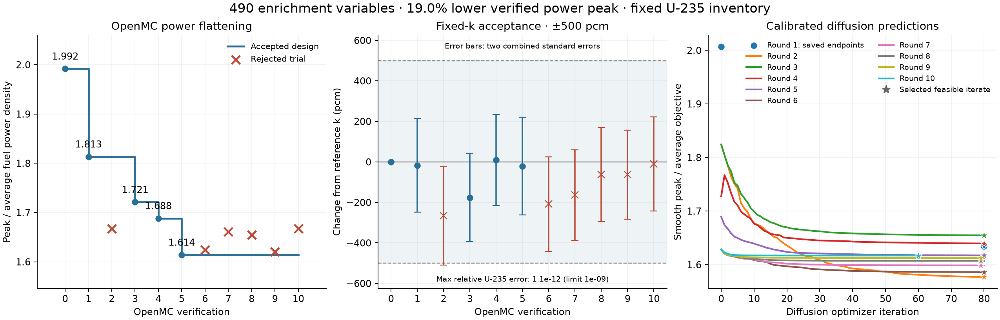
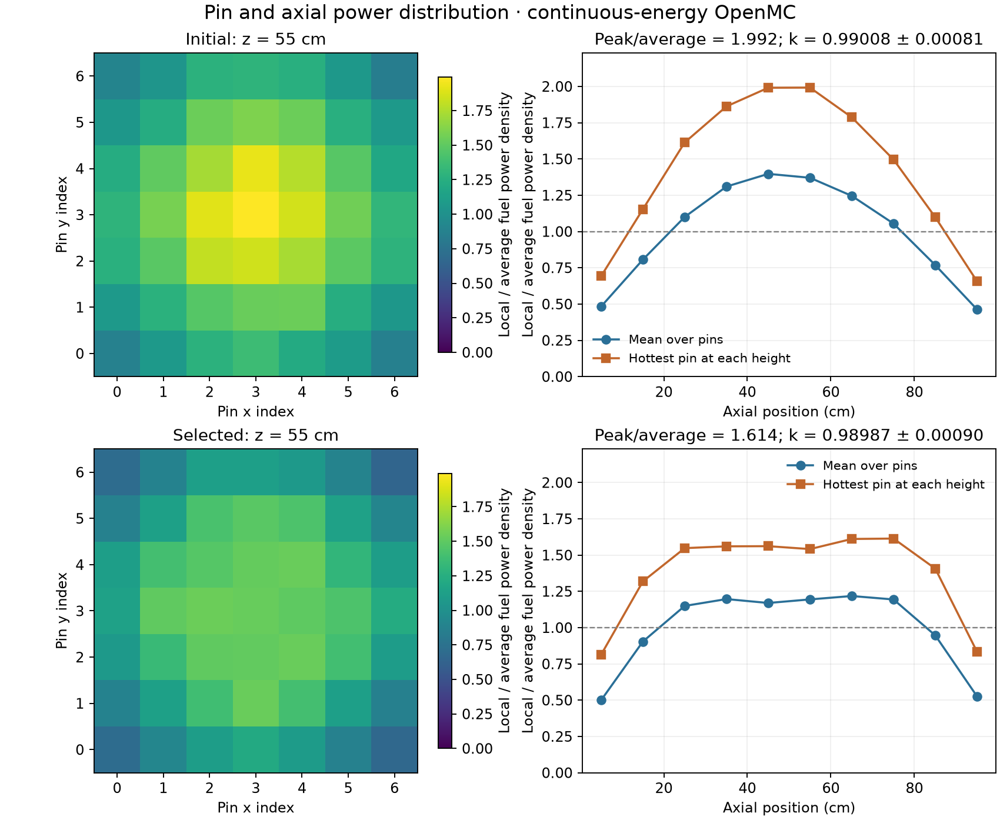
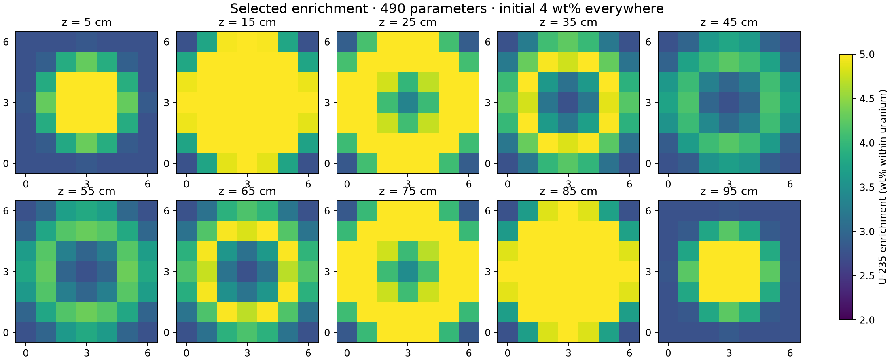

# Pin and axial enrichment shaping

A finite 7 × 7 UO₂ lattice with ten axial fuel segments per pin: **490 enrichment
parameters** for shaping the three-dimensional power distribution. The starting
enrichment is 4 wt% U-235 within uranium, with 2–5 wt% bounds and fixed total
U-235 inventory. This study uses fresh-fuel steady-state transport only; it has
no depletion calculation.

The physical definition is [inputs/model.toml](inputs/model.toml), and the agreed
objective is in [goals.md](goals.md). Flatten power at the fixed uniform-reference
value, **k = 0.99008 ± 0.00081**. The surrogate search preserves that k exactly;
independent OpenMC verification allows ±0.005 including two combined standard
errors. Geometry and U-235 inventory stay fixed during enrichment shaping.

After installing the package using the [repository instructions](../../README.md#install),
run from the repository root:

```bash
.venv/bin/python -m designs.enrichment_shaping.scripts.prepare_data
.venv/bin/python -m designs.enrichment_shaping.scripts.run_optimization
```

This downloads about 21 MB of selected ENDF/B-VII.1 HDF5 tables from
[OpenMC Data Storage](https://github.com/openmc-data-storage/ENDF-B-VII.1-NNDC)
into the ignored `.cache/nuclear_data/endfb71_nndc/` folder. Uranium, oxygen and
hydrogen data plus water thermal scattering support continuous-energy OpenMC
calculations. No manufactured cross sections are used for this study.

The optimization command includes the uniform OpenMC reference. Each round
then fits material cross sections, takes **up to 80 diffusion optimization iterations
using that same native reference**, and verifies one candidate with a new OpenMC
calculation. The accepted native result supplies the next calibration. A rejected
candidate restores the last accepted design and halves the next enrichment step.
The initial target k stays fixed throughout all rounds.

Each search retains its best feasible improving iterate, including a short
constraint correction when needed. The workflow continues from accepted designs
until no feasible improvement is found or repeated native rejections reduce the
local enrichment step below the minimum in `inputs/model.toml`. It does not stop
after an arbitrary number of rounds. This is a local stopping criterion, not a
claim of a global optimum.

Progress figures update automatically after every native verification. The
accepted objective is shown as a nonincreasing step curve; rejected trials stay
separate. Stars identify the feasible diffusion candidates sent to OpenMC. Raw
optimizer paths may rise temporarily while constraints are being enforced.

For a reference-only calculation, use
`.venv/bin/python -m designs.enrichment_shaping.scripts.prepare_step_1`.
The Python entry point `model.optimization.run(reference_directory)` can reuse
an existing `baseline.json` after comparing its physical and sampling inputs.
Use `run(continuation_directory=previous_run, callback=render)` to resume a
campaign from its selected accepted design, preserving its original targets and
history; `render` is in `scripts.plotting.render`.
Numerical outputs and native XML/statepoints remain local under
`runs/enrichment_shaping/`; figures are retained below.

## OpenMC-verified results

The selected design reduces peak/average fuel power density by **19.0%**, from
**1.992 to 1.614**. The selected enrichments span **2.75–5.00 wt%**,
while the physical U-235 inventory remains **9.598277 kg**. Geometry and the
1 MW power normalization are unchanged.

| OpenMC evaluation | Peak / average power density | k-effective ± 1 SE | Decision |
| --- | ---: | ---: | --- |
| Uniform 4 wt% reference | 1.992 | 0.99008 ± 0.00081 | Reference |
| Round 1 | 1.813 | 0.98991 ± 0.00083 | Accepted |
| Round 2 | 1.667 | 0.98742 ± 0.00092 | Rejected: k constraint |
| Round 3 | 1.721 | 0.98832 ± 0.00074 | Accepted |
| Round 4 | 1.688 | 0.99017 ± 0.00079 | Accepted |
| Round 5 | **1.614** | **0.98987 ± 0.00090** | **Selected** |
| Round 6 | 1.624 | 0.98800 ± 0.00084 | Rejected: higher power peak |
| Round 7 | 1.661 | 0.98844 ± 0.00078 | Rejected: higher power peak |
| Round 8 | 1.654 | 0.98946 ± 0.00084 | Rejected: higher power peak |
| Round 9 | 1.621 | 0.98945 ± 0.00075 | Rejected: higher power peak |
| Round 10 | 1.667 | 0.98998 ± 0.00084 | Rejected: higher power peak |

The k constraint includes two combined standard errors from the candidate and
reference. Round 2 reached a distance of **0.005093**, exceeding the **0.005**
limit. The selected round reaches **0.002624** and passes. The surrogate itself
enforces the reference k and U-235 inventory as equalities at 1e-9 tolerance;
native verification determines whether a proposal is accepted.

Rounds 6–10 each started from round 5 and did not improve its native power peak.
The local search stopped after rejection at the minimum **0.015625 wt%**
enrichment step. Round 5 remains the best accepted design; this stopping
condition does not establish a global optimum.



The left panel shows actual OpenMC results, including rejected candidates.
The middle panel shows the k acceptance interval. The right panel shows
diffusion objective histories; round 1 retains its starting point and saved
80-iteration endpoint because that search was resumed from a checkpoint.



Each heatmap square is one fuel segment's power density at the indicated
elevation. The axial curves show both the pin average and the hottest pin at
each height. The objective is the maximum over all 490 segments.



Selected enrichment is lower around the axial midplane and higher in the
shoulders. The radial pattern also changes to satisfy the inventory and k
constraints. Every segment is an independent design variable; physical U-235
mass is calculated from isotope densities and segment volumes.

## Geometry and methods

The illustrative geometry has 4.00734 cm pin pitch, 1.30398 cm fuel radius, 100 cm
active height, 5.04 cm lateral water reflection and 10 cm water above and below
the fuel. All exterior boundaries are vacuum. Fuel and water are fixed at
293.6 K; their densities are 10.4 and 0.997 g/cm³. Bare UO₂ cylinders omit
cladding, gaps, guide tubes and structures. There is no thermal feedback or
criticality-control model. These are declared example assumptions, not the
specification of a named reactor or the C5G7 benchmark.

`build_geometry.py` defines the physical material solids once. The shared
OpenMC adapter converts them to analytic geometry, while the diffusion adapter
computes exact material fractions on a background mesh. Enrichment changes
isotope densities in the corresponding fuel segments; the geometry stays fixed.
Calibration matches native k-effective and 50 symmetry-grouped power
observations by adjusting material cross sections. These groups share fitted
coefficients; they do not tie the 490 enrichment variables together. The search
minimizes a smooth maximum of power density, while native acceptance uses the
actual maximum segment value.

PyTorch obtains all 490 derivatives of a scalar objective in **one backward
pass**, using the diffusion solver's implicit eigenpair derivative. The inventory
and k constraints each receive their own backward pass through the same forward
solution. Cross sections use the current native spectra during a local search;
the subsequent OpenMC calculation checks the response to changed enrichment.

## Timings and checks

Measured locally with four CPU threads and a 3,888-cell diffusion mesh:

| Quantity | Result |
| --- | ---: |
| First OpenMC candidate, including result extraction | 60.1 s |
| Material refit after that candidate | 41.2 s |
| 80 diffusion iterations and final constraint correction | 121–142 s |
| Reference diffusion evaluation with gradient preparation | 1.84 s |
| One backward pass for all 490 objective sensitivities | 0.061 s |

These are individual calculation timings, excluding data download and CAD
preparation. OpenMC used 20,000 particles per batch, 120 batches and 40 inactive
batches. No depletion was run.

All 490 fuel identities were checked in the converted OpenMC geometry. CAD and
diffusion material volumes agree within **1.3e-13 relative error**. Three
directional objective derivatives agree with centered finite differences within
**4.3e-6 relative error**. At the uniform reference, the fitted individual-segment
power discrepancy is **3.4% RMS**; derivative agreement checks the calibrated
surrogate, and the native rounds separately verify its proposed designs.

An independent reconstruction from all eleven OpenMC statepoints and material XML
files reproduced the powers, enrichments, k values and acceptance decisions.
Every proposal's starting enrichment field also matches the last accepted design.
The selected inventory differs from the reference by less than **4e-16 relative**
at the retained input precision. Candidate geometry XML matches the prepared
shared geometry.

The retained local run is
`runs/enrichment_shaping/20261025T161343434797Z/`: `summary.json`,
`optimization.json`, `fit_*.json`, `native_*.json` and `native_verification.json`.
`native_05.json` contains the selected enrichment field; `native_05/` contains
its OpenMC inputs and statepoint. Run `verify_native.py` in this run directory
to reproduce the native checks. The unchanged geometry and derivative checks
remain in `runs/enrichment_shaping/20261025T071829510199Z/verification.json`,
with `verify_reference.py` beside it. The reused uniform OpenMC state is retained
under `runs/enrichment_shaping/critical_20261025T065117137080Z/size_04/`.
