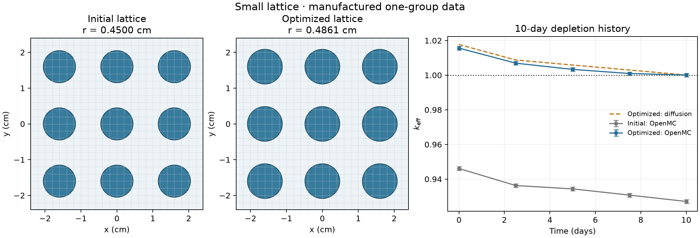

# Small lattice

A nine-pin demonstration of **shared CAD → OpenMC → diffusion calibration →
depletion and radius optimization → a new OpenMC check**. It uses manufactured
one-group cross sections and a four-isotope chain, so no nuclear-data download
is needed. These inputs verify the software workflow; they are not evaluated
reactor data.

From the installed repository root, run:

```sh
.venv/bin/python -m designs.small_lattice.scripts.run_optimization
```

[`inputs/model.toml`](inputs/model.toml) defines the geometry, material data, boundaries, power,
history intervals, radius bounds and numerical criteria. [`goals.md`](goals.md)
states the objective and acceptance criteria. The only design variable is the
common fuel radius; the target is k-effective = 1.0 after the ten-day history.

## Local result

The complete run took **85 seconds** using two OpenMC threads, 5,000 particles per
batch, 80 batches and 20 inactive batches. Three native histories, each with five
transport states, bracketed two surrogate design proposals.

| Quantity | Initial lattice | Selected lattice |
| --- | ---: | ---: |
| Common fuel radius (cm) | 0.4500 | **0.4861** |
| End-of-history OpenMC k-effective | 0.92708 ± 0.00106 | **1.00006 ± 0.00103** |

The final result meets the declared native target and precision criteria. Error
bars are one reported transport standard error; they do not propagate sampling
uncertainty through the preceding depletion calculations.



The diffusion curve uses the final native reference's fitted coefficient. The
native points come from separately executed OpenMC histories. Maximum CAD/mesh
material-volume disagreement was 1.7×10⁻¹³ relative. The full-history radius
derivative agreed with centered differences to 5.3×10⁻¹⁰ relative; refinement
changed final surrogate k-effective by 4.4×10⁻⁵ without refitting. Depletion and
energy checks passed, as did five focused tests including an independent
two-group native reference.

The retained local numerical record is
`runs/small_lattice/20261025T061016409352Z/verification.json` at the repository root.
Numerical records stay local; the command above generates a new run and figure.

## Model and layout

The 3×3 lattice has reflective exterior boundaries, representing a repeated
lattice without leakage. Fuel and coolant share one parametric build123d
construction. The OpenMC adapter converts its actual solids through STEP and
GEOUNED. The diffusion adapter calculates fuel/coolant fractions on a fixed
Cartesian background mesh. Changing the radius updates those fractions, fuel
mass and depletion history while retaining the PyTorch graph.

One material diffusion correction is fitted to each native final k-effective,
then held fixed during the following radius search. Both solvers use the same
microscopic data, prescribed power and CE/CM depletion intervals. The history
has no refuelling or control model; noncritical states are power-normalized
calculations, not claims of sustained reactor operation.

Each run creates a new timestamped directory under `runs/small_lattice/` with
its input files, STEP geometry, native OpenMC inputs/logs/statepoints, isotope
histories, fitted coefficients and `verification.json`. The run checks material
volumes and identities, native target/precision, energy accounting, depletion
against a matrix exponential, full-history radius derivatives, and mesh
refinement without refitting.

The shared methods live in `src/`: `coupling.multigroup` runs native states,
`coupling.depletion` connects transport and isotope histories, and
`optimization.design` coordinates calibration, proposals and native evaluations.

The directory follows the same roles as WR-1: `inputs/` holds configuration,
`model/` holds the case, design-variable and material bindings, `scripts/` holds
the execution entry point, and `scripts/plotting/` renders figures. The shared
physical construction stays in [`build_geometry.py`](build_geometry.py).
