# Canadian organic-cooled reactors: public design, safety and operating records

| ID | Source / report | Date | Access and review status |
| --- | --- | --- | --- |
| S01 | **65-CNA-205; revised 1965 account** — [Status report on the WR-1 reactor and plans for its use in the AECL research and development program](https://www.osti.gov/biblio/4891392) · [PDF](https://www.osti.gov/servlets/purl/4891392) | 1965-04; presented 1965-05-10/12 | PDF saved, 17 pp.; Full short report and all original diagrams inspected for operating-design extraction; construction/planned configuration is distinguished from actual startup. |
| S02 | **AECL-3523** — [Operation of the WR-1 Organic Cooled Research Reactor](https://www.osti.gov/biblio/4114552) · [PDF](https://www.osti.gov/servlets/purl/4114552) | 1969-09 manuscript; 1970-08 issue | PDF saved, 17 pp.; Full short operating account read and FiguresI/II visually inspected. FigureII middle span enlarged and verified as 8 ft 5 1/16 in. |
| S03 | **AECL-2943** — [Current Status of Canadian Organic Cooled Reactor Technology](https://www.osti.gov/biblio/4557804) · [PDF](https://www.osti.gov/servlets/purl/4557804) | 1967-09 | PDF saved, 24 pp.; Operating coolant-system roles, historical chemical controls and prospective cost estimates read; economics are a hypothetical200MWe application, not measured WR1 costs. |
| S04 | **AECL-2640** — [Some Aspects of Materials in Organic-Cooled Reactors](https://www.osti.gov/servlets/purl/4442652) · [PDF](https://www.osti.gov/servlets/purl/4442652) | Not established | PDF saved, 13 pp.; duplicate |
| S05 | **AI-CE-58** — [HEAVY WATER ORGANIC COOLED REACTOR. MELTING POINTS, TRANSITION ENERGIES, AND SPECIFIC HEATS OF POLYPHENYL REACTOR COOLANTS.](https://www.osti.gov/biblio/4267637) · [PDF](https://www.osti.gov/servlets/purl/4267637) | 1967-01-01T00:00:00Z | PDF saved, 27 pp.; Supporting property report; reference chase |
| S06 | **AECL-2553** — [Fuel, Materials and Coolants for WR-1](https://www.osti.gov/biblio/4528366) · [PDF](https://www.osti.gov/servlets/purl/4528366) | 1966-05 CNA conference; OSTI catalogs July 1966 | PDF saved, 12 pp.; Full text read |
| S07 | **CNL-leak-factsheet-135531E** — [Whiteshell Reactor #1 Organic Coolant Leak Fact Sheet](https://iaac-aeic.gc.ca/050/documents/p80124/135531E.pdf) · [PDF](https://iaac-aeic.gc.ca/050/documents/p80124/135531E.pdf) | 2020-04 according to contemporaneous Sagkeeng assessment; PDF itself undated | PDF saved, 4 pp.; Full text read |
| S08 | **WLDP-26100-041-000 Rev.2** — [WR-1 Reactor Radiological Characterization Summary and Radionuclide Inventory Estimates](https://iaac-aeic.gc.ca/050/documents/p80124/146112E.pdf) · [PDF](https://iaac-aeic.gc.ca/050/documents/p80124/146112E.pdf) | 2020-10-28 | PDF saved, 103 pp.; Historical operating-system descriptions and component Table4 read; component dimensions image-checked. A retrospective CNL account citing unavailable HandbookWNRE188, not an original operating-design manual. |
| S09 | **AECL-6436** — [CANDU-OCR Power Station Options and Costs](https://inis.iaea.org/records/e4zqc-d2129) · [PDF](https://inis.iaea.org/records/e4zqc-d2129/files/11559681.pdf) | 1980-02 | PDF saved, 110 pp.; Detailed design, operating conditions, fuel, auxiliary systems, safety, development and economic sections read; principal tables and original drawings visually checked |
| S10 | **AECL-2552** — [The Commissioning of WR-1](https://www.osti.gov/biblio/4513855) · [PDF](https://www.osti.gov/servlets/purl/4513855) | 1966-05-30/06-01 conference; 1966 issue | PDF saved, 14 pp.; Full short report text read; commissioning comparison table image-checked. No standalone safety approval inferred. |
| S11 | **WM02-Ryz** — [Demonstration Solidification Tests Conducted on Radioactively Contaminated Organic Liquids at the AECL Whiteshell Laboratories](https://www.osti.gov/biblio/828214) · [PDF](https://www.osti.gov/servlets/purl/828214) | 2002-02-24/28 WM02 conference | PDF saved, 7 pp.; Full text read |
| S14 | **AECL-4763** — [The WR-1 Reactor: A General Description](https://www.osti.gov/biblio/4950789) | 1974-11 | catalogue |
| S15 | **IAEA-TRS70** — [Organic Liquids as Reactor Coolants and Moderators](https://inis.iaea.org/records/0wefb-2f723) · [PDF](https://inis.iaea.org/records/0wefb-2f723/files/34065185.pdf) | 1967; panel 1966-05-09/13 | PDF saved, 162 pp.; Selected sections and abstracts read |
| S17 | **WLDP-26000-SAR-001 Rev.4** — [In Situ Decommissioning of Whiteshell Reactor 1 Project – Decommissioning Safety Assessment Report](https://iaac-aeic.gc.ca/050/documents/p80124/146089E.pdf) · [PDF](https://iaac-aeic.gc.ca/050/documents/p80124/146089E.pdf) | 2021-12-23 | PDF saved, 504 pp.; Review status not recorded; bibliography coverage unresolved |
| S18 | **WLDP-26000-REPT-011 Rev.1** — [Building Condition Assessment In-situ Decommissioning of Whiteshell Reactor 1 (WR-1)](https://iaac-aeic.gc.ca/050/documents/p80124/146092E.pdf) · [PDF](https://iaac-aeic.gc.ca/050/documents/p80124/146092E.pdf) | 2022-05-26 | PDF saved, 111 pp.; Review status not recorded; bibliography coverage unresolved |
| S26 | **AECL-2118** — [The Behaviour Of Zirconium Alloys In Santowax OM Organic Coolant At High Temperature](https://www.osti.gov/biblio/4657810) · [PDF](https://www.osti.gov/servlets/purl/4657810) | 1964-10-15T00:00:00Z | PDF saved, 51 pp.; Complete15-reference bibliography extracted; report body not comprehensively reviewed in this audit |
| S33 | **AECL-8975-CNS-version** — [Fission Product Release to the Primary Coolant of a Reactor](https://proceedings.cns-snc.ca/index.php/pcns/article/view/523) · [PDF](https://proceedings.cns-snc.ca/index.php/pcns/article/download/523/523) | 1985-06-04 | PDF saved, 4 pp.; Full conference text read |
| S34 | **Sagkeeng2020** — [Sagkeeng Anicinabe Psychosocial Impact Assessment](https://iaac-aeic.gc.ca/050/documents/p80124/146118E.pdf) · [PDF](https://iaac-aeic.gc.ca/050/documents/p80124/146118E.pdf) | 2020-10-26 | PDF saved, 124 pp.; Relevant historical-incident passage read |
| S35 | **AECL-1761** — [FOULING IN ORGANIC-COOLED SYSTEMS](https://www.osti.gov/biblio/4631967) · [PDF](https://www.osti.gov/servlets/purl/4631967) | 1963-04-01 | PDF saved, 88 pp.; bibliography read all12 by OCR PDF86 87 |
| S36 | **AECL--2527** — [THE CHEMISTRY OF THE X-7 (ORGANIC) LOOP COOLANT, MAY 1960--APRIL 1965. PART I](https://www.osti.gov/biblio/4226713) · [PDF](https://www.osti.gov/servlets/purl/4226713) | 1966-01-15T00:00:00Z | PDF saved, 93 pp.; bibliography extracted ocr not fully read |
| S37 | **AECL--2654** — [THE CHEMISTRY OF THE X-7 (ORGANIC) LOOP COOLANT, APRIL 1965--MAY 1966. PART II](https://www.osti.gov/biblio/4235504) · [PDF](https://www.osti.gov/servlets/purl/4235504) | 1966-07-15T00:00:00Z | PDF saved, 21 pp.; bibliography extracted ocr not fully read |
| S42 | **AECL-1291** — [OPTIMIZING ORGANIC-LIQUID-COOLED HEAVY-WATER NATURAL-URANIUM REACTOR DESIGN FOR SHUT-DOWN REFUELLING](https://www.osti.gov/biblio/4841182) · [PDF](https://www.osti.gov/servlets/purl/4841182) | 1961-04-05; revised 1961-07-10 | PDF saved, 34 pp.; Fulltext retrieved; selected substantive sections and complete bibliography read |
| S43 | **AECL-1762** — [STAINLESS STEEL SHEATHED UO2 FUEL ELEMENTS IRRADIATED IN THE X-7 ORGANIC LOOP (COMMISSIONING AND ZIRCONIUM ALLOY FEASIBILITY TESTS)](https://www.osti.gov/biblio/4690421) · [PDF](https://www.osti.gov/servlets/purl/4690421) | 1962-12 | PDF saved, 53 pp.; Fulltext retrieved; selected substantive sections and complete bibliography read |
| S44 | **AECL-1782** — [LONG TERM IRRADIATION OF SAP-CLAD, UO2 FUELLED, TREFOIL BUNDLES IN THE X-7 ORGANIC COOLED LOOP](https://www.osti.gov/biblio/4690564) · [PDF](https://www.osti.gov/servlets/purl/4690564) | 1963-05 | PDF saved, 82 pp.; Fulltext retrieved; selected substantive sections and complete bibliography read |
| S45 | **AI-CE-44** — [HEAVY WATER ORGANIC COOLED REACTOR. DESIGN, FABRICATION, AND INITIAL OPERATION OF EXP-WR1-951 FUEL STRING.](https://www.osti.gov/biblio/4245302) · [PDF](https://www.osti.gov/servlets/purl/4245302) | 1967 | PDF saved, 50 pp.; Selected reactor interfaces and design sections read; source references image-checked. This report concerns experimental EXP-WR1-951 fuel, not WR-1 reference driver fuel. |
| S47 | **AECL-1505** — [LATTICE MEASUREMENTS WITH 7-ELEMENT UO2 CLUSTERS IN ZED-2. PART I: BUCKLINGS OVER A RANGE OF SPACINGS WITH THREE COOLANTS](https://www.osti.gov/biblio/4811448) · [PDF](https://www.osti.gov/servlets/purl/4811448) | 1962-01 | PDF saved, 102 pp.; Fulltext retrieved; selected substantive sections and complete bibliography read |
| S48 | **AECL-1814** — [LATTICE PARAMETER MEASUREMENTS IN ZED-2](https://www.osti.gov/biblio/4629280) · [PDF](https://www.osti.gov/servlets/purl/4629280) | 1963-07; conference 1963-09-02/06 | PDF saved, 38 pp.; Fulltext retrieved; selected substantive sections and complete bibliography read |
| S70 | **AECL-1390** — [IRRADIATION OF DEFECTED SAP CLAD UO2 FUEL IN THE X-7 ORGANIC LOOP](https://www.osti.gov/biblio/4797456) · [PDF](https://www.osti.gov/servlets/purl/4797456) | 1961-10 | PDF saved, 61 pp.; Fulltext retrieved; selected substantive sections and complete bibliography read |
| S71 | **EXP-NRX-70103; AECL-1455** — [COOLED ORGANIC INSULANT TEST EXPERIMENTAL DATA REPORT](https://www.osti.gov/biblio/4840638) · [PDF](https://www.osti.gov/servlets/purl/4840638) | 1962-01-01T00:00:00Z | PDF saved, 44 pp.; Full Markdown inspected; source-aware conversion reviewed with documented limits |
| S72 | **AECL-1506** — [POST IRRADIATION EXAMINATION OF THE FIRST SAP CLAD UO2 FUEL ELEMENTS IRRADIATED IN THE X-7 ORGANIC LOOP](https://www.osti.gov/biblio/4829334) · [PDF](https://www.osti.gov/servlets/purl/4829334) | 1962-02 | PDF saved, 16 pp.; Fulltext retrieved; selected substantive sections and complete bibliography read |
| S75 | **BNWL-1129** — [FABRICATION OF SWELLING RESISTANT URANIUM METAL FUEL RODS FOR THE CANADIAN WHITESHELL REACTOR, WR-1.](https://www.osti.gov/biblio/4755291) · [PDF](https://www.osti.gov/servlets/purl/4755291) | 1969-08 | PDF saved, 108 pp.; Fulltext retrieved; selected substantive sections and complete bibliography read |
| S93 | **AECL--4441** — [Summary report on the design of a prototypical 500 MWe CANDU-OCR power station](https://www.osti.gov/biblio/4945078) | 1974-06-01T00:00:00Z | Catalog metadata only; original full text not retrieved |
| S94 | **AECL--4578** — [Control analysis of organic-cooled nuclear power stations. Part 1. Control analysis of OCR-500](https://www.osti.gov/biblio/4947731) | 1974-09-01T00:00:00Z | Catalog metadata only; original full text not retrieved |
| S98 | **66-CNA-315; CONF-660516-16** — [The HWOCR Program](https://www.osti.gov/biblio/4513902) · [PDF](https://www.osti.gov/servlets/purl/4513902) | 1966-05 | PDF saved, 12 pp.; fulltext |
| S104 | **AECL-5117** — [Nuclear Power for District Heating](https://www.osti.gov/biblio/4957334) · [PDF](https://bi-ib.ca/files/AECL_Nuclear_power_for_district_heating.pdf) | 1975-09 | PDF saved, 71 pp.; fulltext |
| S174 | **DL-115** — [Nuclear Power Symposium,Lecture17: Development Potential of CANDU Reactors](https://canteach.candu.org/Content%20Library/19720117.pdf) · [PDF](https://canteach.candu.org/Content%20Library/19720117.pdf) | 1972 [CANTEACH file label; bibliography updated through1973] | PDF saved, 27 pp.; fulltext |
| S208 | **AECL-2082; CONF-766-2** — [Status report on the WR-1 reactor and plans for its use in the AECL Research and Development Program](https://www.osti.gov/biblio/4661088) · [PDF](https://www.osti.gov/servlets/purl/4661088) | 1964-09; presented 1964-10-19/20 | PDF saved, 11 pp.; bibliography read |
| S215 | **CRE-1195; AECL-2244** — [EFFECT OF THE ALUMINUM FLOW PATTERN ON THE BONDING OF ALUMINUM TO OXIDIZED ZIRCALOY-2](https://www.osti.gov/biblio/4604387) · [PDF](https://www.osti.gov/servlets/purl/4604387) | 1964-01; reissued 1965-04 | PDF saved, 17 pp.; bibliography read |
| S221 | **CRC-1058; AECL-1481** — [AXIAL FLUX DISTRIBUTION IN A LATTICE POSITION IN THE NRX REACTOR](https://www.osti.gov/biblio/4781092) · [PDF](https://www.osti.gov/servlets/purl/4781092) | 1962-03-15 | PDF saved, 42 pp.; bibliography read |
| S222 | **AECL-2243; CRE--1139** — [Diffusionless bonding of aluminum to Zircaloy-2](https://www.osti.gov/biblio/4610330) · [PDF](https://www.osti.gov/servlets/purl/4610330) | 1962-12; reissued 1965-04 | PDF saved, 26 pp.; bibliography read |
| S228 | **TID-7641** — [THE THIRD CONFERENCE ON NUCLEAR REACTOR CHEMISTRY HELD IN GATLINBURG, TENNESSEE, OCTOBER 9 THROUGH 11, 1962](https://www.osti.gov/biblio/4665235) · [PDF](https://www.osti.gov/servlets/purl/4665235) | 1963-10-31 | PDF saved, 400 pp.; Mackintosh paper pp202 220 read bibliography all6 PDF218 |
| S233 | **NAA-SR-2470** — [An In-Pile Loop Study of the Performance of Polyphenyl Reactor Coolants](https://www.osti.gov/biblio/4304037) · [PDF](https://www.osti.gov/servlets/purl/4304037) | 1958-09-15 | PDF saved, 145 pp.; title abstract summary and complete bibliography reviewed body not fully read |
| S236 | **NAA-SR-2796** — [Forced Convection Heat Transfer Characteristics of Polyphenyl Reactor Coolants](https://www.osti.gov/biblio/4296671) · [PDF](https://www.osti.gov/servlets/purl/4296671) | 1959-01-15T00:00:00Z | PDF saved, 45 pp.; Complete9-entry numbered bibliography image-checked and inventoried; body-review extent limited to source-owner notes |
| S247 | **AEET-213** — [Studies on the stabilities and allied properties of organic coolants](https://www.osti.gov/biblio/4551116) · [PDF](https://www.osti.gov/servlets/purl/4551116) | 1965-07 | PDF saved, 24 pp.; title abstract and complete bibliography reviewed body not fully read |
| S248 | **AI-CE-15** — [Heavy Water Organic Cooled Reactor: Physical Properties of Some Polyphenyl Coolants](https://www.osti.gov/biblio/4536221) · [PDF](https://www.osti.gov/servlets/purl/4536221) | 1966-04-15 | PDF saved, 54 pp.; title abstract and complete bibliography reviewed body not fully read |
| S249 | **AI-CE-35** — [Heavy Water Organic Cooled Reactor: Gamma-Gamma Coincidence Counting Applied to Chlorine Analysis by Neutron Activation](https://www.osti.gov/biblio/4475447) · [PDF](https://www.osti.gov/servlets/purl/4475447) | 1966 | PDF saved, 40 pp.; title abstract and complete bibliography reviewed body not fully read |
| S250 | **CRRL-917; AECL-1273** — [REACTOR LOOPS AT CHALK RIVER](https://www.osti.gov/biblio/4839643) · [PDF](https://www.osti.gov/servlets/purl/4839643) | 1961-05-25, verified title-page date | PDF saved, 99 pp.; Bibliography fully extracted and image-checked; report body not fully reviewed |
| S254 | **MIT-334-12; MITNE-59** — [In-pile loop irradiation studies of organic coolant materials: progress report, October1,1963–December31,1964](https://dspace.mit.edu/entities/publication/ce014cbf-e8d5-4d32-959d-68faf58ffc03) · [PDF](https://dspace.mit.edu/server/api/core/bitstreams/ffb6850e-8293-46c1-a992-a87b5706b8a5/content) | 1965-02-01 | PDF saved, 29 pp.; title summary and complete bibliography reviewed body not fully read |
| S255 | **EUR-400e** — [Physical Properties of Organic Nuclear Reactor Coolants](https://aei.pitt.edu/90599/) · [PDF](https://aei.pitt.edu/90599/1/400.pdf) | 1963 | PDF saved, 44 pp.; complete bibliography and selected sections only; body not fully reviewed |
| S256 | **MIT-334-11; MITNE-55** — [The nature of the high boiler degradation products from irradiated Santowax OMP](https://www.osti.gov/biblio/4600227) · [PDF](https://www.osti.gov/servlets/purl/4600227) | 1965-02-01 | PDF saved, 103 pp.; title summary and complete bibliography reviewed body not fully read |
| S262 | **NAA-SR-3154** — [High Temperature Gas Chromatography of Aromatic Hydrocarbons: Instrument Design and Exploratory Studies at Temperatures up to 430 °C](https://www.osti.gov/biblio/4233935) · [PDF](https://www.osti.gov/servlets/purl/4233935) | 1959-06-01T00:00:00Z | PDF saved, 32 pp.; Fulltext retrieved; bibliography read, analytical-method context inspected |
| S264 | **SDS150000093416; PRD/SDSCA/EN/0001; version3.3** — HB-40 Safety Data Sheet according to the Hazardous Products Regulations · [bibliographic citation](https://www.eastman.com/en/products/product-detail/71093416/hb-40) | 2026-06-23 | PDF saved, 12 pp.; downloaded and reference scan complete; retrieved through publisher form |
| S270 | **AI-CE-43** — [HEAVY WATER ORGANIC COOLED REACTOR. EXP-NRU-305 EXPERIMENT DESIGN AND IRRADIATION.](https://www.osti.gov/biblio/4238120) · [PDF](https://www.osti.gov/servlets/purl/4238120) | 1967-09-15 | PDF saved, 91 pp.; Full bibliography image-checked; abstract/results/conclusions read for scope; remaining body not comprehensively reviewed |
| S271 | **AI-CE-72** — [HEAVY WATER ORGANIC COOLED REACTOR. DEVELOPMENT OF A STAINLESS STEEL-- ALUMINUM TRANSITION JOINT FOR HIGH-TEMPERATURE SERVICE.](https://www.osti.gov/biblio/4510318) · [PDF](https://www.osti.gov/servlets/purl/4510318) | 1967-09-25 | PDF saved, 34 pp.; Full bibliography image-checked; abstract/results/conclusions read for scope; remaining body not comprehensively reviewed |
| S272 | **AI-CE-76** — [HEAVY WATER ORGANIC COOLED REACTOR. POSTIRRADIATION EXAMINATION OF THE SAP-UC FUEL BUNDLES OF THE NRU-305 EXPERIMENT.](https://www.osti.gov/biblio/4567371) · [PDF](https://www.osti.gov/servlets/purl/4567371) | 1967-12-01 | PDF saved, 54 pp.; Full bibliography image-checked; abstract/results/conclusions read for scope; remaining body not comprehensively reviewed |
| S273 | **AI-CE-78** — [HEAVY WATER ORGANIC COOLED REACTOR. FABRICATION OF SAP-CLAD URANIUM CARBIDE FUEL ASSEMBLIES FOR THE HWOCR IRRADIATION TESTING PROGRAM.](https://www.osti.gov/biblio/4182595) · [PDF](https://www.osti.gov/servlets/purl/4182595) | 1967-09-15 | PDF saved, 39 pp.; Available pages screened; four report footnotes image-checked; missing printed36-37 |
| S275 | **AI-CE-46** — [HEAVY WATER ORGANIC COOLED REACTOR. DEVELOPMENT OF SAP-STEEL PRESSURE TUBE TRANSITION JOINTS FOR THE HWOCR.](https://www.osti.gov/biblio/4282489) · [PDF](https://www.osti.gov/servlets/purl/4282489) | 1967-08-15 | PDF saved, 54 pp.; Abstract/introduction/conclusions and all identified source references inspected; body reviewed selectively |
| S276 | **AI-CE-66** — [HEAVY WATER ORGANIC COOLED REACTOR. INVESTIGATION OF TUNGSTEN AS A DIFFUSION BARRIER FOR HWOCR SAP-STEEL PRESSURE TUBE TRANSITION JOINTS.](https://www.osti.gov/biblio/4151930) · [PDF](https://www.osti.gov/servlets/purl/4151930) | 1967-09-15 | PDF saved, 31 pp.; Abstract/introduction/conclusions and all identified source references inspected; body reviewed selectively |
| S277 | **AI-CE-42** — [HEAVY WATER ORGANIC COOLED REACTOR. LONG-TERM STRESS-RUPTURE PROPERTIES OF FINNED SAP CLADDING TUBES.](https://www.osti.gov/biblio/4182629) · [PDF](https://www.osti.gov/servlets/purl/4182629) | 1967-09-25 | PDF saved, 34 pp.; Abstract/introduction/conclusions and all identified source references inspected; body reviewed selectively |
| S278 | **AI-CE-77** — [HEAVY WATER ORGANIC COOLED REACTOR. COMPATIBILITY OF HYPERSTOICHIOMETRIC UC AND SINTERED ALUMINUM POWDER (SAP).](https://www.osti.gov/biblio/4497430) · [PDF](https://www.osti.gov/servlets/purl/4497430) | 1968-05-31 | PDF saved, 66 pp.; Abstract/introduction/conclusions and all identified source references inspected; body reviewed selectively |
| S284 | **AI-CE-75** — [Heavy Water Organic Cooled Reactor: Fuel Irradiation Experiment EXP-NRU-305 Alternate I](https://www.osti.gov/biblio/4497177) · [PDF](https://www.osti.gov/servlets/purl/4497177) | 1968-06-15 | PDF saved, 77 pp.; Full eleven-reference bibliography image-checked; abstract and conclusions read; body text searched for report citations and all pages viewed as contact sheet. Remaining technical body not comprehensively reviewed. |
| S286 | **AI-CE-36** — [HEAVY WATER ORGANIC COOLED REACTOR. THE EFFECT OF SOME FABRICATION VARIABLES ON THE MECHANICAL PROPERTIES OF SINTERED ALUMINUM POWDER (SAP) SHAPES.](https://www.osti.gov/biblio/4264822) · [PDF](https://www.osti.gov/servlets/purl/4264822) | 1967-08-15 | PDF saved, 46 pp.; Abstract/introduction/conclusions and all identified source references inspected; body reviewed selectively |
| S287 | **ORNL-TM-2010** — [COMPATIBILITY OF DISPERSION STRENGTHENED ALUMINUM WITH URANIUM MONOCARBIDE.](https://www.osti.gov/biblio/4567450) · [PDF](https://www.osti.gov/servlets/purl/4567450) | 1968-01 | PDF saved, 30 pp.; Abstract/introduction/conclusions and all identified source references inspected; body reviewed selectively |
| S288 | **ORNL-2618** — [DISPERSIONS OF URANIUM CARBIDES IN ALUMINUM PLATE-TYPE RESEARCH REACTOR FUEL ELEMENTS](https://www.osti.gov/biblio/4214694) · [PDF](https://www.osti.gov/servlets/purl/4214694) | 1959-11-19 | PDF saved, 54 pp.; Abstract/introduction/conclusions and all identified source references inspected; body reviewed selectively |
| S289 | **AI-CE-46 Addendum** — [Heavy Water Organic Cooled Reactor. Development of SAP-Steel Pressure Tube Transition Joints for the HWOCR. Addendum](https://www.osti.gov/biblio/4558664) · [PDF](https://www.osti.gov/servlets/purl/4558664) | 1968-01-15 | PDF saved, 9 pp.; Abstract/introduction/conclusions and all identified source references inspected; body reviewed selectively |
| S290 | **Risø-139** — [Metallurgy Department Annual Progress Report for the Period Ending March 31st, 1966](https://orbit.dtu.dk/en/publications/metallurgy-department-annual-progress-report-for-the-period-endin-5/) · [PDF](https://backend.orbit.dtu.dk/ws/portalfiles/portal/12843059/ris_r_139.pdf) | 1966-09 | PDF saved, 52 pp.; Abstract/introduction/conclusions and all identified source references inspected; body reviewed selectively |
| S298 | **IDO-16761** — [ORGANIC COOLANT REACTOR PROGRAM QUARTERLY REPORT, OCTOBER 1-DECEMBER 31, 1961](https://www.osti.gov/biblio/4804843) · [PDF](https://www.osti.gov/servlets/purl/4804843) | 1962-03-30T00:00:00Z | PDF saved, 121 pp.; summary selected sections and bibliography read |
| S299 | **IDO-16787** — [ORGANIC COOLANT REACTOR PROGRAM QUARTERLY REPORT, JANUARY 1-MARCH 31, 1962](https://www.osti.gov/biblio/4790074) · [PDF](https://www.osti.gov/servlets/purl/4790074) | 1962-06-29T00:00:00Z | PDF saved, 154 pp.; summary selected sections and bibliography read |
| S300 | **IDO-16807** — [ORGANIC REACTOR TECHNOLOGY QUARTERLY REPORT, APRIL 1-JUNE 30, 1962](https://www.osti.gov/biblio/4730000) · [PDF](https://digital.library.unt.edu/ark:/67531/metadc1030075/m2/1/high_res_d/4730000.pdf) | 1962-10-15T00:00:00Z | PDF saved, 112 pp.; summary selected sections and bibliography read |
| S306 | **IDO-16775** — [EOCR CONTROL ROD LATCH RELIABILITY TEST](https://www.osti.gov/biblio/4817358) · [PDF](https://www.osti.gov/servlets/purl/4817358) | 1962-03-01T00:00:00Z | PDF saved, 26 pp.; abstract conclusion and all citations read |
| S322 | **NAA-SR-5688-GERCKE** — [R.H.J.Gercke.Proceedings of Organic Cooled Reactor Forum,pp29–30](https://www.osti.gov/biblio/4080480) · [PDF](https://www.osti.gov/servlets/purl/4080480) | 1960 | PDF saved, 307 pp.; Selected contained papers reviewed; see contained works for separate scopes. Whole307-page proceedings not claimed read or bibliographically closed.; contained papers: OCDR Power Plant Study (Title PDF 276; technical paper PDF 280–307, proceedingsprinted 279–306 / paper 1–28); Status of Heat Transfer Development for Organic Reactors (printed45–67 / PDF46–68); OMRE Operating Experience (PDF144–171 / printed143–170) |
| S323 | **MITNE-4** — [First annual report : organic moderator-coolant in-pile irradiation loop for the MIT nuclear reactor : October 1, 1958 to October 1, 1959](https://dspace.mit.edu/entities/publication/a7bf411c-64dd-4463-a072-cae03e03f846) · [PDF](https://dspace.mit.edu/server/api/core/bitstreams/8e8d64d6-1fc6-49af-9aa1-1244a2733bef/content) | 1961 | PDF saved, 80 pp.; complete bibliography and selected sections only; body not fully reviewed |
| S324 | **MITNE-7** — [Organic moderator-coolant in-pile irradiation loop for the MIT nuclear reactor](https://dspace.mit.edu/entities/publication/b7c6f2ad-0c6d-4fb2-83c1-3c863846f8e7) · [PDF](https://dspace.mit.edu/server/api/core/bitstreams/d5c55a38-e498-482c-874b-678edca704d7/content) | 1961 | PDF saved, 39 pp.; complete bibliography and selected sections only; body not fully reviewed |
| S325 | **MITNE-9** — [Irradiation loop studies of organic reactor coolants](https://dspace.mit.edu/entities/publication/ae671b8c-72da-4f50-8a7e-42c23f3d9a69) · [PDF](https://dspace.mit.edu/server/api/core/bitstreams/b5efc873-2053-4af3-b21e-69fab52c71dc/content) | 1962 | PDF saved, 32 pp.; complete bibliography and selected sections only; body not fully reviewed |
| S326 | **MITNE-29 / IDO-11106** — [Irradiation Loop Studies of Organic Reactor Coolants: Progress Report January 1–September 30, 1962](https://dspace.mit.edu/entities/publication/1ced1992-d0a5-4de1-826a-678622541abc) · [PDF](https://dspace.mit.edu/server/api/core/bitstreams/ef4fdbc4-9410-469c-84c5-f73cd35172e1/content) | 1963-02-15 | PDF saved, 28 pp.; complete bibliography and selected sections only; body not fully reviewed |
| S327 | **MITNE-39; IDO-11107** — [The effects of reactor irradiation on Santowax OMP at 610°F and 750°F](https://dspace.mit.edu/entities/publication/7fc6c018-153a-49f6-8a71-78ae39082c0c) · [PDF](https://dspace.mit.edu/server/api/core/bitstreams/c6a3c657-eae0-479c-9ea8-e20b4513cdb8/content) | 1963-09 | PDF saved, 533 pp.; complete bibliography and selected sections only; body not fully reviewed |
| S328 | **MITNE-41; SRO-85** — [In-pile loop irradiation studies of organic coolant materials : quarterly progress report, July 1-September 30, 1963](https://dspace.mit.edu/entities/publication/37739fc3-5dcf-4a1a-97fb-5dcc5c26ce0e) · [PDF](https://dspace.mit.edu/server/api/core/bitstreams/5412f1df-7ea9-47f9-a5b8-e39e29220b6b/content) | 1963 | PDF saved, 31 pp.; complete bibliography and selected sections only; body not fully reviewed |
| S329 | **MITNE-48; SRO-87** — [Relative roles of pyrolysis and radiolysis in the degradation of terphenyls](https://dspace.mit.edu/entities/publication/32427fd3-f218-4e0c-9e57-26479dae0d61) · [PDF](https://dspace.mit.edu/server/api/core/bitstreams/87eb4f3c-d3d6-4658-b2da-d9daa991f21b/content) | 1964 | PDF saved, 140 pp.; complete bibliography and selected sections only; body not fully reviewed |
| S330 | **MITNE-21; MITNE-22; IDO-11104; IDO-11105** — [The irradiation of Santowax OMP in the M.I.T. in-pile loop](https://dspace.mit.edu/entities/publication/1313f549-8c4d-4f62-a86e-479bf5c53755) · [PDF](https://dspace.mit.edu/server/api/core/bitstreams/aba72887-9b79-46f2-b0e9-cbf29f7c0464/content) | 1962 | PDF saved, 500 pp.; complete bibliography and selected sections only; body not fully reviewed |
| S331 | **EUR-165e** — [Density and Surface-Tension Measurements of Pure Polyphenyls and Some Polyphenyl Mixtures](https://aei.pitt.edu/89943/) · [PDF](https://aei.pitt.edu/89943/1/165.pdf) | 1963-02 | PDF saved, 28 pp.; complete bibliography and selected sections only; body not fully reviewed |
| S332 | **EUR-209d** — [Vergleich dreier Methoden zur Messung der Oberflachenspannung von Polyphenylen](https://aei.pitt.edu/60371/) · [PDF](https://aei.pitt.edu/60371/1/209.pdf) | 1963-02 | PDF saved, 32 pp.; complete bibliography and selected sections only; body not fully reviewed |
| S333 | **IDO-16876** — [The Electron Radiolysis of Benzene-m-Terphenyl and Perdeuterobenzene-m-Terphenyl Mixtures](https://www.osti.gov/biblio/4696611) · [PDF](https://www.osti.gov/servlets/purl/4696611) | 1963-05 | PDF saved, 19 pp.; complete bibliography and selected sections only; body not fully reviewed |
| S334 | **IDO-17024** — [The Electron Radiolysis of Benzene-Biphenyl Mixture](https://www.osti.gov/biblio/4677971) · [PDF](https://www.osti.gov/servlets/purl/4677971) | 1964-08 | PDF saved, 19 pp.; complete bibliography and selected sections only; body not fully reviewed |
| S344 | **IDO-16675** — [ORGANIC COOLANT REACTOR PROGRAM. Quarterly Report, September 1-December 31, 1960](https://www.osti.gov/biblio/4009877) · [PDF](https://www.osti.gov/servlets/purl/4009877) | 1961-03-28 | PDF saved, 57 pp.; full text summary sections and bibliography read |
| S346 | **TID-8518-Bk7** — [CIVILIAN POWER REACTOR PROGRAM. PART III. BOOK 7. STATUS REPORT ON ORGANIC-COOLED POWER REACTORS AS OF 1959](https://www.osti.gov/biblio/4171634) · [PDF](https://www.osti.gov/servlets/purl/4171634) | 1960-01-01 | PDF saved, 88 pp.; full text summary and complete bibliography read |
| S347 | **IDO-16570** — [EXPERIMENTAL ORGANIC COOLED REACTOR CONCEPTUAL DESIGN](https://www.osti.gov/biblio/4021746) · [PDF](https://www.osti.gov/servlets/purl/4021746) | 1959-12-01 | PDF saved, 241 pp.; full text summary selected engineering sections and scattered footnotes read |
| S384 | **NAA-SR-2570** — [Behavior of Structural Materials Exposed to an Organic Moderated Reactor Environment](https://www.osti.gov/biblio/4204672) · [PDF](https://www.osti.gov/servlets/purl/4204672) | 1959-10-01T00:00:00Z | PDF saved, 44 pp.; Complete6-entry numbered bibliography image-checked and inventoried; body-review extent limited to source-owner notes |
| S385 | **NAA-SR-3835** — [A Survey of the Decomposition Rates of Organic Reactor Coolants](https://www.osti.gov/biblio/4224323) · [PDF](https://www.osti.gov/servlets/purl/4224323) | 1959-06-10T00:00:00Z | PDF saved, 33 pp.; Complete31-entry numbered bibliography image-checked and inventoried; body-review extent limited to source-owner notes |
| S403 | **NAA-SR-5049** — [RADIOISOTOPIC INVESTIGATION OF OMR COOLANTS. PART I. OMRE OPERATION, JANUARY 1958-AUGUST 1960](https://www.osti.gov/biblio/4807456) · [PDF](https://www.osti.gov/servlets/purl/4807456) | 1961-12-01T00:00:00Z | PDF saved, 25 pp.; Complete4-entry numbered bibliography image-checked and inventoried; body-review extent limited to source-owner notes |
| S409 | **DOI 10.1080/00295450.2025.2553362** — [Preliminary Investigation of Gamma Radiation on the Chemical and Physical Characteristics of an Organic Coolant](https://dspace.mit.edu/entities/publication/2f76d57d-e11d-450a-bc15-13177a7dc54c) · [PDF](https://dspace.mit.edu/server/api/core/bitstreams/8b99d0bc-e31b-4040-a5d3-8838bfc30e8a/content) | 2025-12-05 online; April 2026 issue | PDF saved, 14 pp.; Full article read; methods, results, conclusions and 44 references checked; Table 3 and bibliography visually checked |
| S410 | **MIT Summer Research Program abstract** — [Understanding the Chemical and Physical Effects of Gamma Radiation on Potential Organic Coolants for Nuclear Reactors](https://oge.mit.edu/msrp/profiles/sarah-driscoll/) | 2024 program; abstract web page undated | Full institutional abstract read; 2024 membership confirmed in official intern directory |
| S412 | **ICAPP2024, contents p206** — [Understanding the Effects of Gamma Radiation on the Chemical and Physical Characteristics of a Potential Candidate for Organic Cooled Reactors](https://www.proceedings.com/content/075/075812webtoc.pdf) · [PDF](https://www.proceedings.com/content/075/075812webtoc.pdf) | 2024-06-16 to2024-06-19 | PDF saved, 8 pp.; Published proceedings contents checked; conference contribution full text not retrieved |
| S416 | **Nuclear Engineering and Technology 48(4), 893-905; DOI 10.1016/j.net.2016.02.019** — [Design of an Organic Simplified Nuclear Reactor](https://dspace.mit.edu/entities/publication/51aa8fe0-444b-458a-9cb1-b1b8655ec4b1) · [PDF](https://dspace.mit.edu/server/api/core/bitstreams/998012dd-6198-4d00-8e2b-b2b4f1f1e075/content) | 2016-08 (online March 2016) | PDF saved, 14 pp.; Full technical design, discussion and complete 46-reference bibliography read; history skimmed |
| S417 | **Nuclear Engineering and Design 438, 113936; DOI 10.1016/j.nucengdes.2025.113936; SSRN 5100822** — [Bottom-up levelized cost estimation of low-enriched and low-pressure nuclear batteries](https://papers.ssrn.com/sol3/papers.cfm?abstract_id=5100822) | 2025-07; preprint posted2025-01-17 revised2025-03-25 | Metadata, author/publisher abstract, section previews and all 51 Crossref reference records read; full text unavailable |
| S418 | **Nuclear Engineering and Design 412, 112470; DOI 10.1016/j.nucengdes.2023.112470** — [UO2-fueled microreactors: Near-term solutions to emerging markets](https://www.sciencedirect.com/science/article/pii/S0029549323003199) | 2023-10 | Publisher abstract/section excerpts read; full paper unavailable |
| S419 | **ANS Northeastern Section presentation by Jacopo Buongiorno** — [Microreactor designs that make economic sense](https://northeastern.ans.org/file/2735/Jacopo_Buongiorno_ANS-NE-seminar-Feb-2026-v2.pdf) · [PDF](https://northeastern.ans.org/file/2735/Jacopo_Buongiorno_ANS-NE-seminar-Feb-2026-v2.pdf) | 2026-02 (filename/event dating; PDF cover undated) | PDF saved, 42 pp.; Slides20-26 and publication-list slides read; design and NOAK tables visually checked |
| S420 | **PRADS 2025; MIT handle1721.1/162806** — [Neo-Panamax Decarbonization via Microreactor Propulsion Conversion](https://dspace.mit.edu/entities/publication/bcd4db04-ae59-41a2-b896-3782e38767b8) · [PDF](https://dspace.mit.edu/server/api/core/bitstreams/2d44a598-1af0-47af-8c1c-8c307ae383c5/content) | 2025; manuscript file updated2025-09-29 | PDF saved, 22 pp.; Full design, assumptions, systems, financial analysis and27-reference bibliography read; naval calculations reviewed at description level |
| S421 | **MIT-ANP-TR-203** — [Assessment of the Lifecycle Cost of Nuclear-Grade Coolants for Advanced Reactors](https://canes.mit.edu/reports) · [PDF](https://canes.mit.edu/hubfs/Lucas%20report%20203%20ANP-TR%20MIT%20CANES.pdf) | 2024-12 | PDF saved, 149 pp.; Organic chapterpp53-68, cost basispp3-4, conclusionpp116-118 and relevant bibliography read |
| S425 | **MIT-ANP-TR-199** — [Feasibility study of decentralized hydrogen production using nuclear batteries](https://canes.mit.edu/reports) · [PDF](https://canes.mit.edu/hubfs/199%20ANP-TR.pdf) | 2024-01 | PDF saved, 136 pp.; Scope/full-text keyword screening only |
| S426 | **MIT-ANP-TR-202** — [A Preliminary Study on the Feasibility of Nuclear Batteries for Offshore Power Generation](https://canes.mit.edu/reports) · [PDF](https://canes.mit.edu/hubfs/202-ANP-TR%20MIT%20CANES.pdf) | 2024-11 report cover; author bibliography sometimes May2024 | PDF saved, 90 pp.; Scope and design-comparison screening only |
| S428 | **MIT-334-94; MITNE-95** — [Effect of reactor irradiation on Santowax OM and WR](https://www.osti.gov/biblio/4506492) · [PDF](https://dspace.mit.edu/server/api/core/bitstreams/8338dd6b-c0e8-48bb-98a3-e61c2e4682d1/content) | 1968-06 | PDF saved, 388 pp.; selected sections and complete bibliography read |
| S430 | **WLDP-26000-ENA-001 Rev.4** — [Environmental Impact Statement for the In Situ Decommissioning of WR-1 at the Whiteshell Laboratories Site](https://iaac-aeic.gc.ca/050/documents/p80124/146078E.pdf) · [PDF](https://iaac-aeic.gc.ca/050/documents/p80124/146078E.pdf) | 2022-12-14 supplier; 2022-12-15 CNL acceptance | PDF saved, 1428 pp.; Selected historical operating-equipment description section3.2, printed3-3–3-16/PDF143–156; cover and nearby context inspected. The full1428-page EIS body and other chapters were NOT comprehensively read. |
| S431 | **NAA-SR-1592** — [Organic In-Pile Loop NAA-18](https://www.osti.gov/biblio/4355527) · [PDF](https://www.osti.gov/servlets/purl/4355527) | 1956-07-01 | PDF saved, 39 pp.; title abstract summary and complete bibliography reviewed body not fully read |
| S432 | **IDO-16911** — [Organic Coolant Research Summary Report,July1,1960–March31,1963](https://www.osti.gov/biblio/4084541) · [PDF](https://www.osti.gov/servlets/purl/4084541) | 1963-10-01 | PDF saved, 77 pp.; title abstract summary and complete bibliography reviewed body not fully read |
| S433 | **IDO-16909** — [CHARACTERIZATION OF HIGH-BOILING PRODUCTS FROM IRRADIATED BIPHENYL AND TERPHENYLS.](https://www.osti.gov/biblio/4443349) · [PDF](https://www.osti.gov/servlets/purl/4443349) | 1963-08-30 | PDF saved, 51 pp.; title abstract summary and complete bibliography reviewed body not fully read |
| S434 | **IDO-16907** — [Low-Cost Organic Moderator-Coolants for Nuclear Reactors](https://www.osti.gov/biblio/4109437) · [PDF](https://www.osti.gov/servlets/purl/4109437) | 1963-12-23 | PDF saved, 35 pp.; title abstract summary and complete bibliography reviewed body not fully read |
| S435 | **IDO-16877** — [Catalytic Hydrocracking of High Boiler in Nuclear Reactor Coolant](https://www.osti.gov/biblio/4686554) · [PDF](https://www.osti.gov/servlets/purl/4686554) | 1963-05 | PDF saved, 41 pp.; title abstract summary and complete bibliography reviewed body not fully read |
| S443 | **BMI-1319** — [POSTIRRADIATION EXAMINATION AND EVALUATION OF AN OMRE FUEL ASSEMBLY](https://www.osti.gov/biblio/4268049) · [PDF](https://www.osti.gov/servlets/purl/4268049) | 1959-02-11 | PDF saved, 80 pp.; Abstract, configuration, examination methods/results, discussion/evaluation, all four references and appendices inspected; selected claim and reference pages visually verified. |
| S454 | **ANL-5121** — [Engineering Properties of Diphenyl](https://www.osti.gov/biblio/4378091) · [PDF](https://www.osti.gov/servlets/purl/4378091) | 1953-08-11 | PDF saved, 29 pp.; selected sections and embedded citations read |
| S455 | **MONSANTO-DIPHENYL-1930** — [Physical Properties of Diphenyl](https://www.toxicdocs.org/d/pmgv9Kzq8V73enEx5awoy89YB) · [PDF](https://cdn.toxicdocs.org/pm/pmgv9Kzq8V73enEx5awoy89YB/pmgv9Kzq8V73enEx5awoy89YB.pdf) | 1930 | PDF saved, 7 pp.; complete bibliography or footnotes and selected sections only; body not fully reviewed |
| S456 | **NBS-RP-2191** — [Calorimetric Properties of Diphenyl Ether from0to570K](https://doi.org/10.6028/jres.046.025) · [PDF](https://nvlpubs.nist.gov/nistpubs/jres/46/jresv46n3p195_A1b.pdf) | 1951-03 | PDF saved, 12 pp.; complete bibliography or footnotes and selected sections only; body not fully reviewed |
| S471 | **ANL-5457** — [A Preliminary Nuclear Design Study of Diphenyl Moderated and Cooled Reactors](https://www.osti.gov/biblio/4374583) · [PDF](https://www.osti.gov/servlets/purl/4374583) | 1955-11-01 | PDF saved, 57 pp.; full text abstract conclusions and all cited footnotes read |
| S490 | **ORNL-2616** — [EXPERIMENTS ON THE RELEASE OF FISSION PRODUCTS FROM MOLTEN REACTOR FUELS](https://www.osti.gov/biblio/4250559) · [PDF](https://www.osti.gov/servlets/purl/4250559) | 1959-07-22 | PDF saved, 30 pp.; catalogue metadata only scope boundary |
| S513 | **NAA-SR-1934** — [Fuel Elements for the Organic Moderated Reactor Experiment](https://www.osti.gov/biblio/4342569) · [PDF](https://www.osti.gov/servlets/purl/4342569) | 1957-12-15 | PDF saved, 84 pp.; Configuration, fabrication, structural tests, inspection, instrumentation, summary, all references inspected; selected table/reference pages visually verified. |
| S540 | **ORNL-2678** — [Tables of Isotope Effect Functions for Homocompetitive First-Order Reactions](https://www.osti.gov/biblio/4267328) · [PDF](https://www.osti.gov/servlets/purl/4267328) | 1959-05-11 | PDF saved, 43 pp.; catalog abstract read general method boundary |
| S549 | **NAA-SR-1700** — [Organic Moderated Reactor Experiment First Progress Report,October1955–July1956](https://digital.library.unt.edu/ark:/67531/metadc860767/) · [PDF](https://digital.library.unt.edu/ark:/67531/metadc860767/m2/1/high_res_d/metadc860767.pdf) | 1957-03-15 | PDF saved, 194 pp.; selected sections and embedded citations read |
| S574 | **NAA-SR-Memo-3671** — [Calibration of OMRE Fuel-Element Surface Thermocouple Assembly](https://www.osti.gov/biblio/4222649) · [PDF](https://www.osti.gov/servlets/purl/4222649) | 1959-03-12 | PDF saved, 23 pp.; title summary results and complete bibliography reviewed body not fully read |
| S575 | **IDO-16801** — [An Out-of-Pile Electron Irradiation Circulating Loop for Fouling Studies](https://www.osti.gov/biblio/4780312) · [PDF](https://www.osti.gov/servlets/purl/4780312) | 1962-08-01 | PDF saved, 16 pp.; title summary results and complete bibliography reviewed body not fully read |
| S577 | **MIT-334-34; MITNE-68** — [Effect of reactor irradiation on Santowax WR : irradiations from 425° F to 800° F at 40% fast neutron fraction](https://dspace.mit.edu/entities/publication/81c1e5df-bf70-468b-864e-18e5d8db5675) · [PDF](https://dspace.mit.edu/server/api/core/bitstreams/83d78380-3197-4f29-a514-02a82e5bd223/content) | 1966-02 | PDF saved, 247 pp.; selected sections and complete bibliography read |
| S578 | **MIT-334-70; MITNE-78** — [Effect of reactor irradiation on Santowax WR : 1. Radiolysis reaction order and fast neutron effect, 2. Radiopyrolysis](https://dspace.mit.edu/entities/publication/55c19a31-e15d-410e-8cf9-edfb82b9bea5) · [PDF](https://dspace.mit.edu/server/api/core/bitstreams/eccb80c8-2a4a-4e3d-baae-771229eda297/content) | 1966-10 | PDF saved, 310 pp.; selected sections and complete bibliography read |
| S579 | **MIT-334-23; MITNE-63** — [Friction factor and heat transfer correlation for irradiated organic coolants](https://dspace.mit.edu/entities/publication/fcb8572d-0684-405c-a782-5b58694fc3ac) · [PDF](https://dspace.mit.edu/server/api/core/bitstreams/527d9dfc-34fa-452d-ba58-f86b0d0086ab/content) | 1965-09 | PDF saved, 167 pp.; selected sections and complete bibliography read |
| S580 | **MITNE-98** — [Research and educational activities at the MIT Research Reactor : Fiscal year 1968](https://dspace.mit.edu/entities/publication/c8bd54fa-f012-4cdf-863e-62480cce6b54) · [PDF](https://dspace.mit.edu/server/api/core/bitstreams/dd7c68c9-fa2c-423f-8eac-446916638ddf/content) | 1968 | PDF saved, 149 pp.; organic project section only read |
| S581 | **NAA-SR-8277** — [Radiolytic and Pyrolytic Decomposition of Ortho Terphenyl at High Temperature](https://www.osti.gov/biblio/4630775) · [PDF](https://www.osti.gov/servlets/purl/4630775) | 1965-02-26 (OSTI metadata; see date discrepancy) | PDF saved, 30 pp.; methods results conclusions and complete bibliography read |
| S586 | **AI-CE-3** — [Heavy Water Organic-Cooled Reactor: Quarterly Technical Progress Report, January8–June30,1965](https://www.osti.gov/biblio/4526676) · [PDF](https://www.osti.gov/servlets/purl/4526676) | 1965-08-15 | PDF saved, 542 pp.; Complete reference inventory and selected sections; body not comprehensively reviewed |
| S593 | **NAA-SR-2400 Part I** — [Annual Technical Report, AEC Unclassified Programs: January-December 1957-Part I](https://www.osti.gov/biblio/4322235) · [PDF](https://www.osti.gov/servlets/purl/4322235) | 1958-03-15 | PDF saved, 190 pp.; Organic sections VI–VIII (PDF91–150) inspected for engineering findings and all source mentions; sodium/KEWB sections outside scope. |
| S594 | **NAA-SR-1851** — [Reference Design for an OMR-Powered 38,000-DWT Tanker; Supplement: Engineering Drawings](https://digital.library.unt.edu/ark:/67531/metadc303808/) · [PDF](https://digital.library.unt.edu/ark:/67531/metadc303808/m2/1/high_res_d/metadc303808.pdf) | 1957-03-18 | PDF saved, 152 pp.; selected engineering sections complete bibliography and drawing list read |
| S595 | **NAA-SR-1879** — [Economic Analysis of an OMR-Powered 38,000-DWT Tanker](https://www.osti.gov/biblio/4308573) · [PDF](https://www.osti.gov/servlets/purl/4308573) | 1957-03-18 | PDF saved, 20 pp.; full text and four references read |
| S596 | **NAA-SR-1880** — [Research and Development Program for an OMR Power Plant for Propulsion of a 38,000-DWT Tanker](https://www.osti.gov/biblio/4301284) · [PDF](https://www.osti.gov/servlets/purl/4301284) | 1957-03-18 | PDF saved, 17 pp.; full text and embedded sibling citations read |
| S597 | **NAA-SR-2140** — [Interim Studies of OMR for Marine Propulsion](https://www.osti.gov/biblio/4275821) · [PDF](https://www.osti.gov/servlets/purl/4275821) | 1957-09-30 | PDF saved, 83 pp.; selected core shielding residue sections and complete 48 reference bibliography read |
| S598 | **NAA-SR-1921** — [The Theoretical Calculation of the Attenuation of Gamma Radiation from a Swimming Pool Type Reactor](https://www.osti.gov/biblio/4330853) · [PDF](https://www.osti.gov/servlets/purl/4330853) | 1957-08-15 | PDF saved, 41 pp.; introduction comparison discussion conclusions and complete 29 reference bibliography read |
| S599 | **MONSANTO-P106** — [Monsanto Terphenyls](https://cdn.toxicdocs.org/wK/wKDG1me692EYgReGNYwKxyODD/wKDG1me692EYgReGNYwKxyODD.pdf) · [PDF](https://cdn.toxicdocs.org/wK/wKDG1me692EYgReGNYwKxyODD/wKDG1me692EYgReGNYwKxyODD.pdf) | 1950-11-06 | PDF saved, 10 pp.; all text property table and graph scope screened |
| S607 | **NAA-SR-2323** — [Organic Moderated Reactor Experiment: Safeguards Summary](https://digital.library.unt.edu/ark:/67531/metadc853066/) · [PDF](https://digital.library.unt.edu/ark:/67531/metadc853066/m2/1/high_res_d/metadc853066.pdf) | 1958-02-01 | PDF saved, 144 pp.; Original cover and selected design/safety/operating-procedure sections read; full text searched for references and all identified citation footnotes inventoried. Selected figures and numerical table visually checked. Not a line-by-line verification of all equations or dose calculations. |
| S608 | **NAA-SR-4065** — [Hazards Analysis of the Organic Moderated Reactor Experiment](https://digital.library.unt.edu/ark:/67531/metadc853050/) · [PDF](https://digital.library.unt.edu/ark:/67531/metadc853050/m2/1/high_res_d/metadc853050.pdf) | 1959-12-15 | PDF saved, 264 pp.; Original cover and selected design/safety/operating-procedure sections read; full text searched for references and all identified citation footnotes inventoried. Selected figures and numerical table visually checked. Not a line-by-line verification of all equations or dose calculations. |
| S613 | **NAA-SR-4066** — [A Summary of Nuclear Calculations for the Organic Moderated Reactor Experiment (OMRE)](https://www.osti.gov/biblio/4136865) · [PDF](https://www.osti.gov/servlets/purl/4136865) | 1960-05-15 | PDF saved, 86 pp.; Cover, preface, design applicability warning, hot-channel discussion and all eight references read; whole image-only file OCRed and searched for additional citations. Reference page and preface visually checked. Remaining mathematical body not comprehensively reviewed. |
| S634 | **ANL-5587** — [Corrosion and Other Aspects Relative to the Use of Diphenyl as a Coolant-Moderator](https://www.osti.gov/biblio/4384698) · [PDF](https://www.osti.gov/servlets/purl/4384698) | 1956-11-01 | PDF saved, 45 pp.; full ocr text read five footnotes image checked tables not independently reduced |
| S635 | **BMI-1024** — [Enamels and Enameling Techniques for Coating Uranium Slugs](https://digital.library.unt.edu/ark:/67531/metadc502887/) · [PDF](https://digital.library.unt.edu/ark:/67531/metadc502887/m2/1/high_res_d/metadc502887.pdf) | 1955-08-02 | PDF saved, 14 pp.; full text read three embedded report citations image checked |
| S636 | **ISC-640** — [Application of Metal Coatings on Uranium: Summary Report](https://www.osti.gov/biblio/4578285) · [PDF](https://www.osti.gov/servlets/purl/4578285) | 1955-09-20 | PDF saved, 57 pp.; abstract conclusions complete references read body not fully reviewed |
| S641 | **DP-830** — [An Evaluation of Heavy-Water-Moderated Power Reactors: A Status Report as of March1963](https://www.osti.gov/biblio/4675619) · [PDF](https://sti.srs.gov/fulltext/DP-830.pdf) | 1963-06 | PDF saved, 126 pp.; fulltext scoped design and bibliography read |
| S642 | **DP-864** — [Thorium-Fueled D2O-Moderated Power Reactors](https://www.osti.gov/biblio/4101046) · [PDF](https://sti.srs.gov/fulltext/DP-864.pdf) | 1963-12 | PDF saved, 42 pp.; fulltext scoped design and bibliography read |
| S643 | **DP-866** — [Heavy Water Reactors for Sea Water Distillation Plants](https://www.osti.gov/biblio/4003036) · [PDF](https://www.osti.gov/servlets/purl/4003036) | 1964-01 | PDF saved, 61 pp.; Introduction, conclusions, all references and organic design/economic sections inspected; key tables checked visually |
| S652 | **SL-1949** — [Engineering Evaluation Studies: Heavy Water Moderated Power Reactor Plants](https://digital.library.unt.edu/ark:/67531/metadc783713/) · [PDF](https://digital.library.unt.edu/ark:/67531/metadc783713/m2/1/high_res_d/metadc783713.pdf) | 1962-06-30 | PDF saved, 104 pp.; Foreword, summary, cost interfaces, reactor auxiliaries and organic section inspected; all7 formal references and16 prior-series entries inventoried |
| S653 | **SL-2008** — [Engineering Studies: Heavy Water Moderated Reactor Plants](https://www.osti.gov/biblio/4657867) · [PDF](https://www.osti.gov/servlets/purl/4657867) | 1963-06-30 | PDF saved, 261 pp.; fulltext scoped design and bibliography read |
| S671 | **BNL-7650** — [Organic Reactor Coolant Studies](https://digital.library.unt.edu/ark:/67531/metadc1255968/) · [PDF](https://digital.library.unt.edu/ark:/67531/metadc1255968/m2/1/high_res_d/metadc1255968.pdf) | 1963-06-30 | PDF saved, 181 pp.; selected sections and complete bibliography read |
| S687 | **DP-685** — [HEAVY WATER MODERATED POWER REACTORS PROGRESS REPORT, NOVEMBER 1961](https://www.osti.gov/biblio/4805101) · [PDF](https://sti.srs.gov/fulltext/DP-685.pdf) | 1961-12 | PDF saved, 32 pp.; Complete bibliography and selected lattice sections; body not comprehensively reviewed |
| S688 | **DP-785** — [HEAVY WATER MODERATED POWER REACTORS.   Progress Report, September 1962](https://www.osti.gov/biblio/4756796) · [PDF](https://sti.srs.gov/fulltext/DP-785.pdf) | 1962-10 | PDF saved, 25 pp.; Complete bibliography and selected lattice sections; body not comprehensively reviewed |
| S689 | **DP-835** — [HEAVY WATER MODERATED POWER REACTORS.   Progress Report, February 1963](https://www.osti.gov/biblio/4717436) · [PDF](https://sti.srs.gov/fulltext/DP-835.pdf) | 1963-03 | PDF saved, 27 pp.; Complete bibliography and selected lattice sections; body not comprehensively reviewed |
| S692 | **DP-755** — [HEAVY WATER MODERATED POWER REACTORS.   Progress Report, June 1962](https://www.osti.gov/biblio/4772206) · [PDF](https://sti.srs.gov/fulltext/DP-755.pdf) | 1962-07 | PDF saved, 40 pp.; Complete bibliography and selected lattice sections; body not comprehensively reviewed |
| S698 | **DP-805** — [Heavy Water Moderated Power Reactors. Progress Report, November 1962](https://www.osti.gov/biblio/4710177) · [PDF](https://sti.srs.gov/fulltext/DP-805.pdf) | 1962-12 | PDF saved, 62 pp.; Scoped body, summary, complete bibliography and series notices inspected |
| S735 | **NAA-SR-5608** — [Final Safeguards Summary Report for the Piqua Nuclear Power Facility](https://digital.library.unt.edu/ark:/67531/metadc853024/) · [PDF](https://digital.library.unt.edu/ark:/67531/metadc853024/m2/1/high_res_d/metadc853024.pdf) | 1961-08-01 | PDF saved, 352 pp.; Cover, summary, selected fuel/vessel/process/protection/refuelling and accident-analysis sections, Appendix H and Supplement I reviewed. Tables I-1/III-2, reference pages and seven original figures visually checked. Embedded text searched throughout; not every calculation or fine drawing annotation independently checked. |
| S737 | **DP-899** — [Large Heavy-Water-Moderated Power Reactors: An Engineering Feasibility Study](https://www.osti.gov/biblio/4676628) · [PDF](https://www.osti.gov/servlets/purl/4676628) | 1964-11 | PDF saved, 145 pp.; fulltext scoped design and bibliography read |
| S738 | **SL-1974-3** — [Engineering Evaluation Studies, Heavy Water Moderated Power Reactor Plants: Quarterly Progress Report October–December1962](https://www.osti.gov/biblio/4728184) · [PDF](https://www.osti.gov/servlets/purl/4728184) | 1963-01-10 | PDF saved, 139 pp.; fulltext scoped design and bibliography read |
| S739 | **SL-1974-4** — [Engineering Evaluation Studies, Heavy Water Moderated Power Reactor Plants: Quarterly Progress Report January–March1963](https://www.osti.gov/biblio/4681535) · [PDF](https://www.osti.gov/servlets/purl/4681535) | 1963-04-30 | PDF saved, 33 pp.; fulltext scoped design and bibliography read |
| S751 | **DP-873** — [Measurements of Bucklings and Void Effects in D2O Moderated, Organic- or H2O-Cooled Lattices of UO2 Rod Clusters](https://www.osti.gov/biblio/4028629) · [PDF](https://www.osti.gov/servlets/purl/4028629) | 1964-06 | PDF saved, 27 pp.; Complete reference inventory and selected sections; body not comprehensively reviewed |
| S754 | **US3190807A** — [Pressure tube reactor](https://patents.google.com/patent/US3190807A/en) · [PDF](https://patentimages.storage.googleapis.com/27/4d/d7/10e0b8974e2e04/US3190807.pdf) | 1965-06-22 | PDF saved, 6 pp.; Complete reference inventory and selected sections; body not comprehensively reviewed |
| S756 | **DP-795** — [Heavy Water Moderated Power Reactors. Progress Report, October 1962](https://www.osti.gov/biblio/4724463) · [PDF](https://sti.srs.gov/fulltext/DP-795.pdf) | 1962-11 | PDF saved, 41 pp.; Scoped body, summary, complete bibliography and series notices inspected |
| S757 | **TID-19267 UNC (Revised), contained Appendix A** — [Final Report: Large Reactor Study for Sea Water Distillation, revised; contained in Appendices to An Assessment of Large Nuclear Powered Sea Water Distillation Plants](https://digital.library.unt.edu/ark:/67531/metadc784362/) · [PDF](https://digital.library.unt.edu/ark:/67531/metadc784362/m2/1/high_res_d/metadc784362.pdf) | 1964-03 | PDF saved, 500 pp.; Appendix A revised Bechtel report scoped review: preface/summary, organic Cases4/6, cost basis, all17 references and contained Annex E letters; other agencies Appendices B–E not recursively expanded |
| S759 | **EUR-85e** — [ORGEL: A European Power Reactor Design](https://www.osti.gov/biblio/4718449) · [PDF](https://www.osti.gov/servlets/purl/4718449) | 1962-10 | PDF saved, 43 pp.; selected sections and complete bibliography read |
| S760 | **EUR-379e** — [Corrosion Studies in Organic Coolants for Nuclear Reactors](https://aei.pitt.edu/90169/) · [PDF](https://aei.pitt.edu/90169/1/379.pdf) | 1963 | PDF saved, 52 pp.; selected sections and complete bibliography read |
| S761 | **IDO-16839** — [Evaluation of Radiation Stabilizers for Terphenyl by High-Temperature Electron Irradiation](https://digital.library.unt.edu/ark:/67531/metadc100235/) · [PDF](https://digital.library.unt.edu/ark:/67531/metadc100235/m2/1/high_res_d/metadc100235.pdf) | 1963-01-21 | PDF saved, 30 pp.; selected sections and complete bibliography read |
| S762 | **EUR-287f** — [Stabilité thermique et radiolytique des terphényles](https://aei.pitt.edu/57404/) · [PDF](https://aei.pitt.edu/57404/1/B1008.pdf) | 1963 | PDF saved, 16 pp.; selected sections and complete bibliography read |
| S790 | **US2909486A** — [Inhibiting the polymerization of nuclear coolants](https://patents.google.com/patent/US2909486A/en) · [PDF](https://patentimages.storage.googleapis.com/a2/21/82/4205d1de755708/US2909486.pdf) | 1959-10-20 | PDF saved, 3 pp.; selected sections and complete bibliography read |
| S791 | **US2909487A** — [Nuclear reactor coolant](https://patents.google.com/patent/US2909487A/en) · [PDF](https://patentimages.storage.googleapis.com/00/89/35/e2737f7ba2a546/US2909487.pdf) | 1959-10-20 | PDF saved, 2 pp.; selected sections and complete bibliography read |
| S792 | **US2909488A** — [Nuclear reactor coolant](https://patents.google.com/patent/US2909488A/en) · [PDF](https://patentimages.storage.googleapis.com/6d/dc/d7/0c924346e3f596/US2909488.pdf) | 1959-10-20 | PDF saved, 2 pp.; selected sections and complete bibliography read |
| S793 | **US2915567A** — [Reactor coolant and method of use](https://patents.google.com/patent/US2915567A/en) · [PDF](https://patentimages.storage.googleapis.com/1d/34/76/859a3aa4f0d3d0/US2915567.pdf) | 1959-12-01 | PDF saved, 3 pp.; selected sections and complete bibliography read |
| S794 | **US2921891A** — [Reactor coolant-moderator](https://patents.google.com/patent/US2921891A/en) · [PDF](https://patentimages.storage.googleapis.com/e9/62/f7/da8b1c212e6ea7/US2921891.pdf) | 1960-01-19 | PDF saved, 3 pp.; selected sections and complete bibliography read |
| S795 | **US2925448A** — [Method of stabilizing a nuclear reactor coolant](https://patents.google.com/patent/US2925448A/en) · [PDF](https://patentimages.storage.googleapis.com/52/3b/1a/758951e2208ffc/US2925448.pdf) | 1960-02-16 | PDF saved, 3 pp.; selected sections and complete bibliography read |
| S796 | **US2980599A** — [Moderator composition](https://patents.google.com/patent/US2980599A/en) · [PDF](https://patentimages.storage.googleapis.com/16/b2/cf/4c2375606e028b/US2980599.pdf) | 1961-04-18 | PDF saved, 2 pp.; selected sections and complete bibliography read |
| S797 | **US3009881A** — [Method of stabilizing polyphenyl coolants](https://patents.google.com/patent/US3009881A/en) · [PDF](https://patentimages.storage.googleapis.com/33/b0/74/13a7af24d16478/US3009881.pdf) | 1961-11-21 | PDF saved, 2 pp.; selected sections and complete bibliography read |
| S805 | **NAA-SR-2704** — [Aluminum-Electrocladding Studies for Proposed OMR Fuel Elements](https://www.osti.gov/biblio/4295711) · [PDF](https://www.osti.gov/servlets/purl/4295711) | 1958-10-01 | PDF saved, 46 pp.; abstract selected design test sections conclusions and complete references read |
| S806 | **NAA-SR-5119** — [Fuel Element Development for Piqua OMR](https://www.osti.gov/biblio/4186344) · [PDF](https://www.osti.gov/servlets/purl/4186344) | 1960-06-30 | PDF saved, 54 pp.; public original retrieved peer review |
| S807 | **NAA-SR-4239** — [Selection of the Piqua OMR Fuel Element](https://www.osti.gov/biblio/4200452) · [PDF](https://www.osti.gov/servlets/purl/4200452) | 1960-03-15 | PDF saved, 35 pp.; abstract selected design test sections conclusions and complete references read |
| S808 | **NAA-SR-4670** — [Evaluation of Irradiated Experimental OMR Fuel Elements—I](https://www.osti.gov/biblio/4160581) · [PDF](https://www.osti.gov/servlets/purl/4160581) | 1960-04-01 | PDF saved, 51 pp.; public original retrieved peer review |
| S809 | **NAA-SR-4030** — [Casting Development for Uranium-Molybdenum Alloy Shapes](https://www.osti.gov/biblio/4235946) · [PDF](https://www.osti.gov/servlets/purl/4235946) | 1959-11-15 | PDF saved, 31 pp.; complete short text body read tables and figures scanned |
| S810 | **NAA-SR-3583** — [Hot-Pressure Bonding of OMR Fuel Plates](https://digital.library.unt.edu/ark:/67531/metadc853067/) · [PDF](https://digital.library.unt.edu/ark:/67531/metadc853067/m2/1/high_res_d/metadc853067.pdf) | 1959-11-15 | PDF saved, 66 pp.; abstract selected design test sections conclusions and complete references read |
| S826 | **NAA-SR-8722** — [Piqua Nuclear Power Facility Operations Analysis Program, Progress Report No. 2, Fiscal Year 1963](https://digital.library.unt.edu/ark:/67531/metadc860832/) · [PDF](https://digital.library.unt.edu/ark:/67531/metadc860832/m2/1/high_res_d/metadc860832.pdf) | 1963-11-30 | PDF saved, 180 pp.; bibliography and selected startup sections read |
| S827 | **NAA-SR-9473** — [Piqua Nuclear Power Facility Operations Analysis Program, Progress Report No. 3, July 1–December 31, 1963](https://digital.library.unt.edu/ark:/67531/metadc860836/) · [PDF](https://digital.library.unt.edu/ark:/67531/metadc860836/m2/1/high_res_d/metadc860836.pdf) | 1964-07-15 | PDF saved, 125 pp.; bibliography and selected startup sections read |
| S828 | **NAA-SR-10307** — [Piqua Nuclear Power Facility Reactor Operations Analysis Program, Progress Report No. 4, January 1–June 30, 1964](https://digital.library.unt.edu/ark:/67531/metadc860841/) · [PDF](https://digital.library.unt.edu/ark:/67531/metadc860841/m2/1/high_res_d/metadc860841.pdf) | 1964-12-15 | PDF saved, 114 pp.; selected sections and inline citations read |
| S829 | **NAA-SR-11142** — [Piqua Nuclear Power Facility Reactor Operations Analysis Program, Semiannual Progress Report No. 5, July 1–December 31, 1964](https://digital.library.unt.edu/ark:/67531/metadc860838/) · [PDF](https://digital.library.unt.edu/ark:/67531/metadc860838/m2/1/high_res_d/metadc860838.pdf) | 1965-06-15 | PDF saved, 124 pp.; selected operating and thermal limit sections read |
| S830 | **NAA-SR-12148** — [Piqua Nuclear Power Facility Reactor Operations Analysis Program, Semiannual Progress Report No. 8, January 1–June 30, 1966](https://digital.library.unt.edu/ark:/67531/metadc1202759/) · [PDF](https://digital.library.unt.edu/ark:/67531/metadc1202759/m2/1/high_res_d/metadc1202759.pdf) | 1966-12-31 | PDF saved, 224 pp.; selected failure recovery sections and complete bibliography read |
| S831 | **NAA-SR-12445** — [Piqua Nuclear Power Facility Reactor Operations Analysis Program, Semiannual Progress Report No. 9, July 1–December 31, 1966](https://digital.library.unt.edu/ark:/67531/metadc1202757/) · [PDF](https://digital.library.unt.edu/ark:/67531/metadc1202757/m2/1/high_res_d/metadc1202757.pdf) | 1969-05-01 | PDF saved, 118 pp.; selected failure recovery sections and inline citations read |
| S832 | **NAA-SR-Memo-12420-Vol2** — [Piqua Nuclear Power Facility Availability Evaluation Report, Volume II: Reliability Block Diagrams, Major Component Failure Data, Failure Mode and Effect Analyses](https://digital.library.unt.edu/ark:/67531/metadc1034049/) · [PDF](https://digital.library.unt.edu/ark:/67531/metadc1034049/m2/1/high_res_d/4501416.pdf) | 1967-11-06 | PDF saved, 357 pp.; selected repair records reliability diagrams and fmea read |
| S833 | **AI-AEC-12696** — [Piqua Nuclear Power Facility Surveillance and Recovery Program: Final Report](https://www.osti.gov/biblio/4498453) · [PDF](https://www.osti.gov/servlets/purl/4498453) | 1968-06-15 | PDF saved, 56 pp.; operating history recovery chemistry conclusions and complete bibliography read |
| S834 | **AI-AEC-Memo-12648** — [PNPF Control Rod Modification Termination Report](https://digital.library.unt.edu/ark:/67531/metadc1058657/) · [PDF](https://digital.library.unt.edu/ark:/67531/metadc1058657/m2/1/high_res_d/4813226.pdf) | 1968-05-14 | PDF saved, 127 pp.; selected failure test conclusion sections and complete bibliographies read |
| S835 | **NAA-SR-11712** — [Irradiation Performance of Piqua Core I Fuel Elements](https://www.osti.gov/biblio/4535275) · [PDF](https://www.osti.gov/servlets/purl/4535275) | 1966-05-25 | PDF saved, 44 pp.; selected design pie evaluation conclusion sections and complete bibliography read |

Search date: 12 October 2026. The table lists retained originals and sources cited in this report, including explicitly identified access gaps. The full citation-target catalog and relevance boundaries are preserved separately in the research record. A saved PDF does not imply every page was technically reviewed. Metadata-only rows do not support unread technical results.

## What the Canadian program demonstrated

**Atomic Energy of Canada Limited (AECL) operated an organic-cooled research reactor and developed several distinct power-reactor designs.** Whiteshell Reactor No. 1 (WR-1) operated from 1965 to 1985; it supplied irradiation facilities and rejected heat to water-cooled heat exchangers. It had no turbine. The earlier Canadian General Electric OCDR study and later CANDU-OCR/OCR-500 were proposed power stations. Their calculated electrical performance and costs are not WR-1 operating results. [WR-1 design, printed p. 1/PDF 4](https://www.osti.gov/servlets/purl/4891392#page=4); [operating-period summary](https://iaac-aeic.gc.ca/050/documents/p80124/135531E.pdf#page=1).

| Reactor or study | Evidence stage | Distinctive configuration |
| --- | --- | --- |
| CGE OCDR, 1960 | Optimization and engineering proposal | Natural UO₂, SAP/aluminum-alloy sheaths, internally insulated aluminum coolant tubes, heavy water, organic shielding pool. |
| WR-1, 1965–1985 | Built and operated | Vertical pressure tubes, heavy-water moderator, circulating organic coolant; replaceable channels and experimental loops. Initial UO₂ driver fuel, later UC development and conversion. |
| CANDU-OCR-500, updated February 1980 | Proposed commercial station, informed by WR-1 | Approximately 500 MWe; natural-UC reference fuel, zirconium-alloy pressure tubes, on-power string refuelling and a steam plant. |
| MIT OSNR, 2016 | Computational proof of concept | 500 MWth; UC fuel, graphite and zirconium hydride; submerged nuclear hull. |
| MIT organic microreactor, 2023 onward | Computational design and cost studies | Initially 15 MWth; UO₂, water moderator, low-pressure organic primary circuit; later maritime integration studies use a larger assumed reactor. |
| Recent MIT coolant work | Small-specimen irradiation experiments | Cobalt-60 gamma screening of Dowtherm A and Paratherm HT, separate from the historical flowing MIT reactor-loop program. |

The Canadian operating record shows sustained service with active purification, gas removal, inspection and equipment changes. It also records fires, spills, fuel failures, fouling and chemistry-dependent materials behavior. Low coolant pressure reduced some mechanical demands; it did not remove the need for shutdown systems, emergency cooling, fire protection or management of radioactive coolant after fuel failure. [AECL-3523, pp. 5–11/PDF 10–16](https://www.osti.gov/servlets/purl/4114552#page=10).

Page references below give printed numbering followed by the one-based PDF page where useful. The original figures retain their source labels and units. The public collection supplies substantial engineering detail, but not the complete controlled WR-1 design manuals or operating hazards-report set.

## WR-1: reactor, channels and operating conditions

The initial plant had two nearly independent organic circuits supplying the inner 37 positions of a 55-position triangular lattice. The outer 18 positions allowed a third circuit and additional irradiation facilities. This made WR-1 a development facility: channel materials, annulus conditions and loop configurations could change without redefining the entire reactor. The 1965 description gives 35–40 MWth; later descriptions identify three circuits of approximately 20 MWth each. These dated configurations should remain separate. [1965 status report, pp. 1–5/PDF 4–8](https://www.osti.gov/servlets/purl/4891392#page=4); [CNL historical system description, PDF 8–10](https://iaac-aeic.gc.ca/050/documents/p80124/146112E.pdf#page=8).

**Figure 1.** Initial WR-1 arrangement, including two organic heat-transport circuits, water heat rejection, an experimental loop, and the helium-controlled moderator/dump system. This is a functional schematic, not a complete piping and instrumentation drawing. [1965 status report, Figure 1/PDF 12](https://www.osti.gov/servlets/purl/4891392#page=12).

| Item | Initial design or documented arrangement | Qualification |
| --- | --- | --- |
| Calandria | Stainless-steel tank, 16.5 ft high × 9.65 ft diameter, approximately 5.03 × 2.94 m; slight upper taper | Later descriptions give 2.70 or about 2.75 m diameter. Diameter definition or design revision remains unresolved. |
| Reactor lattice | 55 positions; 9¼ in triangular pitch, approximately 235 mm | Reactor-channel pitch, not fuel-rod pitch; 37 initially equipped positions is not the startup critical-core size. |
| Calandria tubes | Text: 42 with 3.69 in ID, 13 with 4.75 in ID; drawing: Al 57S, diameters 3.695/4.755 in and walls 0.050/0.060 in | Preserve the text/drawing precision. One experimental report calls these zirconium alloy, contrary to the detailed initial description. |
| Initial pressure-tube plan | 31 stainless tubes, 3.25 in ID × 0.041 in wall; two each Zircaloy-4 and Zr–2.5Nb, same ID × 0.071 in wall; two SAP-895, same ID × 0.116 in wall | April 1965 progress text says installed tubes were then stainless; planned material counts do not establish startup installation. |
| Initial thermal conditions | Maximum coolant 700°F/371°C; maximum sheath 870°F/465°C; maximum surface heat flux about 0.95 MW/m² | Design values at the initial rating. |
| Hydraulic conditions | Outlet 165 psia, about 1.14 MPa absolute; available pressure drop 130 psi, about 0.896 MPa; fuel-region velocity 30 ft/s, about 9.15 m/s | The original paired value “1.16 kg cm⁻²” for 165 psi is wrong by a factor of ten. |
| Inventories | Organic approximately 26 Mg; heavy water approximately 16.5 Mg | Initial design inventories. |
| Thermal flux | Approximately 8.5 × 10¹³ n/(cm²·s), quoted for 2,200 m/s neutrons | Initial 35-MW design table. |
| Later third circuit | C-circuit added in 1972; later account describes 53 fuel sites and three approximately 20-MW heat-removal circuits | Retrospective historical description, not an as-built revision-controlled specification. |

Sources: [1965 status report, pp. 1–5 and Figure 2/PDF 4–8, 13](https://www.osti.gov/servlets/purl/4891392#page=4); [CNL historical inventory, PDF 8–10](https://iaac-aeic.gc.ca/050/documents/p80124/146112E.pdf#page=8).

**Figure 2.** Initial lattice, division between coolant circuits, and planned tube sizes/materials. The original inch dimensions are more useful than dimensions inferred from the drawing scale. [1965 status report, Figure 2/PDF 13](https://www.osti.gov/servlets/purl/4891392#page=13).

Later operation extended beyond the initial 371°C design reference: AECL’s 1980 review reports that some WR-1 channels operated above 410°C during 1970–1977. This is a dated channel operating observation, not a universal plant limit. [AECL-6436, p. 52/PDF 59](https://inis.iaea.org/records/e4zqc-d2129/files/11559681.pdf#page=59).

### Primary circulation, degassing and purification

Santowax OM was the original design reference, but partially hydrogenated terphenyl HB-40 became the operating coolant. Its room-temperature fluidity reduced trace-heating requirements. Irradiation and heat still generated gases, low boilers and high boilers. Degassing controlled volatile content and vapor pressure; distillation limited the accumulation of heavier products; clay treatment and filtration addressed impurities and fouling species. These are distinct functions. [AECL-2943, pp. 3–6/PDF 7–10](https://www.osti.gov/servlets/purl/4557804#page=7).

| System | Actual arrangement or operating lesson |
| --- | --- |
| Main pumps | 1,000-hp Bingham pumps at 3,600 rpm; 100% duty without a standby main pump, but a complete spare rotating/seal assembly was retained. Reported operating pressure was 350 lbf/in² without an explicit absolute/gauge datum. |
| Pump coastdown | One-ton flywheels provided rundown circulation. Their presence does not define an assured cooling duration without a coastdown curve. |
| Degassing train, later A/B/C configuration | Two pressurizing pumps, degassing tank, off-gas condensing circuit, volatile recycle and particulate-removal branches. The tank also accommodated thermal expansion, reserve inventory and pressurizing-pump suction head. |
| Particulate treatment | Approximately 15% of **degassing return flow**, cooled to 300°C, passed through a clay-column/filter branch. This is not 15% of main primary flow. Two clay columns and backup filtration were provided, normally one train in use. |
| Distillation | Vacuum distillation separated high boilers. The commissioning design pressure was 1 psia, about 6.9 kPa absolute; air ingress through packing and seals required bellows-seal valves, improved seals and welded connections. |
| Chemistry control | The 1967 account specified chlorine ≤0.5 ppm, water 100–200 ppm and low oxygen ingress. The later operating account discussed 50–500 ppm water for fouling control. These are dated practices, not one universal specification. |
| Emergency organic injection | Later historical descriptions identify two pressurized fresh-organic tanks: one feeding inlet headers/experimental-loop connections and one feeding outlet feeders through activity-monitoring lines. Public excerpts do not give inventory, pressure or injection duration. |
| Failed-fuel detection | Channel coolant bleed streams were monitored by Geiger tubes. The low ordinary background was useful, but a severe experimental-fuel failure raised background enough to compromise detection. |
| Annulus monitoring | CO₂-vented space between pressure and calandria tubes was monitored for organic and heavy-water leakage. |

Contemporary sources: [AECL-2552, pp. 3–4/PDF 7–8](https://www.osti.gov/servlets/purl/4513855#page=7); [AECL-3523, pp. 8–11/PDF 13–16](https://www.osti.gov/servlets/purl/4114552#page=13). Later equipment descriptions: [CNL characterization, PDF 9–10](https://iaac-aeic.gc.ca/050/documents/p80124/146112E.pdf#page=9); [CNL historical operating description, p. 3-15/PDF 155](https://iaac-aeic.gc.ca/050/documents/p80124/146078E.pdf#page=155).

The later CNL equipment inventory transcribes useful dimensions from the unavailable WR-1 Handbook, WNRE-188. They establish equipment scale, but not all internals, duties or operating setpoints. A/B dimensions are listed first; C-circuit differences are explicit. [Table 4/PDF 53](https://iaac-aeic.gc.ca/050/documents/p80124/146112E.pdf#page=53).

| Equipment | Reported dimensions | Function |
| --- | --- | --- |
| Degassifier reservoir | A/B: 6 ft OD × 12 ft; C: 7 ft OD × 10.82 ft | Degassing, expansion and coolant reserve. |
| Clay columns | 20 in OD × 60 in | Impurity/particulate treatment. |
| Backup filters | 13.25 in OD × 62 in | Source specifies particles larger than 1 µm. |
| Main and secondary condensers | 8.625 in OD × 81 in; 6.625 in OD × 81.625 in | Successive off-gas condensation stages. |
| Low-boiler condenser | A/B: 9 in diameter × 53 in; C: 24 in × 48 in | Condense low boilers and water vapor. |
| Volatile/water collection | A/B: 16 in OD × 40 in; C: 24 in OD × 48 in | Collect condensate. |
| Standby cooler | 10.75 in OD × 96 in; C: same OD × 80 in | Standby primary cooling; C also cools particulate-treatment flow. |
| A/B particulate cooler | 12 in OD × 26.8 in | Cool purification stream to 300°C. |

### Moderator control, shutdown and measured feedback

WR-1 regulated reactivity by changing the heavy-water level using helium differential pressure. Boron concentration could be adjusted through ion-exchange systems. Rapid moderator dumping removed the principal moderator from the core. The original schematic includes the helium blower, regulating/dump valves, dump volume, moderator pump and exchanger. Later descriptions list two helium pumps, two regulating valves, six dump valves, an accumulator, vapor condensers and a recombiner. [AECL-3523, p. 1/PDF 6](https://www.osti.gov/servlets/purl/4114552#page=6); [CNL historical description, PDF 9–10](https://iaac-aeic.gc.ca/050/documents/p80124/146112E.pdf#page=9).

**The measured feedbacks were not all negative.** Commissioning found positive moderator-temperature feedback at low temperature and a positive B-loop coolant-void worth. The following measurements belong to the small startup configurations and stated conditions; the source reports “mk,” not a universal coefficient per percent void. [AECL-2552, Table I, p. 5/PDF 9](https://www.osti.gov/servlets/purl/4513855#page=9).

| Quantity | Prediction | Commissioning measurement |
| --- | ---: | ---: |
| Critical moderator level, clean 19-site core | 78.2 in | 84.45 in |
| Critical moderator level, clean 25-site core | 57.0 in | 59.5 in |
| Moderator temperature coefficient | −0.16 mk/°C at 54°C | +0.135 at 10°C; zero at 50°C; −0.09 at 80°C, in mk/°C |
| Power coefficient | −0.098 mk/% | −0.046 mk/% |
| Coolant temperature coefficient | −0.023 mk/°C | −0.014 mk/°C |
| B-loop coolant void quantity | +25.0 mk | +22.5 mk |
| Reactivity removed during first second of moderator dump | 12.5 mk | 15.5 mk |

The report attributes the low-temperature moderator result to over-moderation and explains a positive contribution to the power coefficient from coolant displacement as sheath temperature rises. A negative net measured power coefficient therefore does not establish negative coolant-void feedback. [AECL-2552, pp. 5–6/PDF 9–10](https://www.osti.gov/servlets/purl/4513855#page=9).

Commissioning required several safety-relevant changes: dump-tank piping and baffles prevented entrained-helium pump gas-locking; a high moderator-level trip prevented overflow into a balance line that slowed dumping; a moderator/process-water temperature-difference trip limited rapid-cooling reactivity insertion. Helium-blower speed was reduced from 1,200 to 900 rpm to respect the 0.33 mk/s design pump-up rate. Public reports identify these functions but do not supply a complete trip-setpoint schedule or protection logic. [AECL-2552, pp. 2–3/PDF 6–7](https://www.osti.gov/servlets/purl/4513855#page=6).

### Fuel handling and practical operation

WR-1 refuelled during shutdown. Rotating deck plates positioned access, and the building crane handled a shielded flask. Channels were accessible at both ends. Most feeder isolation valves were omitted to reduce leakage; freeze plugs isolated organic coolant during infrequent channel removal. Spent fuel remained in organic-filled tubes or cans within water-filled storage bays. [AECL-3523, pp. 3, 9/PDF 8, 14](https://www.osti.gov/servlets/purl/4114552#page=8).

The driver string drawing shows approximately 9 ft 1 in overall, an indicated middle dimension of **8 ft 5 1/16 in**, and a 1 7/16 in lower projection. These refer to the drawing's indicated endpoints; they are not interchangeable with the approximately 8-ft fueled section. Its latch, centering rings and end supports explain how the string was suspended and guided without supplying manufacturing tolerances for every part.

**Figure 3.** Operating-era WR-1 driver fuel string and cross-section. The central hanger replaces a nineteenth fuel element; five 18-element bundles form the driver string. [AECL-3523, Figure II, p. 4/PDF 9](https://www.osti.gov/servlets/purl/4114552#page=9).

| Experience | Engineering consequence |
| --- | --- |
| More than 85% average availability over the first four years | Evidence of sustained research-reactor operation; not a lifetime electrical capacity factor. |
| Refuelling initially admitted air and partly gas-locked pumps | Channel levels became unstable and could overflow; commissioning piping changes were required. |
| Clay baskets floated and released clay | Backup screens and hold-down springs were added; purification hardware itself could introduce contamination. |
| Pump support design assumed an 8,000-lb motor; actual motor was 12,000 lb | Revised springs corrected alignment/vibration, with a reported 28-day commissioning delay. |
| 1966 insulation fire; two hot-coolant valve failures without fire | Insulation and valves were modified; successful response did not remove the combustible-fluid hazard. |
| Experimental uranium–graphite fuel rupture | Piping fields reached 50 R/h; recovery took about six weeks. Low normal radiation fields were conditional on fuel integrity. |
| December 1973 C-circuit pump failure | Bearing/shaft/seal damage released roughly 340°C organic; shaft friction ignited a localized fire extinguished by sprinklers. |
| Long equipment service | By the 1980 review, fewer than 5% of about 850 valves had needed repacking/new gaskets in 13 years; pump seals were preventively replaced about every two years. |
| Heat-exchanger leakage in 1978 | Attributed to secondary-water corrosion, illustrating the importance of the water side even with a relatively benign organic primary. |

Sources: [AECL-2552, pp. 3–4/PDF 7–8](https://www.osti.gov/servlets/purl/4513855#page=7); [AECL-3523, pp. 5–11/PDF 10–16](https://www.osti.gov/servlets/purl/4114552#page=10); [AECL-6436, pp. 36–43/PDF 43–50](https://inis.iaea.org/records/e4zqc-d2129/files/11559681.pdf#page=43).

Fire provisions included water fog/sprays, ventilation, explosion-proof fittings, grounded piping, suitable insulation and CO₂ inerting of selected hot spaces. These are reported operating provisions, not a recovered complete fire-hazards analysis. The practical lesson is that hot leakage, insulation, shaft friction and ventilation deserve separate assessment; coolant flash point alone does not describe the plant hazard. [AECL-3523, pp. 6–8/PDF 11–13](https://www.osti.gov/servlets/purl/4114552#page=11).

## Fuel geometry, qualification and observed limits

### Canadian driver and carbide alternatives

AECL-2553 distinguishes four Canadian fuel designs. At its reporting date the UO₂/Zr–Nb material system was the driver; the SAP and UC alternatives were at different fabrication or irradiation stages. The design temperatures below use a **350°C coolant outlet**, which should not be replaced by another report's later operating capability. SAP denotes sintered aluminum powder containing dispersed alumina. [AECL-2553, pp. 6–8 and Tables III–IV/PDF 7–9](https://www.osti.gov/servlets/purl/4528366#page=7).

| Quantity | UO₂/Zr–Nb | UO₂/SAP | UC/Zr–Nb | UC/SAP |
| --- | ---: | ---: | ---: | ---: |
| U-235 enrichment, wt% in uranium | 2.4 | 2.4 | 2.7 | 2.7 |
| Nominal bundle length, cm | 49.5 | 81.3 | 49.5 | 81.3 |
| Bundles/channel × rods/bundle | 5 × 18 | 3 × 18 | 5 × 18 | 3 × 18 |
| Cladding OD, mm | 15.1 | 15.4 | 15.1 | 15.4 |
| Cladding wall, mm | 0.635 | 0.635 | 0.635 | 0.635 |
| Cold diametral clearance, mm | 0.05–0.13 | 0.08–0.15 | 0.09 | 0.14 |
| Design Q/4π, W/cm | 40 | 40 | 44 | 44 |
| Design surface heat flux, W/cm² | 105 | 105 | 115 | 115 |
| Design clad surface, °C | 435 | 435 | 427 | 427 |
| Design fuel center, °C | ~2,000 | ~2,000 | 795 | 1,020 |
| Target burnup, MWd/tU | 7,500 | 7,500 | 16,000 | 16,000 |

The source's Q/4π is not itself rod linear power. Interpreting Q as linear heat rate gives approximately 50 kW/m for UO₂ and 55 kW/m for UC, consistent with diameter and surface heat flux. Clearances are diametral, not radial. Explicit driver rod pitch and complete end-hardware tolerances were not recovered; the reactor-site pitch cannot fill that gap.

One SAP/UO₂ site and one Zr–Nb/UC string were under irradiation at that reporting date; SAP/UC introduction remained planned. The later station review says UC driver conversion began in 1973, with more than 400 bundles and two defects reported by the review. Hydrogen migration and endplate embrittlement prompted changes. These dated results are stronger than design targets but do not establish every later fuel geometry's qualification. [AECL-2553, pp. 6–8/PDF 7–9](https://www.osti.gov/servlets/purl/4528366#page=7); [AECL-6436, pp. 46–48/PDF 53–55](https://inis.iaea.org/records/e4zqc-d2129/files/11559681.pdf#page=53).

### Separate instrumented experiments

WR1-951 was a U.S. HWOCR-related experiment installed in WR-1, comprising two 19-rod SAP/UC bundles in tandem. It represented the inner 19 rods of a proposed 37-rod bundle, not the Canadian 18-rod driver. Its detailed fabrication dimensions illustrate how much information is lost by describing all of these simply as “UC fuel.” [AI-CE-44, pp. 12–17/PDF 14–19](https://www.osti.gov/servlets/purl/4245302#page=14).

| WR1-951 item | Specified detail |
| --- | --- |
| UC slug / cladding ID | 0.4500 ±0.0005 in / 0.455 ±0.001 in; nominal 0.005 in diametral gap. |
| SAP cladding | 7 wt% alumina; base wall 0.025 in, +0.006/−0.000; fin-tip diameter 0.641 ±0.002 in; fin width 0.040 ±0.002 in. |
| Length and enrichment | Rod 43.50 in; fuel stack 39.875 in, including 37.875 in at 3 wt% U-235 and two 1-in end slugs at 1.5 wt%; upper gas space 2.25 in. |
| Bond/support | 70 vol% He/30 vol% Ar; brazed stainless tubular end plates, crimped ferrules, birdcage and 125-lb spring preload; hanger to closure. |
| Channel fit | Nominal pressure-tube ID 3.25 in; completed assembly checked through a gauge tube of that ID. |
| Design conditions | Peak rod rating 16 kW/ft; maximum string power 1.25 MWth at 96-in moderator height; inlet 646°F, maximum outlet 700°F; inlet-header pressure 300 psig; header differential 150 psi; coolant 25–30 ft/s. |
| Targets | Clean maximum cladding 780°F; fuel 2,000°F; 15,000 MWd/tU. |

The interface description separately gives approximately 240 psig at the fuel-section inlet; this is a different pressure location from the 300-psig inlet header. [AI-CE-44, p. 25/PDF 27](https://www.osti.gov/servlets/purl/4245302#page=27).

Sources: [AI-CE-44, Figure 3 and fabrication description/PDF 16–19](https://www.osti.gov/servlets/purl/4245302#page=16); [design table/PDF 28](https://www.osti.gov/servlets/purl/4245302#page=28).

Initial operation on June 2, 1966 reported peak cladding 740°F, peak fuel-to-cladding temperature difference 815°F and velocity 27 ft/s; two in-fuel temperature responses remained unexplained. Loading required correction of an instrumentation graphite-seal leak and reduction of birdcage rods to avoid pressure-tube contact. By July 1967 the experiment had an estimated 10,000 MWd/tU peak burnup and remained in test. None of these results converts the 15,000-MWd/tU target into achieved qualification. [AI-CE-44, pp. 39–47/PDF 41–49](https://www.osti.gov/servlets/purl/4245302#page=41); [AI-CE-78, pp. 9–10/PDF 11–12](https://www.osti.gov/servlets/purl/4182595#page=11).

| Other experiment | Geometry and measured evidence | What limits transfer |
| --- | --- | --- |
| NRU-305, U-3 loop | Three 18-rod SAP/UC bundles plus two 18-rod Zircaloy-4/UO₂ bundles on a central hanger. SAP/UC fuel OD 0.4995 ±0.0005 in, narrative clad ID 0.5045 ±0.0005 in, 14 fins twisted 90°/ft; bundle 3.175 ±0.005 in over fins. | This is an NRU loop string, not WR-1 driver fuel. One drawing prints a different clad-ID tolerance; the fabrication original is needed to resolve it. |
| NRU-305 irradiation | 263 days in-pile, 206 at design string power about 1.7 MW; peak UC ~10,000 and UO₂ ~8,500 MWd/tU; controlled flow 16.9 kg/s. | Terminated after gas release from ruptured UO₂ rods. Examination of selected SAP/UC rods found no conclusive irradiation-induced degradation; that result does not apply to the failed UO₂ portion. |
| NRU-305 Alternate I | 17 months; reported peak UC 16,700 and UO₂ 14,000 MWd/tU; outlet 345–400°C; Santowax OM followed by HB-40. | Defect(s) developed after about a year; location/nature remained unknown without examination. Low-water fouling stopped after water was raised toward 300 ppm, but acceptable bounds were not established. |
| NRX X-7 SAP/UO₂ trefoils | Two three-rod bundles; 61-cm rods, pellet OD 1.415 ±0.0025 cm, six fins 1 mm high; peak burnup 2,400 MWd/tU. | Approximately 80-µm deposits accompanied a 50% pressure-drop increase and 60°C sheath-temperature rise. These earlier specimens had different geometry and coolant history. |
| Intentionally defected X-7 SAP/UO₂ | Pressure drop doubled, then exceeded five times its initial value after shutdown/restart. | One specimen with substandard SAP tubing developed swelling, sheath splitting and hard organic deposits. The report did not establish a unique rupture mechanism. |

Sources: [NRU-305 design/operation, AI-CE-43, PDF 13–21, 50, 70](https://www.osti.gov/servlets/purl/4238120#page=13); [SAP/UC examination, AI-CE-76, PDF 9–16](https://www.osti.gov/servlets/purl/4567371#page=9); [Alternate I, AI-CE-75, PDF 11–19, 51–52](https://www.osti.gov/servlets/purl/4497177#page=11); [X-7 trefoils, AECL-1782, PDF 3, 9–11](https://www.osti.gov/servlets/purl/4690564#page=3); [defected specimen, AECL-1390, PDF 3, 9, 29–33](https://www.osti.gov/servlets/purl/4797456#page=29).

BNWL-1129 describes uranium-metal rods fabricated for a proposed WR-1 experiment, but BNWL-1129 predates their proposed irradiation. It describes 134 rods made, 19 rejected, and a removable 12-fuel-rod/six-dummy bundle. Rod OD was 0.601 in, overall length 9.17 in, with 0.020/0.035-in Ozhennite-0.5 cladding and 0%, 5% or 10% swelling void in bonded/unbonded variants. Its 400°C coolant and 12,000-MWd/t exposure were intended conditions, not achieved WR-1 results. [BNWL-1129, pp. 1–11/PDF 11–21](https://www.osti.gov/servlets/purl/4755291#page=11).

## Two Canadian power-station generations

### The 1960 CGE OCDR study

Dickinson and Scarth's 1960 OCDR was an optimization study with a different material and support-system architecture from the later OCR-500. It used natural UO₂ in SAP/aluminum-alloy sheaths, an internally insulated aluminum stress tube without a separate calandria tube, and a cool organic shielding pool above the core. Near-atmospheric helium supported the heavy-water moderator over dump slots; removing that support initiated shutdown. [“OCDR Power Plant Study,” NAA-SR-5688, proceedings pp. 279–290/PDF 280–291](https://www.osti.gov/servlets/purl/4080480#page=280).

| Component | Proposed arrangement |
| --- | --- |
| Coolant tube | Aluminum stress wall 0.065 in, internal slow-flow organic annulus 0.030 in, aluminum-base liner 0.020 in; moderator cooled the outside. |
| Shield pool | Carbon-steel upper tank about 40 ft high, diameter somewhat larger than core; organic maintained just above 100°F; intended shielding and emergency flooding functions. |
| Exposed tube protection | Dribble headers cooled tube surfaces above the moderator level. |
| Primary circulation | Refinery-type pumps at reactor outlet to reduce working pressure in coolant tubes; variable flow and flywheels. |
| Coolant treatment | Side stream to a vacuum flash still; high boilers separated from reusable lighter material. Assumed ortho:meta terphenyl ratio 2:1 with 30 wt% high boilers; nitrogen cover gas. |
| Fuel handling | Rotating cover/hoist, internal storage, pressure-lock loading/discharge chutes and tilting devices; separate inspection and spent-fuel bay. |
| Steam plant | Economizer, evaporator, steam drum and superheater; turbine bypass allowed reactor operation to 75% load with unloaded turbine. |

Sources: [paper pp. 5–12, proceedings pp. 283–290/PDF 284–291](https://www.osti.gov/servlets/purl/4080480#page=284).

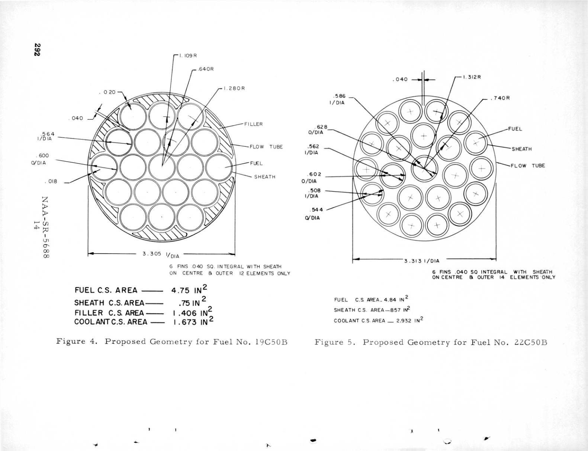

**Figure 4.** Proposed 19C50B fuel with graphite filler and 22C50B without filler. These actual dimensioned source drawings describe candidate fuel cross-sections; they do not define one final plant-wide channel count or active length. Dimensions are inches. [NAA-SR-5688, proceedings p. 292/PDF 293](https://www.osti.gov/servlets/purl/4080480#page=293).

| Quantity | 19C50B | 22C50B |
| --- | ---: | ---: |
| Flow-tube ID, in | 3.305 | 3.313 |
| Sheath OD, in | 0.600 | 0.628 / 0.602 / 0.544 |
| Sheath ID, in | 0.564 | 0.586 / 0.562 / 0.508 |
| Element-location radii, in | 0.640 / 1.109 / 1.280 | 0.740 / 1.312 |
| Fuel cross-section, in² | 4.75 | 4.84 |
| Sheath cross-section, in² | 0.75 | 0.857 |
| Graphite-filler cross-section, in² | 1.406 | None |
| Coolant cross-section, in² | 1.673 | 2.932 |

Both drawings specify selected elements with six integral 0.040-in-square fins. Sheath ID is not pellet OD without a defined gap. The optimization produced 56 optimized plant designs, averaging 112 candidates per optimum, using assumed radiation-damage yields and Dittus–Boelter heat transfer; the authors questioned a reactivity-penalty treatment when none of the optima used flux flattening. The calculated optimum therefore carries explicit physics and engineering uncertainty. [paper pp. 12–15/PDF 291–294](https://www.osti.gov/servlets/purl/4080480#page=291).

### The later OCR-500 reference station

AECL-6436, issued February 1980, updates the 1974 prototypical station study. It contains retained 324-channel drawings/physics discussions, revised 280-channel station specifications and separately optimized cost cases. The following table uses the **revised station specification**, not a mixture of those sets. [AECL-6436, pp. 15–24/PDF 22–31](https://inis.iaea.org/records/e4zqc-d2129/files/11559681.pdf#page=22).

| Item | Revised OCR-500 specification |
| --- | --- |
| Power | 1,483 MW fission; 543 MWe gross, 501 MWe net; 42 MWe auxiliaries; 33.8% net efficiency. |
| Core | 280 vertical channels, square pitch 286 mm; radius 2.70 m, active length 6.00 m, 0.600-m heavy-water reflector; 96 Mg uranium. |
| Pressure tube | Zr–2.5Nb, 103-mm ID × 2.5-mm wall, carbon-steel end fittings. |
| Calandria tube | Zirconium alloy, 121-mm ID × 1.1-mm wall; gas-sealed annulus around pressure tube. |
| Fuel string | Twelve aligned 500-mm bundles on a central hanger; natural UC in Zr–2.5Nb sheath; 18 elements/bundle, 19.4-mm element OD; assembly 9.5 m and 340 kg. |
| Thermal envelope | Maximum channel power 6.28 MW; nominal maximum element rating 95 kW/m; maximum surface heat flux 1.56 MW/m². |
| Coolant | Approximately 310/400°C inlet/outlet; outlet-header pressure 1.4 MPa; primary organic holdup 145 Mg. |
| Flow | Total 6,050 kg/s; central channel 23 kg/s and 10 m/s; fuel pressure loss 1,125 kPa at full burnup. |
| Main pumps | Two per circuit, four total; each 1.735 m³/s at 2,280-kPa head; horizontal single-stage machines with flywheels. |
| Moderator | 254 Mg heavy water; 0.75 m³/s flow; duplicated pumps and exchangers. |
| Steam plant | Four boilers, two U-tube superheaters; 643 kg/s steam, 10.86 MPa and 378°C, 43°C superheat; 143°C feedwater. |
| Turbine | Single shaft, 3,600 rpm; one double-flow HP and three double-flow LP sections; moisture separation/live-steam reheat, feedwater heaters and deaerator. |
| Building | Prestressed concrete cylinder, 41.2-m inside diameter × 41.5-m height, 1.2-m wall; listed design pressure 225 kPa and leakage 0.5% volume/day. |

The listed pump motor rating of **56 kW is inconsistent with the accompanying flow and head**: their product is about 3.96 MW of hydraulic power per pump before losses. No replacement motor rating is inferred. The fuel summary also lacks pellet diameter, sheath thickness, pin pitch and spacer/endplate tolerances. [AECL-6436, station specifications, pp. 16–19/PDF 23–26](https://inis.iaea.org/records/e4zqc-d2129/files/11559681.pdf#page=23).

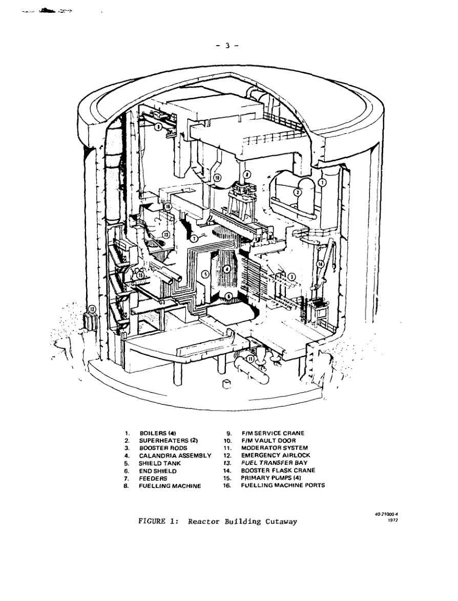

**Figure 5.** OCR-500 building arrangement: calandria, primary pumps, boilers/superheaters, moderator equipment, fuelling machine and fuel-transfer facilities. This retained conceptual drawing is dated 1972; it is not a construction drawing for every revised 1980 parameter. [AECL-6436, Figure 1, p. 3/PDF 10](https://inis.iaea.org/records/e4zqc-d2129/files/11559681.pdf#page=10).

| Support function | Proposed OCR-500 system |
| --- | --- |
| Main heat path | Two interlaced circuits; upward flow through channels, then superheater and boilers. |
| Pressure control | Nitrogen-covered surge tank at each outlet header; bleed/feed control shares organic-cleanup equipment. |
| Shutdown cooling | Two dedicated 50%-capacity pumps and one heat exchanger bypass the inlet and outlet headers. |
| Emergency cooling | Fresh organic under nitrogen pressure feeds inlet and outlet headers through check valves; emergency water backup after organic exhaustion. |
| Makeup/composition | OS-84 hydrogenated terphenyl; circulating coolant approximately 30 wt% high boilers; reference makeup 50 g/s, or 180 kg/h. |
| Degassing | Remove noncondensable decomposition gases and a fraction of low boilers. |
| Impurity control | Attapulgus clay and filtration remove chlorides and other fouling-associated impurities. |
| Distillation/waste | Remove high boilers; proposed organic incineration with heat recovery, clay regeneration by oxidation, sealed filter storage. |
| On-power refuelling | Withdraw an entire 12-bundle string through the top and replace it with a shuffled string of fresh/part-burned bundles. |
| Fuel cooling/shuffling | Organic-filled tubes in a water bay; typically 20 days' cooling, solvent wash and hot-cell shuffling in air; facilities for failed-fuel examination. |
| Discharged fuel | Organic-filled tubes in a water bay; stated capacity for ten years of discharge. |

Source: [AECL-6436, pp. 9–14/PDF 16–21](https://inis.iaea.org/records/e4zqc-d2129/files/11559681.pdf#page=16). Degasser dimensions, side-stream flow, distillation duty and detailed interlocks are not supplied by this functional description.

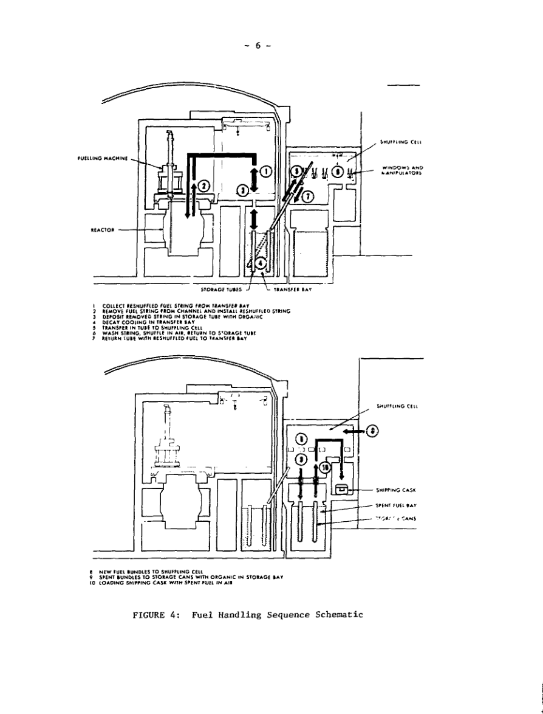

**Figure 6.** Proposed OCR-500 fuel handling: organic-filled string storage, water-bay cooling, washing/shuffling and spent-fuel transfer. This on-power commercial concept is distinct from WR-1's shutdown refuelling. [AECL-6436, Figure 4, p. 6/PDF 13](https://inis.iaea.org/records/e4zqc-d2129/files/11559681.pdf#page=13).

The optimized cost cases alter fuel/channel geometry and operating conditions. In particular, A1's 5.65-Mg/s core flow and 96°C rise differ from the earlier specification's 6.05 Mg/s and 90°C. Retained flow drawings label 162 feeders per branch, belonging to the earlier 324-channel concept. [AECL-6436, pp. 22–24 and Table 4/PDF 29–31, 73](https://inis.iaea.org/records/e4zqc-d2129/files/11559681.pdf#page=29).

| Costed 500-MWe variant | A1 natural reference | A2 enriched, same channel power | A3 enriched, higher channel power |
| --- | ---: | ---: | ---: |
| U-235 enrichment, wt% | Natural | 1.4 | 1.4 |
| Elements/bundle | 18 | 36 | 36 |
| Element OD, mm | 19.4 | 13.55 | 13.55 |
| Channels | 280 | 280 | 206 |
| Lattice pitch, mm | 286 | 229 | 229 |
| Maximum channel power, MW | 6.28 | 6.28 | 8.53 |
| Maximum coolant velocity, m/s | 11.3 | 10.25 | 15 |
| Maximum sheath/fuel-center temperature, °C | 483 / 1,150 | 457 / 865 | 460 / 1,010 |
| Predicted exit burnup, MWh/kgU | 116 | 458 | 443 |
| Bundles replaced/shift | 8 | 2 | 2 |

Source: [AECL-6436, Table 4, p. 66/PDF 73](https://inis.iaea.org/records/e4zqc-d2129/files/11559681.pdf#page=73). These are calculated design values. Replacing boosters with absorbers and reducing channel count lowered predicted natural-fuel burnup; the report calls 116 MWh/kgU the low end of the estimate and states that these predicted burnups may be approximately 15% too low; the associated roughly 6-mk discrepancy was within the calculation code's uncertainty.

### Safety conclusions and unfinished development

| Issue | Source result or proposal | Material limit |
| --- | --- | --- |
| Positive feedback | Calculated full-core void worth 49 mk fresh/34 mk equilibrium; one circuit 27/16 mk; equilibrium power coefficient about +0.02 mk per 1% power. | Requires sufficiently fast independent shutdown; cannot borrow the 2016 OSNR's negative feedback claim. |
| Shutdown/control | 24 liquid shutoff rods and six moderator poison-injection tubes; eight zone absorbers with two water regions each. | Fresh-core analysis more developed than equilibrium shutdown requirements. |
| Steam-generator tube rupture | Higher-pressure water/steam enters organic; trip, surge-tank relief and secondary blowdown proposed. | Detailed analysis still needed to exclude steam blanketing of pumps. |
| LOCA and loss of emergency cooling | Organic injection/recovery/recirculation; with lost emergency cooling, fuel-to-moderator conduction/radiation predicted maximum fuel near 1,400°C. | Depends on channel geometry/contact, moderator availability and thermal model; not a demonstrated accident response. |
| Blowdown experiments | Approximately one-tenth scale by channel power supported model development. | Larger-scale confirmation remained necessary. |
| Fuel qualification | UC tests sustained significant operation at ≥120 kW/m. | The specific 18-element reference bundle still needed demonstration. |
| Low-flow fouling | WR-1 operation near 9 m/s; prolonged 7.5-m/s exposure without increased fouling; 3.0/4.8-m/s tests increased fouling and caused some early failures. | Bundle/subchannel-dependent evidence, not a universal allowable-velocity threshold. |
| Outer-channel cooling | Proportional flow would leave many outer channels near 4 m/s; proposed remedy raised minimum to 7 m/s, with other channels near 406°C outlet. | Flow allocation, pumping and thermal decomposition are coupled. |
| Tube/string lifetime | About 3% worst-point pressure-tube radial creep projected in 14 full-power years; one replacement over a 30-year life; high-burnup strings could grow about 2%. | Creep, cold-spot hydride blisters, spring travel and hot-cell disassembly required development. |

Sources: [AECL-6436, pp. 23–31/PDF 30–38](https://inis.iaea.org/records/e4zqc-d2129/files/11559681.pdf#page=30); [boiler rupture and fuel performance, pp. 45–46/PDF 52–53](https://inis.iaea.org/records/e4zqc-d2129/files/11559681.pdf#page=52); [development needs, pp. 49–58/PDF 56–65](https://inis.iaea.org/records/e4zqc-d2129/files/11559681.pdf#page=56).

The same study explored a 100-MWth, 54-fuel-channel unit with 2-m active height and four 500-mm, 36-element bundles per channel, and a 1,200-MWe scale-up. The small unit's loss-of-coolant/loss-of-emergency-cooling temperature transients were explicitly unassessed; the large unit's second mechanical shutdown system required development. Neither should inherit a complete safety case from the 500-MWe discussion. [AECL-6436, pp. 77–91/PDF 84–98](https://inis.iaea.org/records/e4zqc-d2129/files/11559681.pdf#page=84).

## Historical performance and economics

WR-1's availability and component experience support technical feasibility at its operating conditions. Its lack of a turbine prevents an observed electricity-production cost or efficiency claim. The 37–39% efficiency discussed in the operating paper was a prospective translation to a power reactor. Similarly, AECL-2943's coolant-control penalty concerned a hypothetical 200-MWe station, not WR-1 electricity. [AECL-3523, p. 11/PDF 16](https://www.osti.gov/servlets/purl/4114552#page=16); [AECL-2943, p. 6/PDF 10](https://www.osti.gov/servlets/purl/4557804#page=10).

| Estimate | Monetary/financial basis | Reported result and interpretation |
| --- | --- | --- |
| 1960 OCDR optimization | Ontario context; then-current material/money costs and assumed 1964 fuel price; 80% load factor; development excluded. No uniform currency code/base year declared for every cost. | 150-MWe case: historical $340/kW net; 5.38 mills/kWh at 6.13% capital charge, 6.77 at 9%, 8.23 at 12%. Proposed 800°F outlet case. |
| 1960 scale/temperature alternatives | Same study assumptions | At 6.13% capital charge: 100 MWe 6.58 mills/kWh; 200 MWe 4.73; conservative 188-MWe/700°F variant 5.15. These are optimized predictions, not bids. |
| 1967 coolant management estimate | Hypothetical 200 MWe, 80% load factor, 30 years, 8% financing; historical money | Distillation 0.028, clay control 0.018 and analytical work 0.024 mill/kWh; total organic makeup/control penalty 0.11–0.13 mill/kWh. |
| 1980 OCR study | Cost indices in 1979 CAD; capital in dollars of the day over 1979–1985 construction; operating/fuel costs in 1985 CAD | Costs below are neither uniform 1979 overnight values nor present costs. |

Sources: [OCDR Table III, proceedings p. 306/PDF 307](https://www.osti.gov/servlets/purl/4080480#page=307); [AECL-2943, p. 6/PDF 10](https://www.osti.gov/servlets/purl/4557804#page=10); [AECL-6436, pp. 92–97/PDF 99–104](https://inis.iaea.org/records/e4zqc-d2129/files/11559681.pdf#page=99).

The OCR-500 study used 9.7% interest, 8% escalation, 80% capacity factor, 30-year life, six-year electrical-station construction and 9% federal/5% provincial sales taxes. Its CANCAP optimization estimate was explicitly less reliable than quotation-based costing. [AECL-6436, pp. 92–93/PDF 99–100](https://inis.iaea.org/records/e4zqc-d2129/files/11559681.pdf#page=99).

| Costed case | Capital, million CAD over construction | Unit energy cost, 1985 CAD/GJ |
| --- | ---: | ---: |
| 501-MWe natural-UC A1 | 1,059 | 12.02 electrical |
| 635-MWe natural-UC | 1,235 | 11.20 electrical |
| 638-MWe pressurized-heavy-water comparison | 1,325 | 11.33 electrical |
| 1,200-MWe natural-UC | 1,982 | 9.33 electrical |
| 500-MWe enriched-UC A3 | 940 | 10.65 electrical |
| 1,200-MWe enriched-UC | 1,726 | 8.30 electrical |
| 100-MWth enriched-UC | 164 | 10.62 thermal |

Sources: [AECL-6436, Tables 9 and 11/PDF 102, 104](https://inis.iaea.org/records/e4zqc-d2129/files/11559681.pdf#page=102). Electrical and thermal energy costs have different products and should not be compared as equivalent electricity costs. The report's Table 8 prints CAD 981.49 million for the 1,200-MWe natural total, whereas Table 9 gives about CAD 1,981.5 million; Table 10 gives 839.73 million for enriched A3, whereas Table 11 gives 939.73, consistent with its stated sum. The table above follows the internally consistent comparisons and flags those printed discrepancies.

For natural A1, the reported annual total was about CAD 152 million, including CAD 4.37 million organic upkeep. Ground-rule prices included heavy water at CAD 270/kg and OS-84 at CAD 2.20/kg. The modest calculated natural-OCR advantage over the PHW comparison cannot establish present competitiveness, especially while reference-bundle qualification, low-flow fouling, tube life and safety-development work remained open. [AECL-6436, pp. 93–97/PDF 100–104](https://inis.iaea.org/records/e4zqc-d2129/files/11559681.pdf#page=100).

## Related U.S. operating and design evidence

### OMRE fuel design, commissioning and examination

The U.S. Organic Moderated Reactor Experiment (OMRE) provides linked fuel-design, commissioning and post-irradiation evidence. Its first-loading fuel used UO₂ particles dispersed in stainless-steel plates, distinct from WR-1’s later UC driver bundles. The design tests and examination of one discharged OMRE assembly therefore inform specific mechanisms and inspection limitations; they do not qualify Canadian fuel. [BMI-1319, p. 1/PDF 7](https://www.osti.gov/servlets/purl/4268049#page=7); [Canadian driver history, pp. 46–48/PDF 53–55](https://inis.iaea.org/records/e4zqc-d2129/files/11559681.pdf#page=53).

| Item | Design or observed evidence | Primary source and qualification |
| --- | --- | --- |
| Design plate dimensions | Sixteen plates; active region **0.020 × 2.5 × 36 in**; overall **0.030 × 2.8 × 37 in**; Type 304 cladding **0.005 in** thick. Grooved side plates establish **0.134 in** coolant gaps. | [NAA-SR-1934, pp. 13, 16/PDF 15, 18](https://www.osti.gov/servlets/purl/4342569#page=15). Nominal design dimensions. |
| Examined assembly dimensions | BMI-1319 gives nominal **0.030 × 2.8 × 38 in** plates, later stating **38.4 in** overall and **37.5 in** scanned length. | [BMI-1319, pp. 1, 25/PDF 7, 31](https://www.osti.gov/servlets/purl/4268049#page=7). The difference from the design report’s 37 in remains unresolved; these lengths must not be silently combined. |
| Floating-plate purpose and test | Plates could slide in grooves to accommodate differential expansion. A 12 in thermal mockup gave maximum deflections of **0.010 in floating** and **0.064 in brazed**; the brazed plate retained **0.032 in** permanent deformation. | [NAA-SR-1934, pp. 38–42/PDF 40–44](https://www.osti.gov/servlets/purl/4342569#page=40). Unirradiated mockup evidence under imposed temperature profiles, not full-length service qualification. |
| Coolant and support-system startup | First loading used Santowax OM instead of the original diphenyl design reference. Hot testing exposed flange-gasket leaks and main/auxiliary-pump seal failures; uneven preheating required circuit changes and resistance cartridges. A failed flow-deflector skirt required unloading, drainage, replacement and reloading. | [NAA-SR-2400 Part I, VI-3–10/PDF 95–102](https://www.osti.gov/servlets/purl/4322235#page=95). Documented commissioning problems and repairs. |
| Irradiated passage restriction | Detailed examination reported maximum local closure **0.013 in, or 11%**; **85%** of measurements indicated less than 5%. This contradicts the abstract’s below-5% statement if read as a maximum. | [BMI-1319, p. 50/PDF 56](https://www.osti.gov/servlets/purl/4268049#page=56), compared with [abstract, p. 1/PDF 7](https://www.osti.gov/servlets/purl/4268049#page=7). Loose plates caused significant measurement error. |
| Measured temperature feedback | Reported coefficient was positive below **400°F**, negative above **500°F**, with crossover **435–485°F**. Xenon transients and spurious scrams complicated measurements; separate curves were matched at **425°F**. | [NAA-SR-2400 Part I, VI-17/PDF 109](https://www.osti.gov/servlets/purl/4322235#page=109). OMRE startup conditions; no universal organic-coolant or Canadian-reactor feedback sign follows. |

BMI-1319 examined one first-loading assembly, with intensive examination and calibrated gamma scans of three plates. Six punched samples supported radiochemical calibration; one point in a steep burnup gradient was excluded. Appendix D gives a **13% standard-deviation uncertainty** in radiochemical burnup, dominated by the Cs-137 half-life then used. The authors estimated average channel reduction near 2% or less, but that estimate is neither a measured maximum nor a hydraulic-performance qualification. These sampling and spacing-measurement limits matter when interpreting the otherwise modest reported distortion. [BMI-1319, pp. 15, 42–44, 50–52/PDF 21, 48–50, 56–58; Appendix D/PDF 75](https://www.osti.gov/servlets/purl/4268049#page=48).

### Original OMRE plant and safety documentation

Two public originals substantially improve the plant-design record: [NAA-SR-2323](https://digital.library.unt.edu/ark:/67531/metadc853066/) provides the safeguards description and operating procedures; [NAA-SR-4065](https://digital.library.unt.edu/ark:/67531/metadc853050/) develops the accident analysis. Their covers identify earlier issuances as Memo-1667 (July 1956) and Memo-1911 (June 1957), respectively. The later publication dates—1958 and 1959—must not turn proposed operating conditions or calculated accidents into demonstrated performance.

| System | Original specification | Evidence |
|---|---|---|
| Main cooling | One 16-in line splits into two 10-in branches. The prose specifies a 3,600-gpm, 150-hp centrifugal pump in each branch with an air-blast exchanger; Figure 9 instead labels 3,800 gpm per pump. Both give 55-psi head. The discrepancy remains unresolved. | NAA-2323, pp. 24–25; NAA-4065, pp. 74–78 |
| Pressure control and gas removal | Nitrogen maintains nominal 300 psia, provides an inert cover, and purges decomposition gases at 30 standard ft³/h through the vapor-trap/stack route. | NAA-2323, pp. 32–33; NAA-4065, pp. 78–79 |
| Shutdown cooling | A separate 100-kW loop with an approximately 14-gpm emergency-powered pump supplements the main circuit’s natural-circulation path. | NAA-2323, pp. 28, 110 |
| Coolant cleanup | Batch vacuum distillation without reflux, with a 200-gal still, direct-contact condenser, recirculating distillate cooler, vapor trap and waste tanks. Heater interlocks address pressure and temperature. | NAA-2323, pp. 28–32, 112–113 |
| Fuel handling | An indexing plate and grappling tool move fuel under the organic shielding pool after opening the shutdown vessel and removing the rod-drive/top-shell assemblies; the internal rack holds 23 spent elements. | NAA-2323, p. 57 |

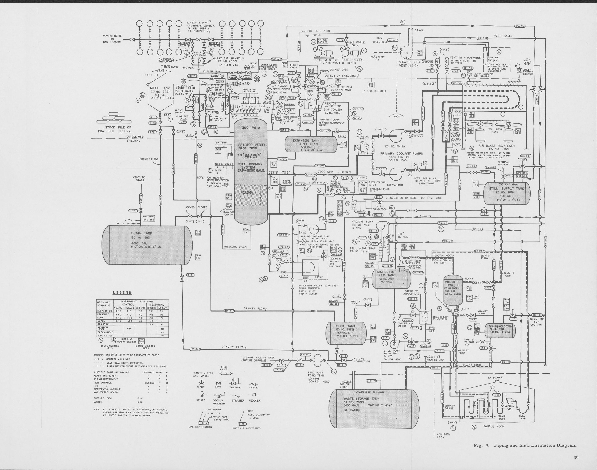

**Figure 7.** Original OMRE piping and instrumentation drawing. The associated heat-transfer and purification schematics are also retained. [NAA-SR-2323, Figure 9, p. 39/PDF 41](https://digital.library.unt.edu/ark:/67531/metadc853066/m1/41/).

Pressure bases and design versions matter. The reactor vessel is described as designed for **400 psig and 850°F**, while normal operating pressure is **300 psia**. The initial safeguards design uses hydraulic control-rod drives with electromagnetic release; the later analysis describes electromechanical drives. Their details should remain attached to their respective source versions.

The accident analysis assumes complete protective-system failure for its principal reactivity-insertion, pump-seizure and pressure-loss cases. It calculates negative void feedback, but also predicts partial core meltdown. It does not solve the fully combined loss-of-pressure, loss-of-flow and reactivity-insertion case; its suggested combined melt fraction is an estimate, not a demonstrated upper bound. These are calculated scenarios, not reports of accidents that occurred. [NAA-SR-4065, pp. 9, 126–128](https://digital.library.unt.edu/ark:/67531/metadc853050/m1/129/).

The terphenyl appendix also qualifies the low-vapor-pressure advantage. A vapor leak is less severe with the assumed ortho/meta mixture, whereas a liquid leak below the core remains problematic because the nitrogen system can drive coolant out. Its calculated power comparison—7.2 MW with terphenyl versus 10.8 MW with diphenyl at 500°F bulk temperature—uses worst combined hot-channel factors and rods inserted through 60% of the active core. It is not an achieved-power comparison and cannot be substituted for the earlier all-rods-out diphenyl table. [NAA-SR-4065, pp. 242–243](https://digital.library.unt.edu/ark:/67531/metadc853050/m1/245/).

### Piqua fuel development and qualification

The June 1960 Piqua development report describes two concentric fuel cylinders containing 1.94%-enriched U–3.5Mo–0.1Al alloy, nickel-bonded to finned Type 1100 aluminum cladding. Development began with flat plates and then changed to tubular fuel; fabrication used cast alloy sections, extruded cladding and pressure bonding. The drawing records the **1960 development configuration**. [NAA-SR-5119, abstract and pp. 1–3](https://www.osti.gov/servlets/purl/4186344#page=8)

| Drawing dimension | Value |
|---|---:|
| Fuel stack | Four 13.5-in. sections; 54 in. total |
| Overall assembly length, 1960 drawing | 76.625 in.; the later 1961 safeguards report specifies 80.5 in. |
| Inner fuel cylinder, OD / ID | 3.816 / 3.396 in. |
| Outer fuel cylinder, OD / ID | 4.842 / 4.422 in. |
| Fuel wall / aluminum base / fin height | 0.210 / 0.035 / 0.108 in. |
| Fuel mass per element | 84 kg |

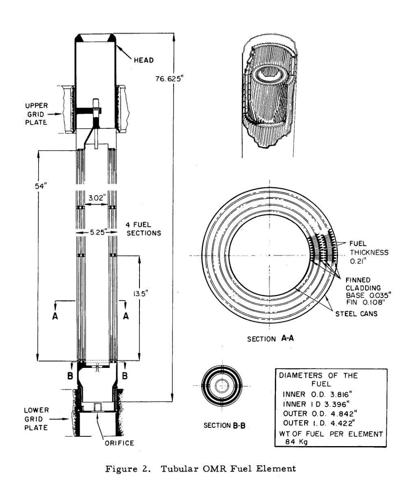

**Figure 8.** NAA-SR-5119, Figure 2, printed p. 3 / PDF p. 11. Original dimensions retained; the extracted image is cropped only to remove page margins. [Public original](https://www.osti.gov/servlets/purl/4186344#page=11).

Qualification depended on the specimen and test conditions. A full-size flat-plate mockup ran in Santowax OM for 345 h at 750°F and 718 h at 800°F. The tubular mockup’s outer steel can buckled when the earlier loop imposed external pressure; its intended condition was internal pressure. The fins and coolant passages remained open. Bond inspection also remained a limitation: the report identified no satisfactory nondestructive method for this finned geometry. [NAA-SR-5119, pp. 23, 30–33](https://www.osti.gov/servlets/purl/4186344#page=31)

The OMRE HB-1/HT-1 prototypes suffered particulate blockage, local overheating and cladding melting or blistering. Their local temperatures exceeded thermocouple indications; the thin nickel barrier could become inadequate above the design temperature. These were prototype results, with specific geometries and alloys. [NAA-SR-4670, pp. 40–41](https://www.osti.gov/servlets/purl/4160581#page=48)

Later prototypes incorporated screens and changed channel details. HB-2’s initial examination at an estimated peak 4,000 MWd/tU showed one distorted plate but no apparent cladding failure; metallography and measured burnup were still pending. HB-3 and tubular HB-4 remained under irradiation. The 1961 safeguards configuration and subsequent Piqua operating record therefore require their own evidence. [NAA-SR-5119, pp. 39–42](https://www.osti.gov/servlets/purl/4186344#page=47)

### Piqua design, supporting systems and safeguards

Piqua's **NAA-SR-5608 final safeguards report (1 August 1961)** is publicly recoverable as a 352-page PDF, including its supplement and engineering foldouts. It supplies substantial original design evidence: dimensioned fuel drawings, coolant-system diagrams, protective logic and fuel-handling arrangements. It precedes plant operation; its ratings, intended cycles and accident conclusions are design evidence, while later inspection reports establish operating outcomes. [NAA-SR-5608](https://digital.library.unt.edu/ark:/67531/metadc853024/m2/1/high_res_d/metadc853024.pdf)

| Design feature | Checked 1961 specification | Original anchor |
|---|---|---|
| Plant/primary circuit | 45.5 MWth; one loop with two parallel 6,000-gpm pumps; mixed terphenyl coolant planned at about 30% high boilers | I-3–5/PDF23–25; III-17,23/PDF53,59 |
| Rated conditions | 519°F inlet, 575°F outlet; 120 **psia** inlet operating pressure; 300 **psig** design pressure | I-4–5/PDF24–25 |
| Steam generation | Organic traverses superheater then boiler; 150,000 lb/h steam at 550°F and 435 psig | III-17–18/PDF53–54 |
| Fuel | 85 elements in final design; each has two concentric finned-Al-clad uranium-alloy tubes, 54-in active length, 80.5-in overall length | III-1,5/PDF37,41; Fig III-2/PDF39 |
| Degassing/pressurizing | Vacuum flashing, condensate recovery and two pressurizing pumps; separate reactor connections permit emergency circulation | III-25–26/PDF61–62; Fig III-8/PDF63 |
| Purification | Vacuum distillation removes high boilers; supplement adds two 10-gpm precoat filters with guard filtration | III-29/PDF65; S-12–13/PDF336–337; Figs III-9/S-12 |
| Refuelling | Reactor shutdown; indexed shield and bridge-mounted shielded cask transfer fuel to water storage | III-70,73–74/PDF106,109–110; Fig III-20/PDF111 |

The report separates the main-loop surge tank from the degasifier/expansion tank, both nominally 1,500 gal. Either pressurizing pump was specified to provide the 500-gpm emergency flow, bypassing the degasifier and filters. A separate organic-to-water decay exchanger rejected heat through a thermosyphon water/steam circuit and overhead condenser; the stated hot-condition duty was about 1.5% of reactor power. These are specified capabilities, not demonstrated accident performance (III-18,23,26,29–30/PDF54,59,62,65–66). [Original system descriptions](https://digital.library.unt.edu/ark:/67531/metadc853024/m2/1/high_res_d/metadc853024.pdf)

Thirteen submerged magnetic-jack rods dropped on loss of coil power. The protection system used coincidence logic for temperature, power/flow and pressure signals, with separate power-loss and level inputs. Low pressure or loss of degasifier inventory initiated a sequence intended to identify and isolate the leaking circulation branch; interlocks prevented isolation of both branches together (III-48–55/PDF84–91; Fig III-14/PDF85). Negative temperature feedback did not eliminate modeled fuel damage: the unprotected startup analysis predicted partial central-element melting (IV-1/PDF133). [Safeguards analysis](https://digital.library.unt.edu/ark:/67531/metadc853024/m2/1/high_res_d/metadc853024.pdf)

The supplement also records **actual damage to a Piqua test element in OMRE**: loose scale obstructed coolant-channel entrances, causing local loss of cooling and partial Al-cladding melting. Later clean Al-clad test surfaces supported an expectation of limited Piqua fouling, but that expectation must be compared with Piqua's subsequent inspection evidence. Neither the modeled accidents nor the test-element incident should be relabeled as an operating Piqua plant accident (S-13,16/PDF337,340). [Supplement I](https://digital.library.unt.edu/ark:/67531/metadc853024/m2/1/high_res_d/metadc853024.pdf)

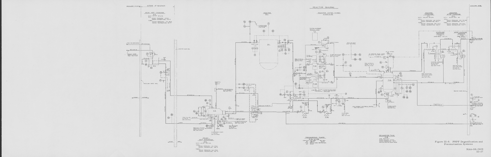

**Figure 9.** Piqua degasification, pressurization and decay-heat circuit. The emergency bypass and separate heat-rejection path are shown in the original drawing. [NAA-SR-5608, PDF 63](https://digital.library.unt.edu/ark:/67531/metadc853024/m2/1/high_res_d/metadc853024.pdf#page=63).

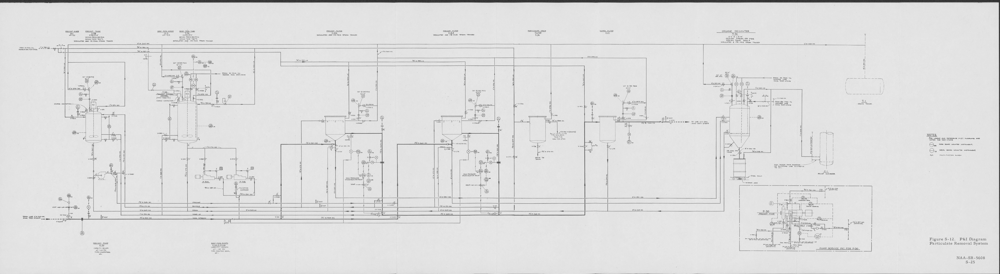

**Figure 10.** Piqua particulate-removal system added by Supplement I, including precoat filtration and waste handling. [NAA-SR-5608, PDF 349](https://digital.library.unt.edu/ark:/67531/metadc853024/m2/1/high_res_d/metadc853024.pdf#page=349).

### Piqua operating performance, failures and proposed recovery

Piqua’s operating limits involved coolant deposits, flow distribution, control-drive electrical failures and conventional plant equipment. The final operating summary records about **257,000 MWh of accumulated thermal generation** by January 13, 1966 and **70.1% accumulated availability from January 27, 1964**. Availability is distinct from capacity factor. For example, September 1964 achieved 100% availability but a 55.2% capacity factor. [Final recovery report, p.7/PDF9](https://www.osti.gov/servlets/purl/4498453#page=9); [1964 operating report, p.5/PDF15](https://digital.library.unt.edu/ark:/67531/metadc860838/m2/1/high_res_d/metadc860838.pdf#page=15).

The operating-era fuel examination describes 80.5-in elements with 0.208-in uranium-alloy walls, finned Type 1100 aluminum cladding and a 0.0010–0.0015-in nickel barrier. Facing fin surfaces spiral in opposite senses at 30°/ft. Adjustable driver orifices and a 7/64-in inner-process-tube drainage/flow hole are specific features of this arrangement. These dimensions belong to the examined hardware. [NAA-SR-11712, pp. 9–12/PDF 11–14](https://www.osti.gov/servlets/purl/4535275#page=11).

Early examinations of fuel elements P-1071 and P-1091, at peak burnups of approximately **1,400 and 2,550 MWd/tU**, found small dimensional changes and an intact nickel diffusion barrier. However, decomposed coolant obstructed the inner process tubes and drainage valves. Investigators attributed P-1091’s rising outlet temperature principally to increased surface roughness; measured film thickness and fuel growth did not explain it through flow-area reduction alone. These two examinations cannot establish the condition of the later whole core. [Arnold, NAA-SR-11712, pp.31–41/PDF33–43](https://www.osti.gov/servlets/purl/4535275#page=33).

The January 1966 shutdown began with a spurious degasifier-level signal. Subsequent tests found mechanical binding that prevented normal rod movement and free drop. Exchanging rod assemblies localized the binding to particular fuel/core positions. Core unloading found buckled **outer process tubes** on 20 of 57 driver elements and nine of 13 control-rod elements; these counts do not describe failed fuel cladding. [Operating report No.8, pp.9–23/PDF11–25](https://digital.library.unt.edu/ark:/67531/metadc1202759/m2/1/high_res_d/metadc1202759.pdf#page=11).

The recovery report attributed core coking primarily to inadequate moderator-region velocity, while also identifying oxygen contamination as a contributor to coolant deterioration. Its proposed hydraulic changes were substantial:

| Parameter | 61-element core used in the comparison | Proposed 41-element restart core |
|---|---:|---:|
| Rated thermal power | 45.5 MW | 30 MW |
| System flow | 13,900 gpm | 12,500 gpm |
| Inner-process-tube velocity | 0.07 ft/s | 1.7 ft/s |
| Outer-moderator velocity | 0.07 ft/s downward | 5.0 ft/s |

These are original/reference and proposed conditions, respectively. The 61-element comparison, 70-element unloading inventory and 85-element safeguards design represent different source configurations. The restart core was not demonstrated in power operation. [Final recovery report, Table2, p.28/PDF30; pp.41,49–50](https://www.osti.gov/servlets/purl/4498453#page=30).

Control-drive failures had identifiable electrical and mechanical causes: organic leakage into nominally dry coils, conductive decomposition products, inadequate feedthrough pins, insulation defects and damaged jumper wiring. The redesign used individually sealed coils and protected wiring, but its termination report explicitly states that **no prototype or system tests were completed**; component tests alone supported its conclusions. [Sobo, AI-AEC-Memo-12648, pp.II-7–9/PDF19–21 and VII-1/PDF127](https://digital.library.unt.edu/ark:/67531/metadc1058657/m2/1/high_res_d/4813226.pdf#page=19).

Plant repair records also document repeated superheater-tube leaks, decay-heat condenser repairs, pressurizing-pump seal work and purification-equipment problems. These dated records are separate from the report’s predicted failure rates and failure-mode analyses. [Availability evaluation, Vol.II, pp.61–74/PDF62–75](https://digital.library.unt.edu/ark:/67531/metadc1034049/m2/1/high_res_d/4501416.pdf#page=62).

### An earlier marine design with a detailed drawing package

The 1957 U.S. Atomics International tanker study supplies an unusually complete public **conceptual engineering package**: NAA-SR-1851 includes 26 numbered drawings covering the reactor, fuel, vessel, rods, piping and instrumentation, purification, fuel handling, ship arrangement, heat balances and electrical systems. It describes an unbuilt reactor using organic for **both moderation and cooling**. Its plate fuel, pressures and support systems belong to that concept, not WR-1 or the modern MIT marine study. [NAA-SR-1851 and engineering supplement, drawing list/PDF 119](https://digital.library.unt.edu/ark:/67531/metadc303808/m2/1/high_res_d/metadc303808.pdf#page=119).

| Design feature | 1957 reference |
| --- | --- |
| Duty | 70 MWth; simultaneous 20,000 shp propulsion, 1,500 kW auxiliary electrical and about 36,500 lb/h process steam. |
| Core | 72 in diameter × 72 in active height; 260 fuel elements on a 4-in square lattice; 16 control/safety rods. |
| Fuel | Eleven aluminum-clad uranium-metal plates per element; 1.58 atomic% initial enrichment; uranium section 0.100 × 2.500 × 72 in; clad plate approximately 0.140 in thick. |
| Cooling passages | Nonuniform clear gaps of 0.096, 0.099, 0.105, 0.115, 0.130 and 0.135 in outward from the central plate; intended to match unequal plate powers. |
| Vessel/primary | 100-in vessel ID, 18 ft 4 in overall height, 1-in steel wall; 35 psig operating and 150 psig design pressure; 580/622°F inlet/outlet. |
| Circulation | Two main loops; each pump rated 12,000 US gpm at 50-psi head, with 500-hp motor; maximum design plate surface 750°F. |
| Refuelling | Shutdown, cooling to about 400°F and depressurization; rotating shield plugs, single-element coffin, nine-element transfer cask and shore facilities. |

Sources: [design parameters/PDF 17–21](https://digital.library.unt.edu/ark:/67531/metadc303808/m2/1/high_res_d/metadc303808.pdf#page=17); [fuel/vessel/PDF 25–30](https://digital.library.unt.edu/ark:/67531/metadc303808/m2/1/high_res_d/metadc303808.pdf#page=25); [handling/PDF 89–94](https://digital.library.unt.edu/ark:/67531/metadc303808/m2/1/high_res_d/metadc303808.pdf#page=89).

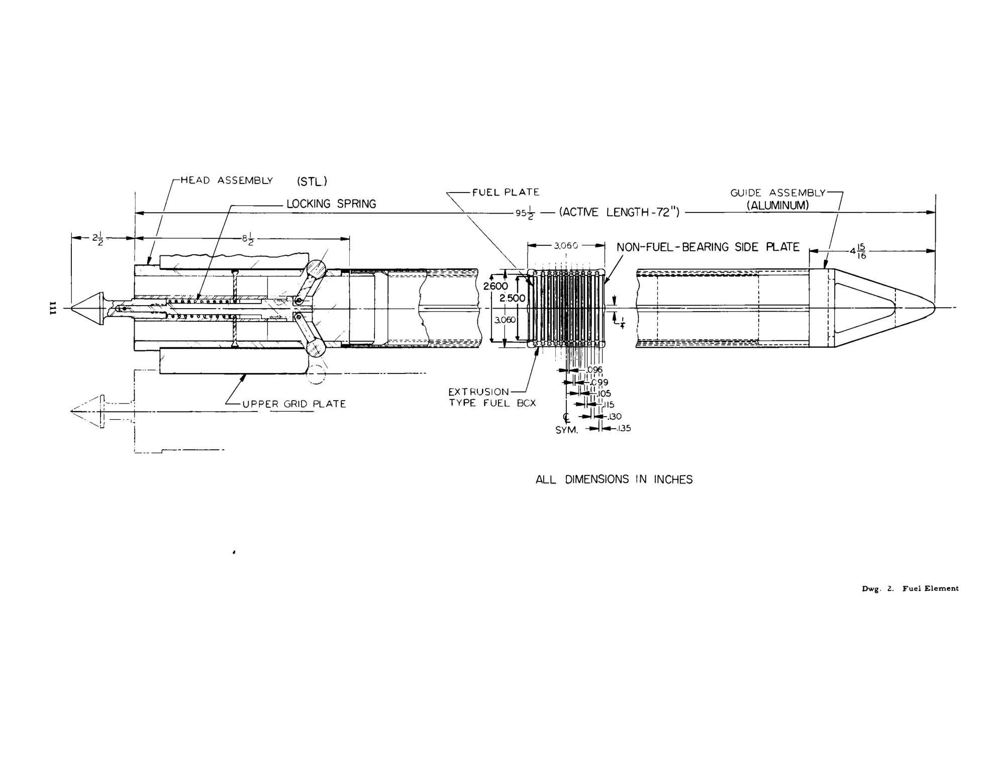

**Figure 11.** Original fuel-element drawing: mechanical plate assembly, variable cooling gaps, upper locking mechanism and lower orifice/guide. The 72-in active length differs from the other indicated assembly dimensions. [NAA-SR-1851, Drawing 2, PDF 121](https://digital.library.unt.edu/ark:/67531/metadc303808/m2/1/high_res_d/metadc303808.pdf#page=121).

The support plant shows what “low-pressure organic cooling” still required. A 1,400-gallon pressurizer/expansion tank connected to a 6,000-gallon storage/decay tank. A vacuum still maintained nominal 30 wt% polymer, processing 175 lb/h and returning 123 lb/h distillate, with fresh makeup replacing bottoms. The gas system was sized for **10 scfm during startup**, compared with **12.5 scfh steady gas**, and included a heated vapor trap, fiberglass filter, iodine trap, switchable activated-carbon cartridges and refrigerated silica gel for noble gases. The radioactive-gas cleanup train was normally bypassed and switched into service by a radiation controller. Steam diluted the hydrogen-rich exhaust. [NAA-SR-1851, PDF 65, 83–88](https://digital.library.unt.edu/ark:/67531/metadc303808/m2/1/high_res_d/metadc303808.pdf#page=83).

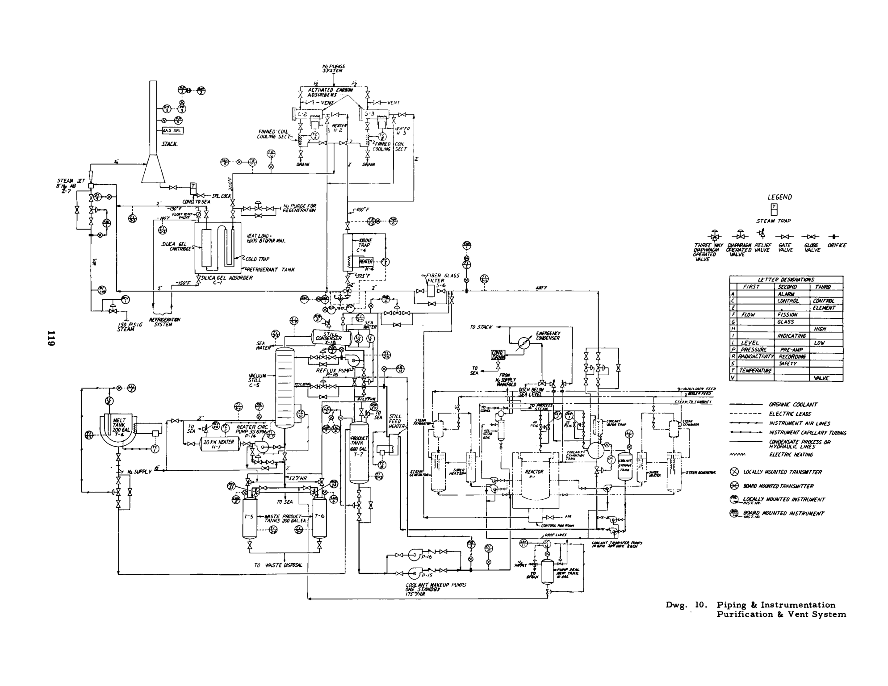

**Figure 12.** Original purification/vent piping and instrumentation. Its sea-disposal and release routes are historical proposals, not recommendations. The drawing provides a concrete system topology, but not demonstrated operation or acceptable modern disposal performance. [NAA-SR-1851, Drawing 10, PDF 129](https://digital.library.unt.edu/ark:/67531/metadc303808/m2/1/high_res_d/metadc303808.pdf#page=129).

The separate decay-heat loop required powered pumps, diesel supply and a valve-start sequence; it was **active**, although its evaporator was kept warm for readiness. Nuclear overflux trip settings still required accident studies. The report also recognized that new aluminum-corrosion data could make its predicted operating radiation fields low by as much as a factor of four. [NAA-SR-1851, PDF 57, 67–68, 73](https://digital.library.unt.edu/ark:/67531/metadc303808/m2/1/high_res_d/metadc303808.pdf#page=57).

The companion economics report estimated **higher**, not lower, transport cost than the conventional tanker: $12.90 versus $9.30 per long ton of cargo for the first OMR, and $10.64 for an assumed third reactor with a different flat-flux core—penalties of 38.7% and 14.4%. Vessel capital was approximately $17.24 million, $11.40 million and $14.97 million respectively. These historical U.S. dollar estimates use early-1957 market inputs, a Kuwait–Philadelphia/Suez route, 345 operating days/year, 18 knots, 20-year depreciation, 5% interest, $2.50/barrel oil and plutonium credit; nuclear insurance was uncertain. They are neither operating results nor present costs. [NAA-SR-1879, assumptions and Tables 5–7/PDF 9–19](https://www.osti.gov/servlets/purl/4308573#page=9).

A separate $4.6-million, 22-month R&D plan called for fuel irradiation, critical experiments, rod endurance, motion/tilt mockups, hydraulic tests and residue characterization. The September 1957 follow-up reported calculations and actual residue-property tests, but its shielding method remained inadequate in important nonhydrogenous regions. Its seawater test found fragmentation and some floating particles, while leaching rates were unmeasured. These explicit development limits prevent treating the extensive drawings as a qualified maritime plant. [NAA-SR-1880, PDF 7–17](https://www.osti.gov/servlets/purl/4301284#page=7); [NAA-SR-2140, PDF 10–13, 48–54](https://www.osti.gov/servlets/purl/4275821#page=10).

### DuPont's large organic-cooled concepts, 1964

DP-899 developed two unbuilt heavy-water-moderated, organic-cooled concepts at much larger scale than WR-1. These were preliminary engineering designs; no experimental development or plant cost estimate was performed. The quoted thermal capacities are **heat delivered to the primary coolant**, with additional fission heat deposited in the moderator. [DP-899, pp. 1–7/PDF 11–17](https://www.osti.gov/servlets/purl/4676628#page=11).

| Design quantity | Smaller organic concept | Larger organic concept |
| --- | ---: | ---: |
| Primary-coolant heat / total fission power | 3,500 / 3,643 MWth | 8,300 / 8,640 MWth |
| Calculated gross electrical output | 1,240 MWe | 2,950 MWe |
| Vertical fuel channels | 604 | 1,360 |
| Active length / square lattice pitch | 20 ft / 9.25 in | 20 ft / 9.25 in |
| Santowax-R inlet / outlet | 280 / 380°C | 280 / 380°C |
| Primary design pressure | 350 psig | 400 psig |
| Primary loops / total inlet flow | 6 / 280,000 US gpm | 10 / 660,000 US gpm |

Values are design specifications, from Table 1, [pp. 99–100/PDF 109–110](https://www.osti.gov/servlets/purl/4676628#page=109).

Each channel contained **three concentric UC fuel tubes**, enriched to 1.2% U-235, with 0.020-in SAP cladding and spacer ribs maintaining coolant passages. The pressure tube lay inside a separate calandria tube. Figure 22 specifies 3.672/3.548-in pressure-tube outside/inside diameters; its wall sizing omitted hydrogen embrittlement and creep, leaving material feasibility unresolved. The report explicitly states that the fuel-tube fabrication procedure had not been developed. [pp. 31–32, 55–57; Figure 22/PDF 133](https://www.osti.gov/servlets/purl/4676628#page=133).

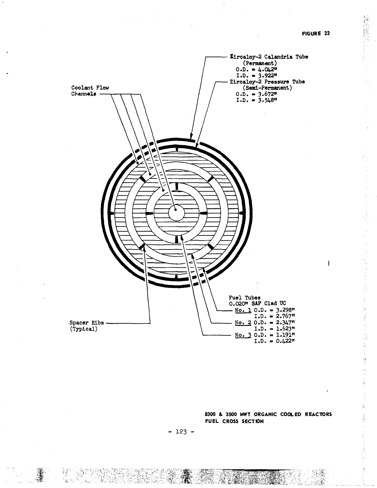

**Figure 13.** Proposed fuel cross section for the 3500 and 8300 MWth organic-cooled concepts: three concentric fuel tubes, spacer ribs, coolant passages, pressure tube and calandria tube. Dimensions are the original design values. [DP-899, Figure 22, p. 123/PDF 133](https://www.osti.gov/servlets/purl/4676628#page=133).

The primary system used carbon-steel pumps, piping and separate economizer, boiler and superheater sections, with steam tracing and low-point drains. Coolant cleanup required continuing removal of gas and high-boiler products. Proposed containment protection combined concrete shielding, sprays and fire fogging; fire pressure was excluded from the design-pressure basis on an assumed sufficiently slow burn and functioning sprays. For the smaller concept, burning 33,000 lb of organic in ten minutes was calculated to produce 31 psig even with sprays operating, 25% above containment design pressure. This was a calculated scenario, not a fire test. [pp. 33–37, 89–90/PDF 43–47, 99–100](https://www.osti.gov/servlets/purl/4676628#page=43).

The unresolved feasibility questions were capital cost, heavy-water losses, pressure-tube reliability and on-power refuelling. **The report did not calculate plant costs** and could not confirm earlier estimates; its competitiveness statements should retain that limitation. [pp. 3, 92–93/PDF 13, 102–103](https://www.osti.gov/servlets/purl/4676628#page=102).

### Desalination variants and auxiliary-system cost assumptions

DP-866 adds a costed desalination concept: its 8,300-MWt organic plant used **eight primary loops**, each containing a pump, superheater, two steam generators and economizer. DP-899's larger electricity case used **ten loops**. Their specifications should remain separate. DP-866 explicitly assumed successful development of pressure tubes and joints, fuel lifetime, heat-transfer limits, fouling control and online refuelling; the estimates therefore describe a proposed plant. [DP-866, pp. 3-4, 3-7/PDF 37, 40](https://www.osti.gov/servlets/purl/4003036#page=37); [DP-899, p. 43/PDF 53](https://www.osti.gov/servlets/purl/4676628#page=53).

The cited SL-1949 supplies auxiliary-system details for an earlier **300-MWe, four-loop** concept. A degasifier/surge tank and pressurizing pumps controlled gas and inventory changes; precoat filters removed solids, and flash distillation separated high-boiler decomposition products. These wastes were held for radioactive decay, then burned with filtered exhaust. Normal shutdown cooling was sized at **1% of thermal power**; emergency heat removal was expected through the primary steam generators. Steam tracing maintained 375–400°F but explicitly provided **no means to melt coolant from a cold condition**. These were design provisions and cost assumptions, without demonstrated plant reliability. [SL-1949, pp. 86, 88–90/PDF 92, 94–96](https://digital.library.unt.edu/ark:/67531/metadc783713/m2/1/high_res_d/metadc783713.pdf#page=92).

DP-866's estimates use **1963 U.S. dollars**, a Southern California coastal site, and exclude construction interest; availability and load factor were assumed. Table IV also contains an unresolved arithmetic inconsistency: the organic case lists 18.7 cents per million Btu total heat cost, an electricity credit of 4.9 cents per million Btu labelled “1 mill/kWh,” and 8.9 cents per million Btu net. Subtraction gives **13.8 cents per million Btu**, not 8.9. The intended correction is unknown, so the printed steam-cost range should not be adopted without resolving this discrepancy. [DP-866, pp. 9–10/PDF 13–14](https://www.osti.gov/servlets/purl/4003036#page=13).

The recovered revised Bechtel study appears in the **March 1964 appendices volume**; its own title page retains July 1963. Its organic cases have different design and fuel-cycle assumptions; it adds contingency and construction interest and explicitly treats allocation of joint power/water costs as arbitrary. Its estimates should remain tied to that revision, rather than merged with DP-866 into one cost basis. [Revised TID-19267, preface/PDF 9–11 and pp. 131–134/PDF 145–148](https://digital.library.unt.edu/ark:/67531/metadc784362/m2/1/high_res_d/metadc784362.pdf#page=9).

## Modern MIT designs: what has changed

### The 2016 Organic Simplified Nuclear Reactor

Shirvan and Forrest's OSNR is a 500-MWth computational proof of concept for a submerged installation. Its geometry deliberately reduces radiation deposition in the coolant: graphite replaces much of the coolant volume, organic passes through separate passages, and zirconium hydride restores moderation. It is materially different from both Canadian pressure-tube fuel and the later MIT water-moderated microreactor. [OSNR paper, pp. 898–901/PDF 7–10](https://dspace.mit.edu/server/api/core/bitstreams/998012dd-6198-4d00-8e2b-b2b4f1f1e075/content#page=7).

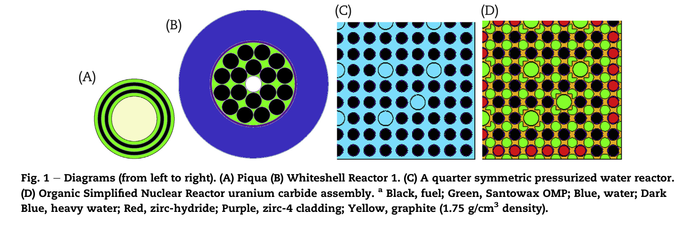

**Figure 14.** Authors' schematic comparison of historical and proposed geometries. In OSNR, graphite separates the organic passages from fuel/cladding; the other panels are comparisons, not manufacturing drawings of the historical reactors. [OSNR Figure 1, p. 899/PDF 8](https://dspace.mit.edu/server/api/core/bitstreams/998012dd-6198-4d00-8e2b-b2b4f1f1e075/content#page=8).

| Parameter | OSNR point design |
| --- | --- |
| Core | 500 MWth; 40 kW/L; equivalent diameter 2.3 m, fuel height 3 m; 91 modified 17×17 assemblies. |
| Assembly | 198 UC fuel rods and 66 ZrH₁.₆ rods; approximately 40% of PWR coolant volume replaced by graphite; organic passages 7.6 mm diameter. |
| Fuel | Mean enrichment 4.5%; five-year cycle; source labels loading 40.74 “tons”; assumed UC density 13.5 g/cm³. |
| Geometry changes | Pellet radius increased 0.2 mm and cladding thickness reduced 0.2 mm relative to the comparison; modeled gas gap 100 µm. |
| Primary conditions | Santowax OMP; 285/320°C inlet/outlet, with inlet derived from 35°C rise; outlet 0.55 MPa, inlet about 0.75 MPa. |
| Flow | 5,700 kg/s; 155-kPa core pressure drop; mass flux 6,300 kg/(m²·s). |
| Performance | Average linear heat rate 9.25 kW/m; calculated coolant energy deposition 0.54% of fission energy; minimum DNB ratio 2.36 using the authors' correlation. |
| Conversion | Approximately 33% nominal efficiency. |

Source: [OSNR Table 3 and analysis, pp. 899–901/PDF 8–10](https://dspace.mit.edu/server/api/core/bitstreams/998012dd-6198-4d00-8e2b-b2b4f1f1e075/content#page=8).

Calculations use constant fluid properties and Dittus–Boelter/Blasius correlations. With prescribed peaking and 95% rated mass flux, the text reports maximum bulk coolant 358°C, wall 417°C and fuel center about 1,020°C. Table 3 separately gives 390°C peak cladding; these are retained as distinct reported results. Temperature- and degradation-dependent property treatment remained future work. Negative density feedback and hydride retention below a target 400°C are design calculations/expectations, not irradiation qualification of this assembly. [pp. 900–901/PDF 9–10](https://dspace.mit.edu/server/api/core/bitstreams/998012dd-6198-4d00-8e2b-b2b4f1f1e075/content#page=9).

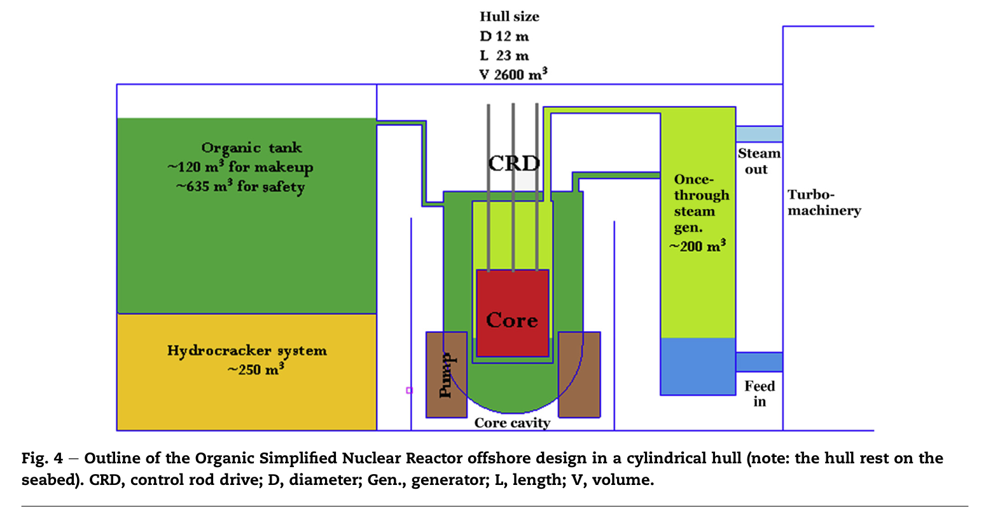

**Figure 15.** Proposed 12-m-diameter, 23-m-long nuclear hull. The allocated organic storage and hydrocracker show that coolant-treatment and emergency inventories remain substantial support systems. The drawing is a preliminary allocation, not a completed submarine plant. [OSNR Figure 4, p. 902/PDF 11](https://dspace.mit.edu/server/api/core/bitstreams/998012dd-6198-4d00-8e2b-b2b4f1f1e075/content#page=11).

The layout allocates about 120 m³ makeup organic, 635 m³ safety inventory, 250 m³ hydrocracker and 200 m³ once-through steam generator, with organic inside its tubes. Estimated degradation of about 1,000 m³/year is reduced to roughly 20 m³/year fresh makeup by an **assumed 98% hydrocracker recovery**. This is an industrial-process extrapolation, not measured recovery of irradiated reactor coolant. [OSNR §4.3–4.4, p. 902/PDF 11](https://dspace.mit.edu/server/api/core/bitstreams/998012dd-6198-4d00-8e2b-b2b4f1f1e075/content#page=11).

Low pressure, negative feedback, an inert submerged enclosure, surrounding water and estimated natural circulation near 10% rated flow support the proposed safety argument. A single blocked passage is examined through graphite conduction; tolerable multiple blockages, severe accidents and licensing analysis remain unresolved. Proposed savings include a 40% smaller hull and thinner vessel than the paper's PWR comparison, but UC qualification, hydride/graphite fabrication and hydrocracker cost remain material. No complete LCOE is supplied. [OSNR pp. 901–904/PDF 10–13](https://dspace.mit.edu/server/api/core/bitstreams/998012dd-6198-4d00-8e2b-b2b4f1f1e075/content#page=10).

### The 15-MWth UO₂/water concept and 2025 cost study

The publicly recovered 2023 paper material is incomplete, but an author's February 2026 presentation reproduces its design and cost tables. The numerical values below are attributed to those slides. [Buongiorno, slides 20–23](https://northeastern.ans.org/file/2735/Jacopo_Buongiorno_ANS-NE-seminar-Feb-2026-v2.pdf#page=20); [2023 paper](https://doi.org/10.1016/j.nucengdes.2023.112470).

| Item | Author-presented organic microreactor |
| --- | --- |
| Output/conversion | 15 MWth, 4.05 MWe, 27%; toluene organic Rankine cycle. |
| Core/fuel | 12 kW/L; 2,000 kg UO₂, 3.2% enrichment, 8.4 MWd/kgU discharge burnup; Zircaloy cladding. |
| Coolant | C₁₈H₁₄ at 285/304°C; pressure labeled atmospheric; **in-core** coolant volume 0.26 m³, not total inventory. |
| Moderation/reflector | H₂O/H₂O. |
| Protection provisions | Control rods, secondary borated-water tank, makeup-water tank for decay heat. |
| Screening envelope | Core/reflector diameter and axial dimension 2.4 m; at least three years without refuelling, two shutdown systems, negative power feedback and passive heat removal requirements. |
| NOAK cost figures | Levelized **fuel** cost $39/MWh; major equipment $4,500/kW; coolant $640/kW; site/transport/installation $726/kW; I&C $1,900/kW. |

The slides do not establish a common currency year, complete financing basis or uncertainty distribution. Their $39/MWh is a fuel component, not LCOE. Screening requirements and selected equipment are not demonstrated passive-safety performance.

Park, Buongiorno and Shirvan's 2025 study compares initially 15-MWth organic/water and sodium/graphite designs using a bottom-up code of accounts. Public abstracts/previews identify capital, O&M, fuel and centralized services, and rank power uprating, multi-unit sharing and fuel batching as cost-reduction measures. Their “well-executed FOAK” follows a full-scale nuclear demonstration by the same vendor. The full 60-page preprint/journal text was not recovered, so exact LCOE, currency year, capacity factor, lifetime, geometry and cost uncertainty are not asserted here. [SSRN preprint, posted January 2025/revised March 2025](https://papers.ssrn.com/sol3/papers.cfm?abstract_id=5100822); [published article, July 2025](https://doi.org/10.1016/j.nucengdes.2025.113936).

### Coolant cost and the maritime application

The December 2024 MIT coolant lifecycle report uses **2024 USD**. It separates purchase cost from purification, makeup and consumables, but several assumptions remain design-dependent. [MIT-ANP-TR-203, organic chapter pp. 53–68/PDF 66–81](https://canes.mit.edu/hubfs/Lucas%20report%20203%20ANP-TR%20MIT%20CANES.pdf#page=66).

| Modeled cost element | Report basis/result |
| --- | --- |
| Purchased fluid | Dowtherm A $22.5/kg from a 55-gallon-drum quotation; inflation-adjusted historical Santowax approximately $2.3–3.9/kg. Chemistry, quantity and market bases differ. |
| Piqua-derived treatment | 45.5-MWth reference; hydrocracker inlet 172–277 kg/h; installed estimate $2.6–3.6 million, scaled from industrial equipment. |
| Makeup/consumables | At 90% capacity factor and assumed 98% recovery plus 4% nonrecoverable light ends: makeup $20,000–28,300/(MWth·year), hydrogen $1,400–5,000, catalyst $1,300–1,500. |
| Processing conditions | Historical-style hydrocracking about 480°C and 69 bar with hydrogen/catalyst. Low primary pressure does not eliminate this pressurized support plant. |
| Separate microreactor case | 15 MWth, 2.9-t total coolant inventory, no purification and complete five-year replacement; reported coolant cost about $0.5/MWh versus $19–28/MWh for the Piqua-derived case. |

Sources: [TR-203, pp. 61–67/PDF 74–80](https://canes.mit.edu/hubfs/Lucas%20report%20203%20ANP-TR%20MIT%20CANES.pdf#page=74); [summary Table 49/PDF 130–131](https://canes.mit.edu/hubfs/Lucas%20report%20203%20ANP-TR%20MIT%20CANES.pdf#page=130). The last row compares different reactor/treatment assumptions, not a controlled purifier optimization. The report also labels 286 lb/h as approximately 22.7 kg/h instead of about 130 kg/h, has an ambiguous recovery-efficiency multiplier in its makeup equation, and calls the microreactor moderator heavy water while the author design table says H₂O. These prevent unqualified quantitative reuse; moderator cost is excluded.

The 2025 Neo-Panamax paper integrates two assumed **78.2-MWth/25.8-MWe** organic reactors into a 12,000-TEU ship, 335 m long and 51 m beam. Its selected reactor uses annular 4%-enriched UO₂, water moderator, 320°C organic and 0.3 MPa primary pressure. Two approximately 2,250-t shielded units supply two 27-MW turbogenerators and one 36.5-MW propulsion motor; two existing diesel generators remain for backup/reduced propulsion. Each unit includes steam/condenser/vacuum and protection equipment. [PRADS manuscript, pp. 4–11/PDF 5–12](https://dspace.mit.edu/server/api/core/bitstreams/2d44a598-1af0-47af-8c1c-8c307ae383c5/content#page=5).

The paper explicitly treats the reactor as an assumed-compliant computational black box. Ship layout, structural and stability calculations do not validate reactor behavior during flooding, fire, vibration, loss of cooling or sinking. Detailed fuel geometry, inventory, degradation, purification and maritime decay-heat qualification remain absent. [§1.3.1 and §4.1, PDF 4, 18–19](https://dspace.mit.edu/server/api/core/bitstreams/2d44a598-1af0-47af-8c1c-8c307ae383c5/content#page=4).

Its roughly $540-million, 25-year retrofit projection versus $946 million for a new conventional ship is an assumption-sensitive scenario. It uses largely 2024 market inputs, 2% inflation and an 8% uranium discount rate, without a fully declared common dollar year or FOAK/NOAK basis. Material inconsistencies include a three-year refuelling reactor in the design table versus an undeveloped 25-year no-refuelling assumption in costs; an $87.2-million lifetime fuel purchase in an annual row; and unreconciled capital totals. The printed 980,000 t/year oil consumption also conflicts with $15.7 million/year at $650/t, which implies about 24,000 t/year. These modeled savings are not commercial cost evidence. [§3.4–4.1, PDF 15–19](https://dspace.mit.edu/server/api/core/bitstreams/2d44a598-1af0-47af-8c1c-8c307ae383c5/content#page=15).

## MIT irradiation: historical flowing loops and recent gamma tests

The recent MIT lead is confirmed, but the modern experiments differ substantially from the 1960s reactor-loop program. The recovered 388-page MIT-334-94/MITNE-95 documents flowing, mixed neutron/gamma exposure with composition control. The recent Dowtherm A paper reports static cobalt-60 specimens and explicitly proposes future MITR/flow work. [MIT-334-94, June 1968](https://dspace.mit.edu/server/api/core/bitstreams/8338dd6b-c0e8-48bb-98a3-e61c2e4682d1/content); [Vasquez et al., online December 2025, April 2026 issue](https://doi.org/10.1080/00295450.2025.2553362).

| Campaign | Actual test | What it can establish |
| --- | --- | --- |
| MIT Santowax OM, July 1966–July 1967; WR, August 1967–March 1968 | Nine OM irradiations plus three WR repeats; flowing stainless loop, approximately 280-mL in-core capsule; OM 300–427°C and approximately 63–86 wt% remaining terphenyl; mean fast-neutron dose fractions 0.36 OM/0.38 WR. | Mixed-field degradation, properties and heat transfer for maintained, partially degraded mixtures. |
| Vasquez/Seshadri/Shirvan/Buongiorno, modern Dowtherm A | 27% biphenyl/73% diphenyl ether; static 50 mL in Pyrex inside SS316 autoclave; 1 MGy at approximately 271 Gy/min; air/room temperature, argon/room temperature, argon/250°C. | Gamma-induced chemical/property changes under these specimen conditions. Pyrex deliberately avoids coolant–metal contact. |
| Driscoll/Seshadri/Shirvan, MSRP 2024 Paratherm HT | Described as 80% hydrogenated terphenyl/20% terphenyl; 50 kGy–2 MGy, atmospheric/inert environments. | Preliminary official abstract only; numerical irradiation temperature, dose rate, arrangement, gas balance and detailed uncertainty are unavailable. |

Sources: [historical campaign Table 1.2/PDF 33](https://dspace.mit.edu/server/api/core/bitstreams/8338dd6b-c0e8-48bb-98a3-e61c2e4682d1/content#page=33); [modern methods, PDF 4–5](https://dspace.mit.edu/server/api/core/bitstreams/8b99d0bc-e31b-4040-a5d3-8838bfc30e8a/content#page=4); [official Paratherm abstract](https://oge.mit.edu/msrp/profiles/sarah-driscoll/).

### What the historical loop adds

The historical loop contained approximately 5.1–5.3 L at its specified surge reference level; apparatus capability reached 800°F, 600 psig and 2.3 US gpm. Those are equipment limits, not simultaneous conditions of every run. Withdrawn coolant underwent distillation; distillate and fresh terphenyl returned while low/intermediate boilers remained in recycle. Composition stabilized for about a week before steady measurements. Nitrogen pressurization drove transfers, and the sample tank vented to an off-gas system. [MIT-334-94, Table 2.1/PDF 75; operating procedure/PDF 349–350](https://dspace.mit.edu/server/api/core/bitstreams/8338dd6b-c0e8-48bb-98a3-e61c2e4682d1/content#page=75).

| Historical finding | Engineering meaning |
| --- | --- |
| In-core mean dose approximately 1.2/1.3 W/g for OM/WR; whole-loop means at 5 MW approximately 0.057/0.067 W/g | These are spatially different dose averages, not separate neutron/gamma components. Circulation, inventory and processing prevent a simple cumulative-vial-dose equivalence. |
| New WR heater TH8 followed Nu = 0.023 Re^0.8 Pr^0.4 within about ±10% | Applies to 630–800°F, 8–20.5 wt% high boilers, Re approximately 3×10⁴–1.3×10⁵ and Pr approximately 5.2–8.2, using appropriate mixture properties. |
| OM heater TH7 fell to about 70% of the McAdams prediction by April 1967 | Actual contrary fouling evidence. Impurities/possible oxygen exposure were suspected, but the deposit was not chemically analyzed. |
| Irradiated mixtures decomposed thermally faster than virgin fluid | Hot inventory outside the radiation field matters. The inferred thermal term had large uncertainty at lower temperature: approximately 90% at 370°C, 25% at 400°C and 10% at 430°C. |

Sources: [dosimetry, Table 1.3/PDF 36](https://dspace.mit.edu/server/api/core/bitstreams/8338dd6b-c0e8-48bb-98a3-e61c2e4682d1/content#page=36); [heat transfer/PDF 61](https://dspace.mit.edu/server/api/core/bitstreams/8338dd6b-c0e8-48bb-98a3-e61c2e4682d1/content#page=61); [fouling/PDF 117–118](https://dspace.mit.edu/server/api/core/bitstreams/8338dd6b-c0e8-48bb-98a3-e61c2e4682d1/content#page=117).

For a proposed 750-MWe HWOCR, that report calculated makeup of about 0.67 t/h at 399°C outlet and 1.77 t/h at 427°C, assuming 90% terphenyl. The hot-leg/outlet-header inventory dominated the increased thermal decomposition. Reported historical makeup costs were 0.27/0.62 mills/kWhe at $0.12/lb coolant. This is a design calculation, not operating cost, but it shows why minimizing in-core radiolysis alone does not establish economical coolant life. [Table 1.11/PDF 66](https://dspace.mit.edu/server/api/core/bitstreams/8338dd6b-c0e8-48bb-98a3-e61c2e4682d1/content#page=66).

### What the recent work does and does not show

Dowtherm A darkened and changed composition. GC-MS identified relative biphenyl depletion and larger molecules, including terphenyls/quaterphenyls, while some peaks and high-boiling material remained unquantified. Heat capacity fell; room-temperature irradiation **reduced viscosity**, whereas the hot-argon specimen was closer to control. Thus, immediate viscosity increase is not a universal consequence across fluids and exposures. Property measurements mainly at 25–100°C do not provide a complete irradiated property correlation at reactor temperature. [Vasquez et al., results/PDF 6–11](https://dspace.mit.edu/server/api/core/bitstreams/8b99d0bc-e31b-4040-a5d3-8838bfc30e8a/content#page=6).

Thermal conductivity was reported as 0.14 ±0.007 W/(m·K) for control, air and hot-argon specimens, and 0.16 ±0.008 for room-temperature argon. These are specimen measurements, not flowing heat-transfer coefficients. The study does not quantify gas generation/removal, corrosion, deposition on heated metal, neutron response or complete degradation mass balance. Initial argon purging does not demonstrate a reactor degassing system. [Table 3 and conclusions/PDF 11–12](https://dspace.mit.edu/server/api/core/bitstreams/8b99d0bc-e31b-4040-a5d3-8838bfc30e8a/content#page=11).

The historical MIT program ended June 30, 1968 after cancellation of the USAEC HWOCR program; its equipment was being disposed of. A related modern paper was presented at ICAPP in June 2024, followed by the December 2025 journal publication. The recovered record therefore supports renewed research, without implying uninterrupted operation or a completed modern organic loop in MITR. [MIT FY1968 report, pp. 53–54/PDF 58–59](https://dspace.mit.edu/server/api/core/bitstreams/dd7c68c9-fa2c-423f-8eac-446916638ddf/content#page=58); [ICAPP 2024 contents](https://www.proceedings.com/content/075/075812webtoc.pdf).

## Remaining originals and limits of the collection

The strongest integrated Canadian station source is AECL-6436; the strongest recovered operating descriptions are the WR-1 commissioning and operating reports. AECL's 1980 account places formal power-program termination after the June 1974 report, citing Pickering's success and support priorities; WR-1 work continued. This is a documented program decision, not proof that every organic technical issue was solved or that a single failure ended the technology. [AECL-6436, p. 1/PDF 8](https://inis.iaea.org/records/e4zqc-d2129/files/11559681.pdf#page=8).

| Important unresolved original | Why it matters |
| --- | --- |
| CGE R64CAP36, July 1964, WR-1 Final Hazards Report, Part One: Plant Description | Original identity is established by a contemporary citation, but the report was not recovered. Part One alone would not establish the complete safety set. |
| CGE WR-1 Design Manual, volumes 1–9, 1964–1965; WNRE-188 Handbook; WDI-33 loop specifications | Needed for controlled component specifications, piping/instrumentation, setpoints, emergency inventory and design revisions. |
| AECL-4763, 1974 general description; AECL-4441, 1974 OCR-500 design; AECL-4578 control study | Catalog records exist; their original detailed contents remain unavailable in this collection. |
| WR-1 hazards addenda for water loops, organic loops, C-circuit and uprating | Public inventory identifies WDI-88, WDI-112, WNRE-71, WNRE-16, WNRE-117, WNRE-144 and WNRE-356. The repeated “Addendum VII” designation needs original revision records. |
| AECL-4922 coolant chemistry/fouling; IDO-11400 hydrocracking economics; full 2023 and 2025 MIT design/cost papers | Important dependencies for chemistry, recovery assumptions and modern cost reconstruction. Metadata and citing papers do not replace these originals. |

Retrieval anchors: [contemporary R64CAP36 citation, AI-CE-44/PDF 50](https://www.osti.gov/servlets/purl/4245302#page=50); [CNL historical references/PDF 31–32 and Table 32/PDF 90–93](https://iaac-aeic.gc.ca/050/documents/p80124/146112E.pdf#page=31); [AECL-4763 catalog](https://www.osti.gov/biblio/4950789); [AECL-4441 catalog](https://www.osti.gov/biblio/4945078); [AECL-4578 catalog](https://www.osti.gov/biblio/4947731).

Citation following distinguishes recovered originals, selected-section reads, abstracts, catalog records, unpublished communications and general-method boundaries. The 1968 MIT synthesis is now recovered, but neither its 388 pages nor every recursively cited source has been read in full. Modern decommissioning inventories are used for historical equipment descriptions and exact document identifiers, not as substitutes for the operating safety case. The unresolved records chiefly limit detailed equipment reconstruction and qualification claims; they do not erase the substantial operating and experimental evidence summarized above.
