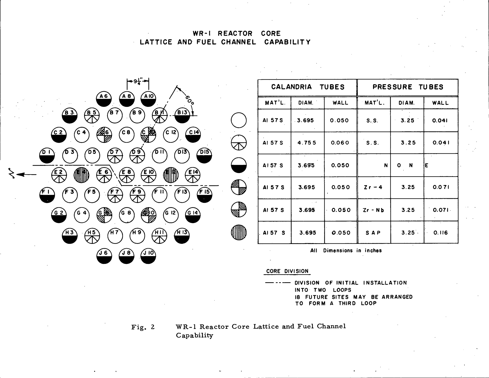

# WR-1 reactor and core structures

| Source | Scope used |
| --- | --- |
| Robertson, **Status Report on the WR-1 Reactor**, 65-CNA-205, April 1965. [Original, pp. 1–3 and Figs. 1–2](https://www.osti.gov/servlets/purl/4891392#page=4) | Initial geometry and planned materials. |
| Tegart, **Operation of the WR-1 Organic Cooled Research Reactor**, AECL-3523, September 1969 account, issued 1970. [Original, pp. 1–4](https://www.osti.gov/servlets/purl/4114552#page=6) | Operating fuel string and removable channels. |
| Miller and Rasmussen, CNL, **WR-1 Reactor Radiological Characterization Summary**, Rev. 2, 2020. [Original, §§2.2–2.7](https://iaac-aeic.gc.ca/050/documents/p80124/146112E.pdf#page=8) | Later inventory and functional arrangement. |
| **CANDU-OCR Power Station Options and Costs**. [Original](https://inis.iaea.org/records/e4zqc-d2129/files/11559681.pdf) | Explicit WR-1 experience; commercial proposals remain separate. |

The core combined a low-pressure heavy-water moderator vessel with individual hot organic pressure channels. The gas annulus and aluminum calandria tube separated each channel from the moderator. This separation allowed channel materials, fuel designs and some coolant conditions to change without replacing the entire vessel.

## Component reports

| Report | Principal questions |
| --- | --- |
| [Calandria vessel and dump spaces](calandria_vessel.md) | Vessel dimensions, suspension, moderator inventory and shutdown drainage. |
| [Calandria tubes and CO₂ annuli](calandria_tubes_and_annuli.md) | Radial geometry, insulation, leakage monitoring and tube-count conflicts. |
| [Pressure tubes, connections and closures](pressure_tubes_and_closures.md) | Materials, removability, pressure boundary and connection experience. |
| [Fuel bundles, supports and inserts](fuel_bundles_and_supports.md) | Dated fuel geometry, support hardware, local cooling and irradiation experience. |

## Arrangement and interfaces

| Boundary | What crosses it | Consequence |
| --- | --- | --- |
| Fuel to organic | Fission heat through the sheath | Local flow, deposits and sheath condition control the fuel temperature. |
| Pressure channel to gas annulus | Heat; organic only if the boundary leaks | An annulus indication can identify a channel problem without ordinary coolant/moderator mixing. |
| Calandria tube to heavy water | Heat; a separate liquid boundary | The calandria tube is not the main organic pressure boundary. |
| Core space to dump space | Moderator during shutdown | Vessel internals and helium pressure control participate in reactivity removal. |
| Channel ends to feeders and flask | Coolant flow during operation; access during shutdown | A replaceable channel needs both hydraulic connections and shielded handling provisions. |

The boundary descriptions follow the original schematic and later CNL inventory. The implications are engineering interpretations of those connections. [1965 schematic](https://www.osti.gov/servlets/purl/4891392#page=12); [CNL, §2.2](https://iaac-aeic.gc.ca/050/documents/p80124/146112E.pdf#page=8).

**Figure 1.** Initial lattice and planned tube materials. The 55-position lattice is not a record of 55 simultaneously fuelled operating channels. [65-CNA-205, Fig. 2](https://www.osti.gov/servlets/purl/4891392#page=13).

## Configuration limits

The April 1965 design, startup core and later UC-fuelled reactor are separate configurations. Early fuel had 18 elements per bundle; the 1980 review identifies 14-element WR-1 UC driver bundles. Later tube counts and vessel diameters do not fully reconcile with the early drawings. Individual reports preserve those differences rather than constructing an undocumented final geometry. [AECL-6436, p. 59](https://inis.iaea.org/records/e4zqc-d2129/files/11559681.pdf#page=66).

No fabrication drawing set, complete tolerance stack, lifetime channel inspection history or component-level cost account was recovered. These reports support a physical understanding of the reactor and identification of further evidence needs; they do not establish a buildable or qualified channel design.
