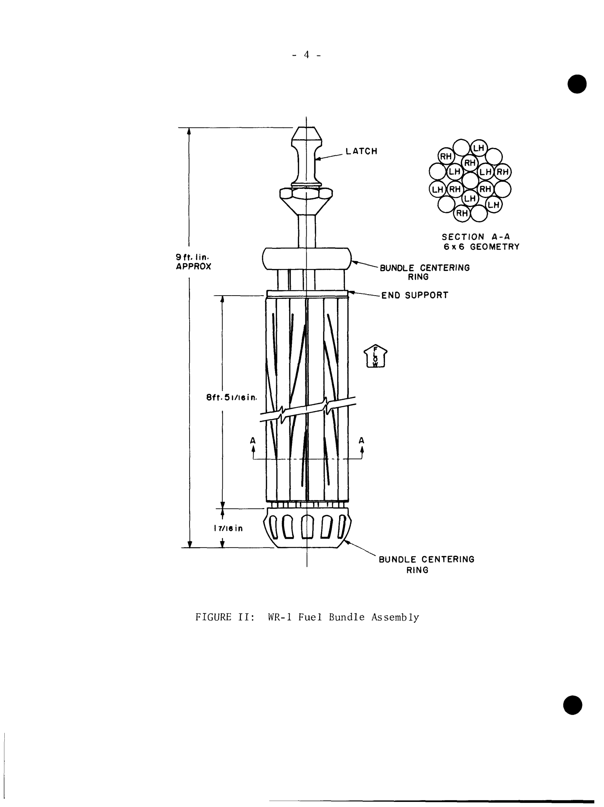

# WR-1 fuel bundles, central supports, centering rings and experimental inserts

| Source | Evidence used |
| --- | --- |
| Robertson, **Fuel, Materials and Coolants for WR-1**, AECL-2553, 1966. [Tables III–IV](https://www.osti.gov/servlets/purl/4528366#page=8) | Four early fuel-design parameter sets. |
| Tegart, **Operation of WR-1**, AECL-3523, 1969/1970. [pp. 3–4, Fig. II](https://www.osti.gov/servlets/purl/4114552#page=8) | Operating driver string, supports and drawing. |
| Mooradian et al., **Current Status of Canadian Organic Cooled Reactor Technology**, AECL-2943, 1967. [§4.1](https://www.osti.gov/servlets/purl/4557804#page=13) | Wire-wrap hydrogen sinks. |
| Sochaski, ed., **CANDU-OCR Power Station Options and Costs**, AECL-6436, 1980. [pp. 46–48, 51, 59](https://inis.iaea.org/records/e4zqc-d2129/files/11559681.pdf#page=53) | Explicit WR-1 UC, support, defect and low-flow experience; commercial proposals excluded. |
| CNL, **WR-1 Radiological Characterization Summary**, 2020. [§2.7](https://iaac-aeic.gc.ca/050/documents/p80124/146112E.pdf#page=10) | Later enrichments and experimental ring fuel. |

## Fuel string and support functions

The early operating driver string contained five 18-element UO₂ bundles on a central support. The support occupied the position that would otherwise have held a nineteenth element. The drawing identifies centering rings and end-support hardware; organic flowed upward through the assembly. The string was removable through the top closure during shutdown. [AECL-3523, pp. 3–4](https://www.osti.gov/servlets/purl/4114552#page=8).

| Part | Documented arrangement and engineering role |
| --- | --- |
| Fuel elements and sheaths | Generated heat and separated the fuel/fission products from the organic. Materials and dimensions changed between designs. |
| Central shaft/support | Carried a multi-bundle string; later accounts also describe central support tubes used during bundle shuffling. |
| Centering rings and end supports | Shown in the driver-string drawing. They positioned the string within the channel; detailed contact loads and tolerances are not published there. |
| Element wire wraps | Spaced elements and, for the zirconium designs discussed in 1967, served as cooler hydrogen sinks. |
| Experimental inserts | Used selected fuel sites or loop test sections; fast-neutron ring fuel left central space for specimens. |

Sources: [AECL-3523, Fig. II](https://www.osti.gov/servlets/purl/4114552#page=9); [AECL-2943, p. 9](https://www.osti.gov/servlets/purl/4557804#page=13); [CNL 2020, §2.7](https://iaac-aeic.gc.ca/050/documents/p80124/146112E.pdf#page=10). Positioning and heat-flow consequences are engineering interpretations of the documented hardware.

**Figure 1.** Original early driver-string drawing. Overall hardware dimensions include support features and do not define the active pellet-stack length. [AECL-3523, Fig. II](https://www.osti.gov/servlets/purl/4114552#page=9).

## Early fuel designs

| Parameter | UO₂ / Zr–Nb | UO₂ / SAP | UC / Zr–Nb | UC / SAP |
| --- | ---: | ---: | ---: | ---: |
| Enrichment, wt% U-235 in uranium | 2.4 | 2.4 | 2.7 | 2.7 |
| Bundles/channel × elements/bundle | 5 × 18 | 3 × 18 | 5 × 18 | 3 × 18 |
| Nominal bundle length (mm) | 495 | 813 | 495 | 813 |
| Sheath outside diameter (mm) | 15.1 | 15.4 | 15.1 | 15.4 |
| Sheath wall (mm) | 0.635 | 0.635 | 0.635 | 0.635 |
| Cold diametral fuel/sheath clearance (mm) | 0.05–0.13 | 0.08–0.15 | 0.09 | 0.14 |
| Maximum design surface heat flux (MW/m²) | 1.05 | 1.05 | 1.15 | 1.15 |
| Design sheath temperature at 350°C outlet (°C) | 435 | 435 | 427 | 427 |
| Design fuel-centre temperature (°C) | ≈2,000 | ≈2,000 | 795 | 1,020 |
| Target burnup (MWd/tU) | 7,500 | 7,500 | 16,000 | 16,000 |

These are 1966 design parameters and targets, not demonstrated limits for all four fuels. [AECL-2553, Tables III–IV](https://www.osti.gov/servlets/purl/4528366#page=8). Five 495-mm bundles sum to 2.475 m nominal length; that sum is not a measured active fuel length. The operating description calls the fuel assembly approximately eight feet long, while the drawing includes a larger support-hardware envelope.

## Later fuel and experimental configurations

UC driver conversion began in 1973. The 1980 review reported over 400 UC bundles irradiated and two defects at that date, and separately identified the WR-1 driver as a 14-element bundle. Its unbuilt commercial 18- and 36-element designs must not be substituted for the WR-1 driver geometry. [AECL-6436, pp. 46 and 59](https://inis.iaea.org/records/e4zqc-d2129/files/11559681.pdf#page=53).

CNL describes later UC operation at approximately 54 MWth, with 1.33-wt% enrichment at four central sites and 1.95 wt% elsewhere. Fast-neutron loops used 4.95-wt% UC in a ring around a large central support tube containing experiments. These are distinct fuel populations, not interchangeable descriptions of one bundle. [CNL 2020, §2.7](https://iaac-aeic.gc.ca/050/documents/p80124/146112E.pdf#page=10).

## Degradation and operating lessons

| Observation | What it establishes |
| --- | --- |
| Wire wraps about 30°C cooler than the sheath collected hydrogen | Temperature gradients could protect the sheath by moving hydrogen to cooler attached material; sink capacity was finite. |
| Hydrogen accumulation caused embrittlement and breakage of some endplates during the later programme | Support integrity required attention as well as sheath integrity; the 1980 review reports design changes without supplying their drawings. |
| Tests at approximately 3.0 and 4.8 m/s average velocity showed more deposits and some premature failures | Mean flow did not resolve the low-velocity subchannels. The source's below-5-m/s rejection applies to the tested standard cluster. |
| Organic entering a sheath defect could decompose and cause internal hydriding | Detection was needed before deterioration impaired removal or released more contamination. |

Sources: [AECL-2943, p. 9](https://www.osti.gov/servlets/purl/4557804#page=13); [AECL-6436, pp. 47–48](https://inis.iaea.org/records/e4zqc-d2129/files/11559681.pdf#page=54), [p. 51](https://inis.iaea.org/records/e4zqc-d2129/files/11559681.pdf#page=58).

No common dated specification for element pitch, wire diameter/lead, support diameter, ring clearances, hydraulic loss coefficients or full later UC dimensions was recovered. Those missing details prevent a defensible subchannel reconstruction from the tables alone. Experimental fuel failures also cannot be used as an unqualified driver-fuel failure rate without population, exposure and test-severity information.
