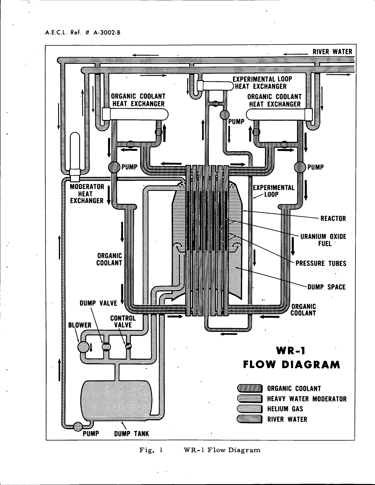

# WR-1 main heat transport

| Source | Scope used |
| --- | --- |
| Robertson, **Status Report on the WR-1 Reactor**, 65-CNA-205, 1965. [Table 1 and Fig. 1](https://www.osti.gov/servlets/purl/4891392#page=6) | Initial conditions and two-circuit flow path. |
| Tegart, **Operation of WR-1**, AECL-3523, 1969/1970. [§§4, 8](https://www.osti.gov/servlets/purl/4114552#page=10) | Main pumps, seals, connections and maintenance. |
| CNL, **WR-1 Radiological Characterization Summary**, 2020. [§§2.4, 2.10](https://iaac-aeic.gc.ca/050/documents/p80124/146112E.pdf#page=8) | Three-circuit arrangement and river-water services. |
| **CANDU-OCR Power Station Options and Costs**. [Original](https://inis.iaea.org/records/e4zqc-d2129/files/11559681.pdf) | Explicit WR-1 experience; commercial proposals remain separate. |

The main system carried heat upward through the fuel channels in organic coolant and rejected it to Winnipeg River water through heat exchangers. WR-1 produced research heat, not electricity. Circuits A and B initially served 37 available sites; circuit C was added in 1972, bringing the described available core to 53 sites. The later inventory assigns approximately 20 MWth heat-removal capacity to each circuit, while distinguishing C from the otherwise matching A/B designs. [CNL, §§2.4–2.5](https://iaac-aeic.gc.ca/050/documents/p80124/146112E.pdf#page=9).

## Component reports

| Report | Coverage |
| --- | --- |
| [Organic circuits, pumps and exchangers](organic_circuits.md) | Main flow path, pump/flywheel, dated conditions and circuit boundaries. |
| [Channel flow restrictions and connections](channel_flow_and_connections.md) | Flow distribution, orifices, unfuelled sites and removable joints. |
| [Process and standby cooling water](process_and_standby_water.md) | River supply, heat rejection, standby service and exchanger leakage. |

**Figure 1.** Original two-circuit schematic. The heavy-water circuit has its own heat-removal path; it is not in series with the organic fuel-cooling flow. [65-CNA-205, Fig. 1](https://www.osti.gov/servlets/purl/4891392#page=12).

## What controls performance

| Quantity or boundary | Why it matters |
| --- | --- |
| Channel power and channel flow | Determine bulk temperature rise; average circuit temperature does not identify the hottest subchannel. |
| Organic composition and temperature | Change viscosity, vapour pressure and degradation; auxiliary treatment affects main-circuit performance. |
| Pump speed and flywheel | Establish forced flow and its rundown after drive loss. |
| Exchanger organic/water boundary | Transfers heat while separating coolant inventories; water-side corrosion can breach an otherwise clean organic side. |
| Process/standby water | Provides heat rejection for different operating functions; the shared river supply must not be mistaken for fully independent ultimate heat sinks. |

These are engineering implications of the documented equipment connections. WR-1 low-flow experiments directly demonstrate that lower average channel velocity could increase fouling and cause premature failures in the tested bundle. [AECL-6436, p. 51](https://inis.iaea.org/records/e4zqc-d2129/files/11559681.pdf#page=58).

No complete pump curves, channel flow schedule, exchanger performance map, standby-water reliability study or component capital-cost breakdown was recovered. The reported early availability above 85% is a four-year research-reactor observation, not an electrical capacity factor or a lifetime reliability result. [AECL-3523, §4](https://www.osti.gov/servlets/purl/4114552#page=10).
