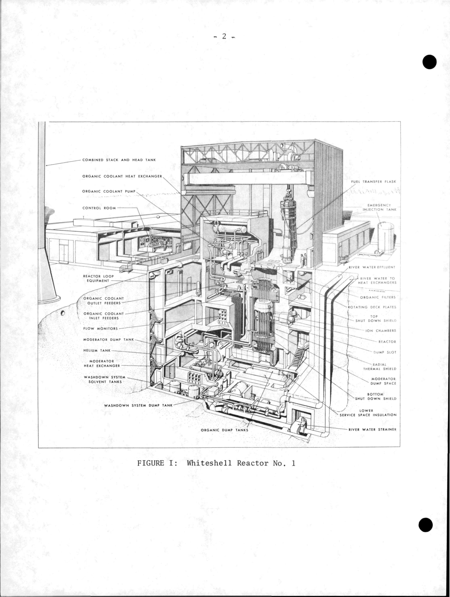

# WR-1 shielding and structural cooling

| Source | Scope used |
| --- | --- |
| Tegart, **Operation of WR-1**, AECL-3523, 1969/1970. [Fig. I](https://www.osti.gov/servlets/purl/4114552#page=7) | Relative arrangement of access spaces, shields and vessel. |
| CNL, **WR-1 Radiological Characterization Summary**, 2020. [§§2.2–2.3](https://iaac-aeic.gc.ca/050/documents/p80124/146112E.pdf#page=8), [Table 1](https://iaac-aeic.gc.ca/050/documents/p80124/146112E.pdf#page=33) | Biological shield and actively cooled thermal shielding. |
| CNL, **WR-1 Decommissioning EIS**, Rev. 4, 2022. [pp. 3-5, 3-15](https://iaac-aeic.gc.ca/050/documents/p80124/146078E.pdf#page=145) | Deck materials and separate cooling-system equipment. |
| **The Commissioning of WR-1**. [Original](https://www.osti.gov/servlets/purl/4513855) | Commissioning modifications and measured behaviour. |

The shielding arrangement combined radial and axial structures near the vessel, thick heavy-concrete biological shielding, movable top-deck shielding and shielded penetrations. Separate water circuits removed heat from the thermal shields and concrete. The reactor's low normal organic-coolant activity did not remove the need to attenuate radiation directly from the core or to cool irradiated structures.

## Component reports

| Report | Coverage |
| --- | --- |
| [Thermal shields and cooling](thermal_shields.md) | Radial/axial arrangement, cooling users, pumps and power supply. |
| [Biological shield and concrete cooling](biological_shield_and_concrete.md) | Concrete thickness/density, design radiation objective and cooling equipment. |
| [Deck plates, access and penetrations](deck_plates_and_penetrations.md) | Rotating shields, flask support, lower access and streaming evidence. |

**Figure 1.** The early arrangement identifies radial thermal shielding, top and bottom shutdown shields, ion chambers, moderator dump space and rotating deck plates. It is an arrangement drawing, not a dimensioned shielding calculation. [AECL-3523, Fig. I](https://www.osti.gov/servlets/purl/4114552#page=7).

## Interfaces

| Interface | Evidence-supported consequence |
| --- | --- |
| Core radiation to shield materials | Shielding absorbs energy and becomes activated; attenuation and heating are related but different design checks. |
| Thermal-shield water to process-water heat sink | Active heat removal depends on circulation and the exchanger. |
| Thermal-shield motors to Class III bus | A specific standby electrical dependency is documented. |
| Calandria suspension to radial shield | Shield structures also participate in vessel support. |
| Access openings to occupied areas | Local streaming can dominate over bulk-wall attenuation. |

Sources: [CNL 2020, pp. 8, 13, 33](https://iaac-aeic.gc.ca/050/documents/p80124/146112E.pdf#page=33); [AECL-2552, §5](https://www.osti.gov/servlets/purl/4513855#page=10). No quantitative load or dose is inferred where the source only identifies a connection.

The reviewed documents provide useful envelope dimensions but not full shield compositions, cooling-channel maps, heat loads or attenuation models. Design objectives, commissioning radiation observations and post-shutdown inventories remain distinct evidence types.
